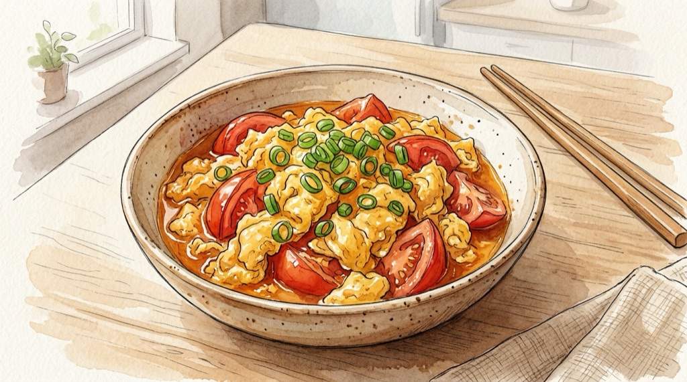
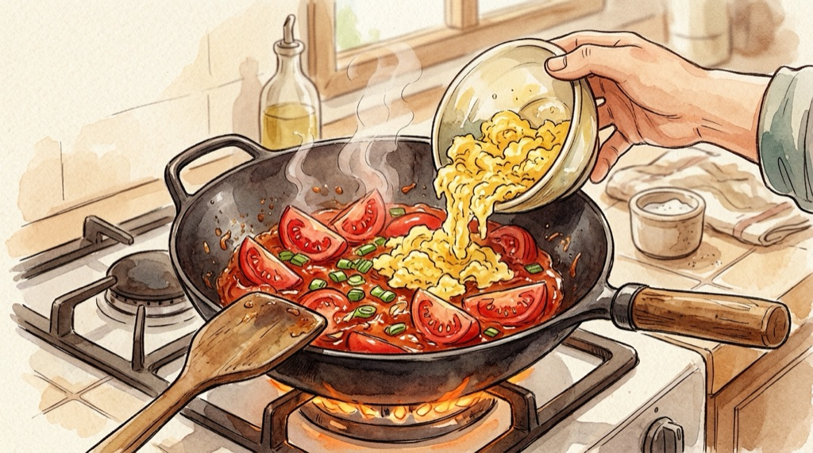

# 🍅 7분 완성 촉촉하고 감칠맛 나는 토마토 달걀볶음(토달볶) 레시피

포슬포슬하고 폭신한 **반숙 스크램블 에그**와 불에 구워 감칠맛이 폭발한 **새콤달콤 토마토**를 굴소스 양념으로 버무려 내는 **7분 완성 초간단 영양식** 레시피입니다. 반찬이나 아침 식사, 다이어트 식단은 물론 따뜻한 밥 위에 얹어 덮밥으로 먹어도 정말 맛있습니다!

---

## 📌 개요
토마토 달걀볶음이 질척거리거나 비린내가 나는 이유는 **토마토와 달걀을 한 팬에서 처음부터 같이 볶기 때문**입니다. 반드시 **달걀만 먼저 80% 반숙 스크램블로 폭신하게 익혀 그릇에 덜어둔 뒤**, 같은 팬에 파기름을 내어 토마토를 구워내고 마지막 30초만 합쳐서 볶아야 달걀은 포슬포슬하고 토마토 육즙은 진하게 살아납니다!

* **핵심 포인트:** 조리 전 볶음 양념과 달걀물 먼저 각각 섞어두기, 달걀 먼저 80% 반숙으로 볶아 덜어두기, 토마토에 설탕 약간 넣어 신맛 잡고 마지막에 달걀 합치기
* **조리 분량:** 1-2인분 기준 (토마토 1개 + 달걀 3개)
* **조리 시간:** 약 7분
* **난이도:** 매우 쉬움
* **코멘트:** 
* **분류:** 중식

---

## 🛒 재료 (1-2인분 기본 조리 기준)

> [!NOTE]
> **토마토 선택 팁:** 큰 완숙 토마토 1개(약 200g) 또는 방울토마토 10-12알(반 갈라 사용) 모두 동일하게 조리 가능합니다. 밥 위에 걸쭉하게 비벼 먹는 덮밥을 원하시면 상단 조리 모드 탭에서 **`🍚 걸쭉한 중식 토달볶 덮밥`** 모드를 선택하세요!

### 1. 주재료 및 향신 채소
| 변수 | 재료 | 수량 / 분량 (g·ml) | 손질 및 비고 |
| :--- | :--- | :--- | :--- |
| `tomato` | **완숙 토마토 (또는 방울토마토)** | 1개 (약 200g, 방울토마토는 10-12알) | 한 입 크기 웨지(초승달) 모양 썰기 |
| `egg` | **달걀** | 3개 (약 165-180g) | 소금·맛술 넣고 먼저 풀어두기 |
| `scallion` | **대파 (또는 쪽파)** | 1/3대 (약 15g) | 송송 썰기 (파기름 및 마무리 향) |
| `garlic` | **다진 마늘 (또는 편마늘)** | 0.3큰술 (약 5g) | 토마토 볶을 때 감칠맛 추가 (생략 가능) |
| `oil` | **식용유** | 1.5큰술 (약 22ml) | 달걀 스크램블(1큰술) + 토마토 파기름(0.5큰술) |
| `sesame_oil` | **참기름** | 0.5큰술 (약 5g) | 불 끄고 마지막 고소한 향 코팅 |
| `sesame_seed` | **통깨·후춧가루** | 약간 | 마무리 토핑 |

### 2. 달걀 밑간 및 미리 섞어둘 볶음 양념
| 변수 | 재료 | 수량 / 분량 (g·ml) | 비고 |
| :--- | :--- | :--- | :--- |
| `egg_salt` | **가는 소금 (달걀 밑간용)** | 1-2꼬집 (약 0.5g) | 달걀물 풀 때 미리 넣기 |
| `egg_mirin` | **맛술 또는 물 (달걀물용)** | 1큰술 (약 15ml) | 달걀을 폭신하고 비린내 없게 만듦 |
| `oyster` | **굴소스 (볶음 양념)** | 0.7큰술 (약 10g) | 토달볶 감칠맛의 핵심! *(짜지 않은 정량)* |
| `sugar` | **설탕 (볶음 양념)** | 0.3큰술 (약 3g) | ⭐ 토마토의 풋내·신맛을 잡고 감칠맛을 끌어올리는 비법 |
| `ketchup` | **케첩 (선택 · 볶음 양념)** | 0.5큰술 (약 8g) | 덜 익은 토마토일 때 넣으면 색감과 새콤달콤함 2배! |

### 🥣 미리 준비할 용기
| 용기 | 용도 및 준비 포인트 |
| :--- | :--- |
| **작은 종지 (볶음 양념 배합용)** | 굴소스(`{{oyster}}`)와 설탕(`{{sugar}}`), 케첩(`{{ketchup}}`)을 먼저 섞어둘 그릇 |
| **믹싱볼 (달걀물 배합 & 스크램블 덜어둘 겸용)** | 달걀(`{{egg}}`)을 먼저 풀어 팬에 붓고, 80% 익힌 스크램블을 잠시 덜어둘 볼 |
| **넓은 프라이팬 또는 웍** | 달걀과 토마토를 순서대로 빠르게 볶아낼 팬 |

---

## 🍳 조리 순서 (Instructions)

### Step 1. [재료 손질] 볶음 양념·달걀물 먼저 섞어두기 및 토마토·대파 썰기
1. **볶음 양념 먼저 섞기:** 준비한 작은 종지에 **굴소스 `{{oyster}}`**, **설탕 `{{sugar}}`**, (선택)**케첩 `{{ketchup}}`**을 가장 먼저 넣고 설탕이 녹도록 섞어둡니다. *(토마토의 신맛을 중화하고 감칠맛을 내는 핵심 양념입니다.)*
2. **폭신한 달걀물 배합:** 믹싱볼에 **달걀 `{{egg}}`**, **소금 `{{egg_salt}}`**, **맛술(또는 물) `{{egg_mirin}}`**을 넣고 젓가락으로 알끈이 풀리도록 고루 저어둡니다.
3. **토마토·대파 손질:** **토마토(`{{tomato}}`)**는 꼭지를 도려내고 반으로 가른 뒤 한 입 크기의 초승달(웨지) 모양으로 도톰하게 썰고, **대파(`{{scallion}}`)**는 송송 썰어둡니다.

### Step 2. 달걀 먼저 80% 반숙 스크램블로 익혀 그릇에 덜어두기 (핵심!)
1. 팬에 **식용유(`{{oil}}`)의 2/3 분량(약 1큰술)**을 두르고 **중강불**로 달군 뒤 풀어둔 **달걀물**을 한 번에 붓습니다.
2. 가장자리가 부풀어 오르면 젓가락이나 주걱으로 천천히 크게 휘저으며 **약 30-40초간** 큼직하고 몽글몽글한 덩어리로 익힙니다.
3. 달걀이 완전히 다 굳기 전, **촉촉한 80% 반숙 상태일 때 즉시 빈 그릇에 모두 덜어둡니다.** *(나중에 토마토와 다시 볶을 때 잔열로 100% 익습니다!)*

### Step 3. 파·마늘 기름에 토마토와 양념 넣고 육즙 내기
1. 달걀을 덜어낸 팬(닦지 않고 그대로!)에 남은 **식용유(약 0.5큰술)**와 송송 썬 **대파(`{{scallion}}`)**, **다진 마늘 `{{garlic}}`**을 넣고 **중불에서 30초간** 볶아 향긋한 파기름을 냅니다.
2. 썰어둔 **토마토(`{{tomato}}`)**와 Step 1에서 미리 섞어둔 **볶음 양념(굴소스·설탕·케첩)**을 넣고 **중강불에서 약 1분 30초간** 볶습니다. 토마토 겉면이 살짝 무르면서 팬 바닥에 붉고 진한 토마토 육즙 소스가 자작하게 만들어집니다.

### Step 4. 덜어둔 달걀 합치고 30초만 코팅해 완성하기
1. 토마토에서 맛있는 육즙이 우러나오면, Step 2에서 덜어두었던 **반숙 스크램블 달걀**을 팬에 다시 넣습니다.
2. 달걀이 부서지지 않게 주걱으로 아래에서 위로 살살 뒤적이며 **중강불에서 딱 20-30초만** 토마토 육즙 소스를 달걀에 코팅하듯 섞어줍니다.
3. **참기름 마무리:** 불을 끄고 **참기름 `{{sesame_oil}}`**과 **통깨·후춧가루(`{{sesame_seed}}`)**를 둘러 완성 그릇에 담아냅니다!

---

## 🔄 베리에이션

### [모드] 🍚 한 그릇 뚝딱! 촉촉 걸쭉한 중식 토달볶 덮밥 (가정식 게란판)
따뜻한 밥 위에 듬뿍 얹어 숟가락으로 쓱쓱 비벼 먹을 수 있도록, **토마토 육즙에 물과 전분물을 살짝 더해 소스를 넉넉하고 윤기 나게 만드는 중식 덮밥** 모드입니다!

| 변수 | 재료 | 수량 / 분량 (1인분 덮밥 기준) | 비고 |
| :--- | :--- | :--- | :--- |
| `d_rice` | **따뜻한 밥** | 1공기 (약 200g) | 덮밥 그릇에 미리 담아두기 |
| `d_tomato` | **완숙 토마토 (또는 방울토마토)** | 1개 (약 200g) | 한 입 크기 웨지 썰기 |
| `d_egg` | **달걀** | 2-3개 (약 120-165g) | 소금 1꼬집 + 맛술 1큰술 넣고 풀기 |
| `d_scallion` | **대파** | 1/3대 (약 15g) | 송송 썰기 |
| `d_oil` | **식용유** | 1.5큰술 (약 22ml) | |
| `d_oyster` | **굴소스** | 0.8큰술 (약 12g) | 밥과 비벼 먹기 딱 좋은 감칠맛 간 |
| `d_soy` | **진간장** | 0.3큰술 (약 5ml) | 덮밥 소스의 깊은 향 추가 |
| `d_sugar` | **설탕** | 0.3큰술 (약 3g) | 토마토 신맛 중화 |
| `d_water` | **물 (소스용)** | 3큰술 (약 45ml) | 밥을 적셔줄 촉촉한 소스 베이스 |
| `d_starch` | **감자전분 (또는 옥수수전분 · 선택)** | 0.3작은술 (약 1.5g) | 물에 함께 풀어 걸쭉한 농도 형성 (생략 가능) |
| `d_sesame` | **참기름·통깨** | 0.5큰술 (약 5g) | 마무리용 |

#### 🥣 미리 준비할 용기
| 용기 | 용도 및 준비 포인트 |
| :--- | :--- |
| **작은 볼 (덮밥 소스 배합용)** | 물(`{{d_water}}`)에 굴소스·진간장·설탕·전분을 미리 풀어둘 그릇 |
| **달걀물 볼 & 덮밥 대접** | 달걀 풀기용 볼 및 따뜻한 밥(`{{d_rice}}`)을 담아둘 덮밥 그릇 |
| **프라이팬 또는 웍** | 조리용 |

#### Step 1. [재료 손질] 덮밥 소스·달걀물 먼저 섞기 및 토마토·대파 썰기
1. **덮밥 소스 먼저 배합:** 작은 볼에 **물 `{{d_water}}`, 굴소스 `{{d_oyster}}`, 진간장 `{{d_soy}}`, 설탕 `{{d_sugar}}`, 전분 `{{d_starch}}`**을 가장 먼저 넣고 가루가 가라앉지 않게 잘 풀어둡니다.
2. **달걀물 풀기 & 채소 손질:** 다른 볼에 **달걀(`{{d_egg}}`)**을 풀어두고, **토마토(`{{d_tomato}}`)**는 한 입 크기로 썰며 **대파(`{{d_scallion}}`)**는 송송 썹니다.

#### Step 2. 달걀 80% 스크램블 만들어 덜어두기
1. 팬에 **식용유(`{{d_oil}}`) 1큰술**을 두르고 달걀물을 부어 **30-40초간** 포슬포슬한 80% 반숙 스크램블로 익혀 그릇에 덜어둡니다.

#### Step 3. 토마토 볶다가 덮밥 소스 붓고 달걀 합쳐 밥 위에 올리기
1. 팬에 남은 식용유(0.5큰술)와 **대파(`{{d_scallion}}`)**를 볶아 파기름을 낸 뒤, **토마토(`{{d_tomato}}`)**를 넣고 **중강불에서 1분간** 볶습니다.
2. 미리 섞어둔 **덮밥 소스**를 한 번 더 저어 팬에 붓고 바글바글 끓어오르며 걸쭉해지면(**약 30초**), 덜어둔 **스크램블 달걀**과 **참기름·통깨(`{{d_sesame}}`)**를 넣고 가볍게 섞어 **따뜻한 밥(`{{d_rice}}`)** 위에 듬뿍 얹어냅니다!

### [옵션] 🦐 칵테일 새우(또는 베이컨/스팸) 추가 (고단백 한 끼)
탱글탱글한 새우나 고소한 베이컨을 더하면 손님 초대 요리나 든든한 메인 반찬으로 손색없습니다.

| 변수 | 재료 | 수량 / 분량 (g) | 비고 |
| :--- | :--- | :--- | :--- |
| `add_protein` | **칵테일 새우 (또는 베이컨/스팸)** | 60-80g (새우 6-8마리 또는 베이컨 2줄) | 새우는 해동 후 물기 제거 / 베이컨은 한 입 크기 썰기 |

#### [Step 1에 추가] 새우 물기 제거(또는 베이컨 썰기)
1. 냉동 **새우(`{{add_protein}}`)**는 찬물에 해동한 뒤 키친타올로 물기를 꼭 닦아두고, 베이컨이나 스팸을 쓸 경우 한 입 크기로 썰어둡니다.

#### [Step 3에 추가] 파기름 낸 직후 새우(베이컨) 먼저 노릇하게 굽기
1. 파기름 향이 올라오면 토마토를 넣기 전에 **새우(또는 베이컨) `{{add_protein:main}}`**를 먼저 넣고 **중강불에서 1분간** 노릇하게 구운 뒤 토마토와 양념을 넣고 함께 볶아줍니다.

---

## 💡 토마토 달걀볶음 실패 없는 팁 (Tips)
* **토마토 껍질이 입에 걸리는 게 싫다면:** 완숙 토마토 엉덩이에 열십자(+) 칼집을 살짝 내고 끓는 물에 **딱 10초만** 담갔다 빼면 껍질이 과일처럼 후루룩 벗겨져 아이들도 정말 잘 먹습니다!
* **방울토마토로 할 때:** 방울토마토는 껍질이 얇고 단맛이 강해 껍질을 벗길 필요 없이 **반으로만 갈라서** 단면이 팬 바닥에 닿게 1분간 구워주면 육즙과 단맛이 훨씬 진하게 나옵니다.
