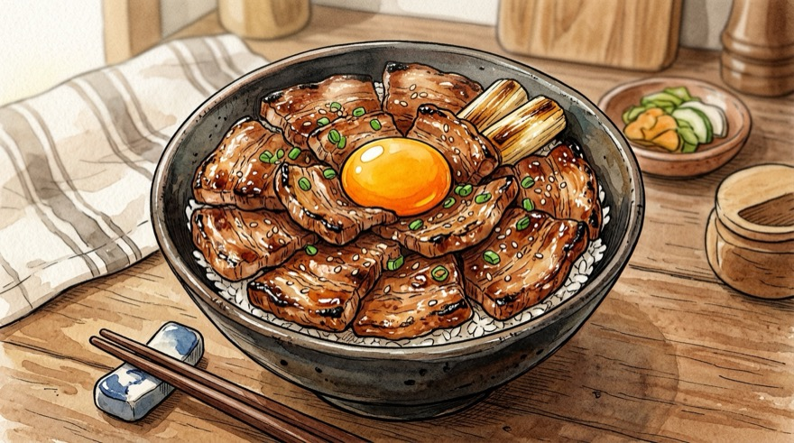
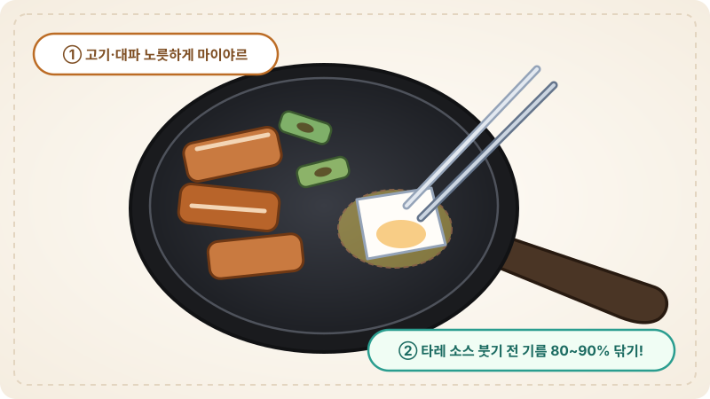

# 🍚 단짠단짠 불맛 가득 일본식 부타동(돼지고기 덮밥) 레시피

노릇하게 구운 삼겹살(또는 목살)에 짭조름하고 달콤한 타레 소스를 졸여 밥 위에 듬뿍 올리는 홋카이도 오비히로 스타일 부타동 황금 레시피입니다.

---

## 📌 개요
집에 있는 기본 간장 양념으로 일본 현지 덮밥집 특유의 깊은 단짠 풍미와 불맛을 내는 초간단 일식 덮밥입니다.

* **핵심 포인트:** 돼지고기 겉면을 강불에 노릇하게 구워 마이야르(불맛) 내기, 남는 기름 닦아내어 느끼함 잡기, 타레 소스에 짧고 강하게 졸여 윤기 입히기
* **조리 분량:** 1인분 기준
* **조리 시간:** 약 15분
* **난이도:** 쉬움
* **코멘트:** 
* **분류:** 일식

---

## 🛒 재료 (1인분 기준)

> [!NOTE]
> **계량 기준:** 1큰술(1T) = 계량스푼 15ml 기준입니다. 상단 인분을 변경하면 아래 재료와 조리 순서 내 모든 계량 수치가 자동으로 함께 변경됩니다.

### 1. 주재료 및 토핑
| 변수 | 재료 | 수량 / 분량 (g·ml) | 손질 및 비고 |
| :--- | :--- | :--- | :--- |
| `pork` | **돼지고기 (구이용 삼겹살 또는 목살)** | 200g | 두께 4~5mm 정도의 구이용(또는 대패삼겹살) |
| `rice` | **따뜻한 밥** | 1공기 (약 200~220g) | 고슬고슬하게 지은 밥 |
| `scallion` | **대파 (흰 부분 위주)** | 1/2대 (약 25g) | 절반은 구이용(3~4cm 토막), 절반은 고명용(송송 또는 파채) |
| `onion` | **양파 (선택)** | 1/4개 (약 50g) | 채 썰기 *(단맛과 식감을 원할 때 추가)* |
| `yolk` | **달걀 노른자 (또는 온센타마고)** | 1개 | 고명용 (고소한 맛 극대화) |
| `season_salt` | **소금 & 후춧가루** | 각 1꼬집 (약 1g) | 돼지고기 밑간용 |

### 2. 부타동 특제 타레 소스
| 변수 | 재료 | 수량 / 분량 (g·ml) | 비고 |
| :--- | :--- | :--- | :--- |
| `soy` | **진간장 (또는 기꼬만 간장)** | 3큰술 (약 45ml) | 짭조름한 감칠맛의 베이스 |
| `mirin` | **맛술 (미림)** | 3큰술 (약 45ml) | 잡내 제거 및 은은한 단맛 |
| `sake` | **청주 (또는 물)** | 3큰술 (약 45ml) | 간장 농도 조절 및 풍미 향상 |
| `sugar` | **설탕 (황설탕 권장)** | 1.5큰술 (약 15~18g) | 카라멜라이징 및 단맛 |
| `syrup` | **물엿 (또는 올리고당/꿀)** | 0.75~1큰술 (약 12~15g) | 반짝이는 윤기와 걸쭉한 농도 |
| `garlic` | **다진 마늘 (또는 생강즙)** | 0.75큰술 (약 10g) | 느끼함 제거 및 한국인 입맛 맞춤 |

### 📌 조리 내 계량 변수
| 변수 | 항목 | 기준 분량 | 역할 |
| :--- | :--- | :--- | :--- |
| `neck_oil` | 목살 사용 시 식용유 | 0.5큰술 (약 7ml) | oil |
| `tare_remain` | 팬에 남길 타레 소스 양 | 3~4큰술 | mild_seasoning |
| `tare_rice_drizzle` | 밥 위에 먼저 끼얹을 소스 | 2~3큰술 | mild_seasoning |
| `bowl_cnt` | 덮밥 그릇 수 | 1개 | main |

### 🥣 미리 준비할 용기
| 용기 | 용도 및 준비 포인트 |
| :--- | :--- |
| **작은 볼 (타레 소스 배합용)** | 간장·맛술·설탕 등 타레 소스를 미리 섞어 설탕을 녹여둘 그릇 |
| **작은 그릇 (고명 대파 찬물 담금용)** | 곱게 썬 고명용 대파를 찬물에 담가 아린 매운기를 빼둘 용기 |
| **넓은 프라이팬** | 돼지고기(`{{pork}}`)와 대파를 겹치지 않게 노릇하게 구울 팬 |
| **오목한 덮밥 그릇(돈부리 볼)** | 밥과 고기·소스를 넉넉히 담아낼 덮밥 용기 (`{{bowl_cnt}}`) |

---

## 🍳 조리 순서 (Instructions)

### Step 1. [재료 손질] 돼지고기 밑간, 대파 손질 및 타레 소스 배합
1. **고기 손질 및 밑간:** **삼겹살(또는 목살) `{{pork}}`**은 한 입에 먹기 좋은 크기(약 4~5cm 폭)로 썰고, 앞뒤로 **소금·후추(`{{season_salt}}`)**를 살짝 뿌려 밑간합니다.
2. **대파·양파 손질:** **대파(`{{scallion}}`)** 중 절반은 **3~4cm 길이로 큼직하게 토막** 내고(구이용), 나머지 절반은 **곱게 송송 썰거나 파채**로 썰어 준비한 찬물 그릇에 담가 매운기를 뺍니다(고명용). 선택 재료인 **양파(`{{onion}}`)**는 채 썰어둡니다.
3. **타레 소스 미리 섞기:** 준비해 둔 작은 볼에 아래 분량의 타레 소스 재료를 모두 넣고 설탕이 녹도록 미리 섞어둡니다.
   * 진간장 **`{{soy}}`** + 맛술 **`{{mirin}}`** + 청주(또는 물) **`{{sake}}`**
   * 설탕 **`{{sugar}}`** + 물엿 **`{{syrup}}`** + 다진 마늘 **`{{garlic}}`**

### Step 2. 돼지고기와 대파 노릇하게 굽기 (불맛 내기)
1. **고기 굽기:** 달군 팬에 기름을 두르지 않고(목살일 경우 식용유 `{{neck_oil}}`) **중강불**에서 돼지고기(`{{pork}}`)를 올려 앞뒤로 **노릇노릇한 갈색빛(마이야르 반응)**이 나도록 **약 3~4분간** 바싹 구워줍니다.
2. **대파·양파 함께 굽기:** 고기가 반쯤 익어 기름이 나오면 **토막 낸 대파**(와 채 썬 양파)를 빈 공간에 넣고 겉면이 살짝 거뭇하게 그을릴 때까지 함께 구워 파향을 입힙니다.
3. **기름 닦아내기 (핵심!):** 고기가 다 익으면 **키친타올로 팬에 흥건하게 나온 돼지기름을 80~90% 이상 닦아냅니다.**
   *(기름을 닦아내야 소스가 겉돌지 않고 고기에 착 달라붙으며 끝까지 느끼하지 않습니다.)*

### Step 3. 타레 소스 붓고 졸이기
1. **소스 투입:** 불을 **강불**로 유지한 채, 미리 섞어둔 **타레 소스**를 팬 가장자리에 둘러 붓습니다.
2. **빠르게 졸이기:** 소스가 바글바글 끓어오르면 고기와 대파를 소스에 뒤적이며 **약 1분 30초~2분간** 졸여줍니다.
3. **불 끄기:** 소스가 적당히 졸아들어 걸쭉한 윤기가 돌고, 밥을 촉촉하게 적셔 먹을 소스가 **`{{tare_remain}}` 정도 팬 바닥에 넉넉히 남았을 때** 불을 끕니다.

### Step 4. 덮밥 담아내기 (플레이팅)
1. **밥과 소스:** 준비한 덮밥 그릇(`{{bowl_cnt}}`)에 **따뜻한 밥 `{{rice}}`**을 담고, 팬에 남은 **타레 소스를 총 `{{tare_rice_drizzle}}`** 먼저 밥 위에 넉넉하게 끼얹습니다.
2. **고기 올리기:** 밥이 보이지 않게 구운 돼지고기와 구운 대파를 꽃잎처럼 빙 둘러 듬뿍 올리고, 남은 소스를 고기 위에도 한 번 더 뿌려줍니다.
3. **토핑 마무리:** 가운데에 홈을 살짝 파서 **달걀 노른자 `{{yolk}}`**를 톡 올리고, 물기를 꽉 뺀 **송송 썬 대파(또는 파채)**와 통깨를 올려 `{{servings}}` 부타동을 완성합니다.

---

## 💡 요리 팁 & 곁들임 추천 (Tips)

* **토치 불맛 추가:** 요리용 토치가 있다면 소스를 졸인 뒤 고기 윗면을 토치로 10~15초간 살짝 그을려주면 일본 현지 숯불 부타동 맛이 그대로 납니다.
* **찰떡궁합 곁들임:** 느끼함을 잡아주는 **생와사비(고추냉이)**나 **시치미(일식 고춧가루)**, **초생강(베니쇼가)**을 고기 한 점에 살짝 얹어 먹으면 마지막 한 입까지 물리지 않습니다.
