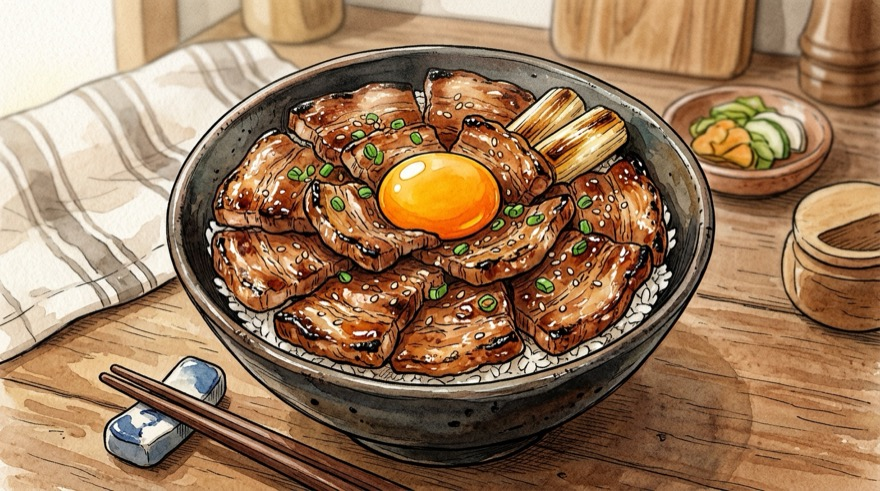
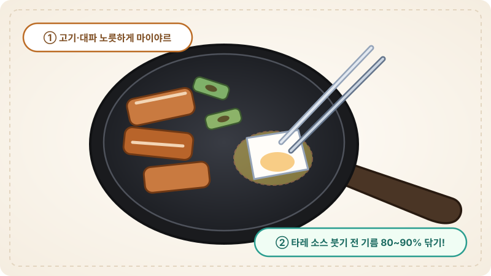

# 🍚 단짠단짠 불맛 가득 일본식 부타동(돼지고기 덮밥) 레시피

노릇하게 구운 삼겹살(또는 목살)에 짭조름하고 달콤한 타레 소스를 졸여 밥 위에 듬뿍 올리는 홋카이도 오비히로 스타일 부타동 황금 레시피입니다.

---

## 📌 개요
집에 있는 기본 간장 양념으로 일본 현지 덮밥집 특유의 깊은 단짠 풍미와 불맛을 내는 초간단 일식 덮밥입니다.

* **핵심 포인트:** 돼지고기 겉면을 강불에 노릇하게 구워 마이야르(불맛) 내기, 남는 기름 닦아내어 느끼함 잡기, 타레 소스에 짧고 강하게 졸여 윤기 입히기
* **조리 분량:** 1인분 기준
* **조리 시간:** 약 15분
* **난이도:** 쉬움
* **검증 상태:** 미검증
* **코멘트:** 
* **분류:** 일식

---

## 🛒 재료 (1인분)

> [!NOTE]
> **계량 기준:** 1큰술(1T) = 계량스푼 15ml 기준입니다. 저울 사용 시 함께 표기된 **그램(g)** 단위를 참고하세요.

### 1. 주재료 및 토핑
| 재료 | 수량 / 분량 (g·ml) | 손질 및 비고 |
| :--- | :--- | :--- |
| **돼지고기 (구이용 삼겹살 또는 목살)** | 200g | 두께 4~5mm 정도의 구이용(또는 대패삼겹살) |
| **따뜻한 밥** | 1공기 (약 200~220g) | 고슬고슬하게 지은 밥 |
| **대파 (흰 부분 위주)** | 1/2대 (약 25g) | 반은 구이용(3~4cm 토막), 반은 고명용(송송 또는 파채) |
| **양파 (선택)** | 1/4개 (약 50g) | 채 썰기 *(단맛과 식감을 원할 때 추가)* |
| **달걀 노른자 (또는 온센타마고)** | 1개 | 고명용 (고소한 맛 극대화) |
| **소금 & 후춧가루** | 각 1꼬집 (약 1g) | 돼지고기 밑간용 |

### 2. 부타동 특제 타레 소스 (넉넉한 1.5배 분량 · 큰술 & 그램 병기)
| 재료 | 수량 / 분량 (g·ml) | 비고 |
| :--- | :--- | :--- |
| **진간장 (또는 기꼬만 간장)** | 3큰술 (약 45g / 45ml) | 짭조름한 감칠맛의 베이스 |
| **맛술 (미림)** | 3큰술 (약 45g / 45ml) | 잡내 제거 및 은은한 단맛 |
| **청주 (또는 물)** | 3큰술 (약 45g / 45ml) | 간장 농도 조절 및 풍미 향상 |
| **설탕 (황설탕 권장)** | 1.5큰술 (약 15~18g) | 카라멜라이징 및 단맛 |
| **물엿 (또는 올리고당/꿀)** | 0.75~1큰술 (약 12~15g) | 반짝이는 윤기와 걸쭉한 농도 |
| **다진 마늘 (또는 생강즙)** | 0.75큰술 (약 10g) | 느끼함 제거 및 한국인 입맛 맞춤 |

---

## 🍳 조리 순서 (Instructions)

### Step 1. 재료 손질 및 타레 소스 배합
1. **고기 손질:** 삼겹살(또는 목살) 200g은 한 입에 먹기 좋은 크기(약 4~5cm 폭)로 썰고, 앞뒤로 **소금·후추 1꼬집**을 살짝 뿌려 밑간합니다.
2. **대파 손질:** 대파 1/2대 중 절반은 **3~4cm 길이로 큼직하게 토막** 내고(구이용), 나머지 절반은 **곱게 송송 썰거나 파채**로 썰어 찬물에 담가 매운기를 뺍니다(고명용).
3. **소스 섞기:** 작은 볼에 분량의 타레 소스 재료를 미리 모두 섞어 설탕을 녹여둡니다.
   * 진간장 **3큰술 (45g)** + 맛술 **3큰술 (45g)** + 청주(또는 물) **3큰술 (45g)**
   * 설탕 **1.5큰술 (15~18g)** + 물엿 **0.75~1큰술 (12~15g)** + 다진 마늘 **0.75큰술 (10g)**

### Step 2. 돼지고기와 대파 노릇하게 굽기 (불맛 내기)
1. **고기 굽기:** 달군 팬에 기름을 두르지 않고(목살일 경우 식용유 0.5큰술) **중강불**에서 돼지고기를 올려 앞뒤로 **노릇노릇한 갈색빛(마이야르 반응)**이 나도록 바싹 구워줍니다.
2. **대파·양파 함께 굽기:** 고기가 반쯤 익어 기름이 나오면 **토막 낸 대파**(와 채 썬 양파)를 빈 공간에 넣고 겉면이 살짝 거뭇하게 그을릴 때까지 함께 구워 파향을 입힙니다.
3. **기름 닦아내기 (핵심!):** 고기가 다 익으면 **키친타올로 팬에 흥건하게 나온 돼지기름을 80~90% 이상 닦아냅니다.**
   *(기름을 닦아내야 소스가 겉돌지 않고 고기에 착 달라붙으며 끝까지 느끼하지 않습니다.)*

### Step 3. 타레 소스 붓고 졸이기
1. **소스 투입:** 불을 **강불**로 유지한 채, 미리 섞어둔 **타레 소스**를 팬 가장자리에 둘러 붓습니다.
2. **빠르게 졸이기:** 소스가 바글바글 끓어오르면 고기와 대파를 소스에 뒤적이며 **약 1분 30초~2분간** 졸여줍니다.
3. **불 끄기:** 소스가 적당히 졸아들어 걸쭉한 윤기가 돌고, 밥을 촉촉하게 적셔 먹을 소스가 **3~4큰술 정도 팬 바닥에 넉넉히 남았을 때** 불을 끕니다.

### Step 4. 덮밥 담아내기 (플레이팅)
1. **밥과 소스:** 넓은 덮밥 그릇에 따뜻한 밥(200g)을 담고, 팬에 남은 **타레 소스를 2~3큰술** 먼저 밥 위에 넉넉하게 끼얹습니다.
2. **고기 올리기:** 밥이 보이지 않게 구운 돼지고기와 구운 대파를 꽃잎처럼 빙 둘러 듬뿍 올리고, 남은 소스를 고기 위에도 한 번 더 뿌려줍니다.
3. **토핑 마무리:** 가운데에 홈을 살짝 파서 **달걀 노른자**를 톡 올리고, 물기를 뺀 **송송 썬 대파(또는 파채)**와 통깨를 올려 완성합니다.

---

## 💡 요리 팁 & 곁들임 추천 (Tips)

* **토치 불맛 추가:** 요리용 토치가 있다면 소스를 졸인 뒤 고기 윗면을 토치로 10~15초간 살짝 그을려주면 일본 현지 숯불 부타동 맛이 그대로 납니다.
* **찰떡궁합 곁들임:** 느끼함을 잡아주는 **생와사비(고추냉이)**나 **시치미(일식 고춧가루)**, **초생강(베니쇼가)**을 고기 한 점에 살짝 얹어 먹으면 마지막 한 입까지 물리지 않습니다.
