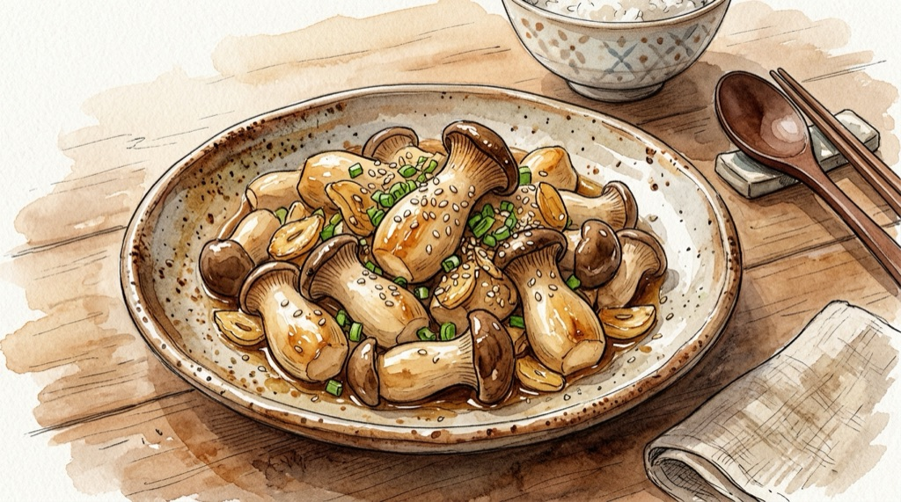
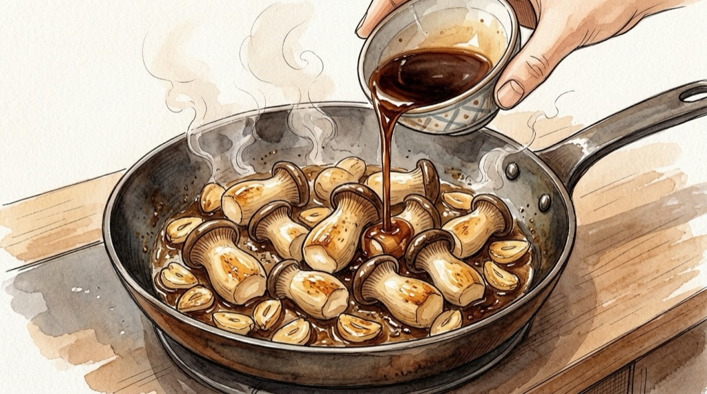

# 🍄 탱글탱글 총알새송이버섯 마늘 간장조림 레시피

한 입 크기의 **총알새송이버섯(미니새송이버섯)**을 통째로 노릇하게 구워 육즙을 가둔 뒤, **미리 섞어둔 단짠 간장 조림장**을 부어 재빨리 코팅해 내는 **7분 완성 초간단 밥도둑** 레시피입니다. 버터 없이 집에 있는 기본 양념과 참기름만으로 전복·소고기 장조림 부럽지 않은 쫄깃한 식감을 낼 수 있습니다!

---

## 📌 개요
총알새송이버섯은 일반 새송이버섯보다 조직이 치밀해서 **통째로(또는 반만 갈라) 강불에 먼저 구운 뒤 조림장을 부어야** 물이 생기지 않고 씹을 때마다 버섯 즙이 팡 터집니다. 조리 시작 전에 간장 양념을 작은 그릇에 미리 섞어두면 불 앞에서 허둥지둥할 일 없이 7분 만에 완성됩니다!

* **핵심 포인트:** 조리 전 간장 조림장 미리 섞어두기, 양념 붓기 전 강불에서 버섯 겉면 먼저 노릇하게 구워 수분 가두기, 불 끄고 참기름으로 고소함 코팅하기
* **조리 분량:** 2인분 기준 (총알새송이버섯 1봉지 · 250-300g)
* **조리 시간:** 약 7분
* **난이도:** 매우 쉬움
* **코멘트:** 
* **분류:** 한식

---

## 🛒 재료 (2인분 · 1봉지 기본 조리 기준)

> [!NOTE]
> **계량 기준:** 1큰술(1T) = 밥숟가락 깍지 않고 넉넉히 1스푼(약 15ml) 기준입니다. **조림 양념 재료는 조리 시작 전 작은 그릇에 미리 한데 섞어두세요!**

### 1. 주재료 및 향신 채소
| 변수 | 재료 | 수량 / 분량 (g·ml) | 손질 및 비고 |
| :--- | :--- | :--- | :--- |
| `mushroom` | **총알새송이버섯 (미니새송이)** | 1봉지 (약 250-300g) | 작은 것은 통째로, 통통한 것만 반 가르기 |
| `garlic` | **통마늘 (또는 다진 마늘)** | 5-6알 (약 25g) | 편 썰기 *(다진 마늘 사용 시 0.5큰술)* |
| `scallion` | **대파** | 1/3대 (약 15g) | 송송 썰기 (향과 색감용 · 생략 가능) |
| `oil` | **식용유** | 1.5큰술 (약 22ml) | 버섯 겉면을 노릇하게 구울 기름 |
| `sesame_oil` | **참기름 (또는 들기름)** | 0.5큰술 (약 5g) | **불 끄고 마지막**에 둘러 고소한 향 코팅 |
| `sesame_seed` | **통깨** | 약간 | 마무리 토핑 |

### 2. 미리 섞어둘 간장 조림장
| 변수 | 재료 | 수량 / 분량 (g·ml) | 비고 |
| :--- | :--- | :--- | :--- |
| `soy` | **진간장** | 1.5큰술 (약 22ml) | 짭조름한 장조림 감칠맛 베이스 |
| `oyster` | **굴소스** | 0.5큰술 (약 7g) | 깊은 감칠맛 *(없으면 진간장 0.5큰술로 대체)* |
| `syrup` | **올리고당 (또는 물엿/설탕)** | 1큰술 (약 15g) | 반짝이는 윤기와 은은한 단맛 *(설탕은 0.7큰술)* |
| `mirin` | **맛술 (미림)** | 1큰술 (약 15ml) | 버섯 특유의 흙내 제거 및 감칠맛 |
| `water` | **물** | 2큰술 (약 30ml) | 양념이 타지 않고 버섯 속까지 배게 하는 수분 |
| `pepper` | **후춧가루** | 약간 | 깔끔한 마무리 향 |

### 📌 조리 내 계량 변수
| 변수 | 항목 | 기준 분량 | 역할 |
| :--- | :--- | :--- | :--- |
| `alt_minced_garlic` | 다진 마늘 대체 분량 | 0.5큰술 (약 8g) | mild_seasoning |
| `batch_sauce_use` | 만능 조림장 1회 사용량 | 4-5큰술 (약 60-75ml) | strong_seasoning |

### 🥣 미리 준비할 용기
| 용기 | 용도 및 준비 포인트 |
| :--- | :--- |
| **작은 볼 / 종지** | 불을 켜기 전에 **간장 조림장 재료(`진간장 + 굴소스 + 올리고당 + 맛술 + 물`)**를 미리 설탕·올리고당이 풀리도록 섞어둘 그릇 |
| **키친타올 (또는 체)** | 총알버섯의 밑동 톱밥·먼지를 털어내고 물기를 닦아낼 용도 |
| **넓은 프라이팬** | 총알버섯(`{{mushroom}}`)이 서로 겹치지 않게 펼쳐 노릇하게 구울 팬 |

---

## 🍳 조리 순서 (Instructions)

### Step 1. [재료 손질] 간장 조림장 먼저 섞어두기 및 총알버섯·마늘 손질
1. **간장 조림장 먼저 배합:** 준비한 작은 볼(종지)에 **진간장 `{{soy}}`**, **굴소스 `{{oyster}}`**, **올리고당 `{{syrup}}`**, **맛술 `{{mirin}}`**, **물 `{{water}}`**, **후춧가루 `{{pepper}}`**를 가장 먼저 넣고 올리고당(또는 설탕)이 바닥에 남지 않도록 미리 고루 섞어둡니다. *(미리 섞어두면 버섯을 손질하는 동안 재료가 잘 어우러집니다.)*
2. **총알버섯 손질:** **총알새송이버섯(`{{mushroom}}`)**은 물에 오래 담그면 수분을 빨아들여 식감이 물러지므로, 키친타올로 가볍게 닦거나 흐르는 물에 재빨리 헹궈 물기를 완전히 털어냅니다. 밑동의 지저분한 끝부분만 살짝 다듬고, **작은 것은 통째로**, 엄지손가락보다 굵은 것만 **세로로 반** 갈라둡니다.
3. **향신 채소 손질:** **통마늘(`{{garlic}}`)**은 얇게 편 썰고(없으면 다진 마늘 `{{alt_minced_garlic}}` 준비), **대파(`{{scallion}}`)**는 송송 썰어둡니다.

### Step 2. 강불에서 총알버섯 먼저 노릇하게 구워 육즙 가두기 (핵심!)
1. 넓은 팬에 **식용유 `{{oil}}`**를 두르고 **중강불**로 달군 뒤 손질한 **총알새송이버섯(`{{mushroom}}`)**을 넣습니다.
2. 처음 1분간은 자주 뒤적이지 말고 그대로 두어 바닥 면에 노릇한 구움색을 낸 뒤, 팬을 흔들어가며 **약 2분 30초-3분간** 버섯 겉면 전체가 노릇노릇하고 탱글해질 때까지 구워줍니다. *(이렇게 먼저 구워야 양념을 부었을 때 물이 흥건해지지 않고 쫄깃합니다!)*

### Step 3. 마늘·대파 넣고 고소한 향 올리기
1. 버섯이 노릇해지면 편 썬 **통마늘(`{{garlic}}`)**과 **대파(`{{scallion}}`)**를 넣고 **중불에서 약 1분간** 함께 볶아 마늘 가장자리가 노릇해지며 고소한 향이 올라오게 합니다.

### Step 4. 미리 섞어둔 조림장 붓고 윤기 나게 졸여 완성
1. 불을 다시 **중강불**로 올리고, Step 1에서 미리 섞어둔 **간장 조림장**을 팬에 한 번에 붓습니다.
2. 조림장이 바글바글 끓어오르면 버섯을 굴려가며 **약 1분-1분 30초간** 국물이 거의 없어지고 버섯 표면에 반짝반짝한 갈색 윤기가 코팅될 때까지 바짝 졸입니다.
3. **참기름 코팅:** 불을 완전히 끄고 **참기름(또는 들기름) `{{sesame_oil}}`**과 **통깨(`{{sesame_seed}}`)**를 둘러 가볍게 섞어 `{{servings}}` 총알새송이버섯 마늘 간장조림을 완성합니다!

---

## 🔄 베리에이션

### [모드] 🫙 만능 버섯·장조림 간장소스만 미리 만들기 (냉장 밀프렙)
이 간장 조림장은 마늘이나 파 같은 생채소를 넣지 않고 **액체·당류 양념만 먼저 섞어 밀폐용기에 담아두면 냉장실에서 2-3주간 거뜬히 보관**할 수 있습니다! 미리 만들어 두면 총알버섯뿐만 아니라 새송이·팽이버섯구이, 두부조림, 계란장조림에도 바로 부어 쓸 수 있습니다.

| 변수 | 재료 | 수량 / 분량 (기본 2인분 · 1회분 기준) | 비고 |
| :--- | :--- | :--- | :--- |
| `b_soy` | **진간장** | 1.5큰술 (약 22ml) | 인분을 `4인분`, `6인분`으로 올리면 대용량 배합비 자동 계산 |
| `b_oyster` | **굴소스** | 0.5큰술 (약 7g) | 감칠맛 베이스 *(생략 시 진간장 대체)* |
| `b_syrup` | **올리고당 (또는 물엿/설탕)** | 1큰술 (약 15g) | 윤기 및 단맛 |
| `b_mirin` | **맛술 (미림)** | 1큰술 (약 15ml) | 보존성 및 풍미 향상 |
| `b_water` | **생수 (또는 정수 물)** | 2큰술 (약 30ml) | 볶을 때 타지 않게 해주는 수분 |
| `b_pepper` | **후춧가루** | 약간 | |

#### 🥣 미리 준비할 용기
| 용기 | 용도 및 준비 포인트 |
| :--- | :--- |
| **물기 없는 유리병 또는 밀폐용기** | 만능 간장 조림장을 섞어 냉장 보관할 용기 |

#### Step 1. [재료 손질] 용기 물기 제거 및 조림장 재료 한데 섞기
1. 유리병이나 밀폐용기에 물기가 없도록 깨끗이 닦아 준비합니다.
2. 용기에 **진간장 `{{b_soy}}`**, **굴소스 `{{b_oyster}}`**, **올리고당 `{{b_syrup}}`**, **맛술 `{{b_mirin}}`**, **물 `{{b_water}}`**, **후춧가루 `{{b_pepper}}`**를 모두 넣고 올리고당과 굴소스가 완전히 풀릴 때까지 잘 저어줍니다.

#### Step 2. 냉장 보관 및 버섯 조리 시 활용법
1. 뚜껑을 닫아 냉장 보관합니다. *(생마늘·대파가 들어가지 않아 냉장실에서 2-3주간 변질 없이 보관됩니다.)*
2. **요리할 때:** 팬에 총알버섯 `1봉지(250-300g)`와 마늘을 노릇하게 구운 뒤, 흔들어 섞은 **만능 조림장 `{{batch_sauce_use}}`**을 붓고 **1분-1분 30초간** 졸여 참기름만 두르면 5분 만에 완성됩니다!

### [모드] 🧂 간장 없이 5분 완성! 고깃집 스타일 들기름(참기름) 소금구이
양념장 졸이는 과정도 생략하고 싶을 때, **식용유 + 들기름(또는 참기름) + 소금·마늘**만으로 노릇하게 구워내는 고깃집 버섯구이 모드입니다.

| 변수 | 재료 | 수량 / 분량 (2인분 기준) | 비고 |
| :--- | :--- | :--- | :--- |
| `g_mushroom` | **총알새송이버섯** | 1봉지 (약 250-300g) | 작은 건 통째로, 큰 건 반 가르기 |
| `g_garlic` | **통마늘** | 5-6알 (약 25g) | 도톰하게 편 썰기 |
| `g_oil` | **식용유** | 1큰술 (약 15ml) | 발연점을 높여 타지 않게 해주는 기름 |
| `g_perilla` | **들기름 (또는 참기름)** | 1큰술 (약 10g) | 고소한 풍미 *(식용유와 함께 두르면 잘 타지 않음)* |
| `g_salt` | **맛소금 (또는 가는 소금)** | 2-3꼬집 (약 2g) | 버섯 육즙을 끌어내는 밑간 |
| `g_pepper` | **후춧가루·통깨** | 약간 | 마무리용 |

#### 🥣 미리 준비할 용기
| 용기 | 용도 및 준비 포인트 |
| :--- | :--- |
| **넓은 프라이팬** | 버섯과 마늘을 노릇하게 구울 팬 |

#### Step 1. [재료 손질] 총알버섯 밑동 다듬기 및 마늘 편 썰기
1. **총알새송이버섯(`{{g_mushroom}}`)**은 물기 없이 먼지만 털어 큰 것만 반으로 가르고, **통마늘(`{{g_garlic}}`)**은 도톰하게 편 썹니다.

#### Step 2. 식용유 + 들기름(참기름)에 버섯·마늘 노릇하게 소금구이하기
1. 팬에 **식용유 `{{g_oil}}`**와 **들기름(또는 참기름) `{{g_perilla}}`**을 함께 두르고 **중불**에서 총알버섯(`{{g_mushroom}}`)과 편 썬 마늘(`{{g_garlic}}`)을 넣습니다.
2. 버섯 겉면이 노릇노릇해지고 탱글하게 부풀어 오를 때까지 **약 3-4분간** 굴려가며 구운 뒤, 마지막에 **맛소금 `{{g_salt}}`**과 후춧가루·통깨를 솔솔 뿌려 가볍게 섞어냅니다!

### [옵션] 🌶️ 청양고추(또는 꽈리고추) 추가 (매콤단짠 장조림풍)
달짝지근한 간장 조림에 칼칼한 고추 향을 더하면 느끼함이 싹 잡히고 소고기 메추리알 장조림 같은 매콤단짠 밥반찬이 됩니다!

| 변수 | 재료 | 수량 / 분량 (g·ml) | 비고 |
| :--- | :--- | :--- | :--- |
| `chili` | **청양고추 (또는 꽈리고추)** | 1-2개 (약 15g) | 청양고추는 어슷(송송) 썰기 / 꽈리고추는 꼭지 떼고 반 자르기 |

#### [Step 1에 추가] 고추 미리 썰어두기
1. **청양고추(`{{chili}}`)**는 송송 썰고, 꽈리고추를 사용할 경우 꼭지를 떼고 양념이 잘 배도록 포크로 한두 번 찌르거나 반으로 어슷 썰어둡니다.

#### [Step 3에 추가] 마늘 볶을 때 고추 함께 넣어 향 내기
1. 마늘·대파를 넣고 볶을 때 손질한 **고추(`{{chili:main}}`)**를 함께 넣고 볶아 매콤하고 향긋한 고추 향을 버섯에 입힙니다.

### [옵션] 🧈 버터 풍미 추가 (스테이크 하우스 스타일)
집에 버터가 있을 때 선택하면 고소한 풍미가 2배로 살아나는 양식당 가니쉬·안주 스타일 옵션입니다.

| 변수 | 재료 | 수량 / 분량 (g·ml) | 비고 |
| :--- | :--- | :--- | :--- |
| `butter` | **무염버터 (또는 가염버터)** | 1큰술 (약 10-12g) | 마늘 볶을 때 투입 *(참기름 대신 사용하거나 함께 사용 가능)* |

#### [Step 3에 추가] 마늘 볶을 때 버터 녹여 코팅하기
1. 마늘을 넣을 때 **버터 `{{butter}}`**를 함께 넣어 녹이며 **중불에서 1분간** 버섯에 고소한 갈색 버터(브라운 버터) 풍미를 입힌 뒤 간장 조림장을 붓습니다.

---

## 💡 셰프의 비법 팁 (Chef's Tips)
* **버섯은 절대 물에 불리지 마세요:** 버섯은 스펀지 구조라 물에 담가 씻으면 조리할 때 물을 잔뜩 뱉어내어 조림장이 싱거워지고 식감이 질겨집니다. 먼지만 털거나 흐르는 물에 1-2초만 스치듯 헹군 뒤 키친타올로 물기를 꼭 닦아주세요.
* **통통한 버섯에 열십자(+) 칼집 내기:** 반으로 가르지 않고 통째로 동그란 모양을 살리고 싶다면, 버섯 갓 윗면에 **열십자(+)로 얕게 칼집**만 내주어도 속까지 간장 양념이 쏙 배어듭니다.
* **덮밥(버섯동을)으로 즐기기:** 따뜻한 밥 위에 완성된 총알버섯 간장조림을 듬뿍 올리고 **반숙 계란후라이(또는 노른자)**를 얹어 비벼 먹으면 훌륭한 한 그릇 일품 덮밥이 됩니다!
