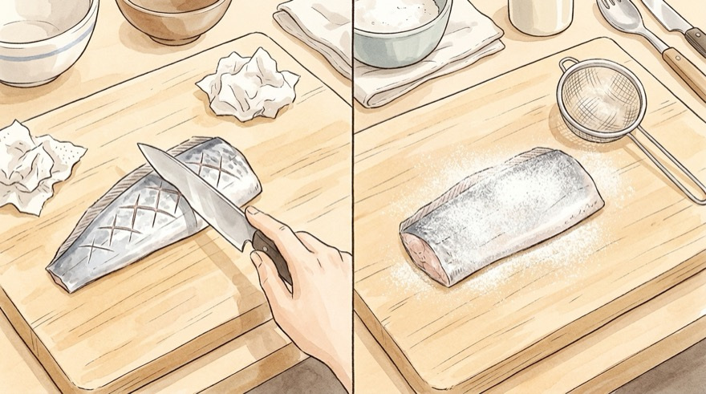

# 🐟 노릇노릇 고소한 갈치 구이 레시피

은빛 껍질을 살려 부서짐 없이 겉은 바삭하고 속은 부드럽게 굽는 갈치 구이 황금 레시피입니다.

---

## 📌 개요
갈치는 살이 연하고 부드러워 팬에 들러붙거나 뒤집을 때 부서지기 쉽습니다. 겉수분을 잡고 가루를 살짝 묻혀 부서짐 없이 깔끔하게 굽는 것이 핵심입니다.
* **핵심 포인트:** 은비늘 가볍게 긁어내기(소화 및 비린내 방지), 부침가루/밀가루 얇게 입히기, 자주 뒤집지 않기
* **조리 분량:** 2인분 기준
* **조리 시간:** 약 15분
* **난이도:** 쉬움
* **코멘트:** 
* **분류:** 한식

---

## 🛒 재료 (2인분 기준)

> [!TIP]
> **간 갈치(염장 갈치)를 사셨다면** 소금(`{{salt}}`) 밑간을 생략하고 후추나 맛술(`{{mirin}}`)만 살짝 뿌려주세요.

### 1. 주재료 및 밑간·코팅
| 변수 | 재료 | 수량 / 분량 (g·ml) | 손질 및 비고 |
| :--- | :--- | :--- | :--- |
| `fish` | **토막 갈치** | 3~4토막 (약 300~400g) | 은비늘·검은 내장막 제거 후 X자 칼집 |
| `salt` | **굵은 소금 (또는 맛소금)** | 0.5큰술 (약 5~6g) | 생물/무염 갈치 밑간용 *(염장 갈치는 생략)* |
| `flour` | **부침가루 (또는 밀가루/전분)** | 2큰술 (약 15~20g) | 살 부서짐 방지 및 바삭함 코팅용 |
| `oil` | **식용유** | 2~3큰술 (약 30~40ml) | 넉넉하게 둘러 튀기듯 굽기 |

### 2. 선택 재료 / 곁들임
| 변수 | 재료 | 수량 / 분량 (g·ml) | 비고 |
| :--- | :--- | :--- | :--- |
| `mirin` | **맛술 (또는 청주)** | 1큰술 (약 15ml) | 선택 (비린내 제거용 밑간) |
| `side_sauce` | **레몬 / 와사비 간장** | 취향껏 | 선택 (곁들임용) |

### 🥣 미리 준비할 용기
| 용기 | 용도 및 준비 포인트 |
| :--- | :--- |
| **밑간용 접시 또는 볼** | 손질한 갈치(`{{fish:main}}`)에 소금·맛술을 뿌려 10분간 재워둘 그릇 |
| **넓은 접시 (또는 위생백)** | 부침가루(`{{flour}}`)를 펴서 갈치 앞뒤에 얇게 옷 입힐 용기 |
| **넓은 코팅 프라이팬** | 갈치(`{{fish:main}}`)가 서로 닿지 않게 올려 노릇하게 구울 팬 |

---

## 🍳 조리 순서 (Instructions)

### Step 1. [재료 손질] 갈치 은비늘·내장막 세척, 칼집 내기 및 밑간
1. 칼날을 세워 **토막 갈치(`{{fish}}`)** 표면의 **은비늘을 살살 긁어냅니다.** *(은비늘의 구아닌 성분은 소화가 잘 안 되거나 비린내의 원인이 될 수 있으므로 가볍게 긁어내는 것이 좋습니다.)*
2. 내장이 있던 안쪽의 **검은 막과 핏물**을 흐르는 물에 깨끗이 씻어냅니다.
3. 갈치 양면에 **X자 모양으로 얕게 칼집**을 2~3개 넣어줍니다. *(간이 잘 배고 속까지 골고루 익습니다.)*
4. 손질한 갈치를 접시에 담고 **소금 `{{salt}}`**과 **맛술 `{{mirin}}`**(선택)을 골고루 뿌려 **10분간** 재워둡니다. *(염장 갈치는 소금 생략)*

### Step 2. 수분 완벽 제거 및 부침가루 옷 얇게 입히기
1. 키친타올로 밑간한 갈치(`{{fish:main}}`) 표면의 **물기와 핏물을 꼼꼼하게 꾹꾹 눌러 닦아냅니다.** *(수분이 남아 있으면 기름이 튀고 껍질이 팬에 들러붙습니다.)*
2. 준비한 넓은 접시나 위생백에 **부침가루(또는 밀가루) `{{flour}}`**를 넣고, 갈치 앞뒤에 **가루를 얇게 묻힌 뒤 손으로 탁탁 털어냅니다.** *(가루 옷이 얇아야 살이 부서지지 않고 겉이 바삭해집니다.)*

### Step 3. 팬에 자주 뒤집지 않고 노릇하게 굽기
1. 넓은 코팅 프라이팬을 달군 후 **식용유 `{{oil}}`**을 넉넉하게 둘러줍니다.
2. 불을 **중약불**로 줄이고 갈치(`{{fish:main}}`)를 서로 닿지 않게 올립니다.
3. 바닥 면이 노릇노릇하고 단단해질 때까지 **약 3~4분간 건드리지 않고 그대로 둡니다.** *(너무 일찍 뒤집으면 부드러운 살이 다 깨집니다.)*
4. 가장자리가 노릇해지면 뒤집개로 조심스럽게 뒤집어 반대쪽도 **2~3분간** 노릇하게 구워줍니다.
5. 마지막 **30초**는 센 불로 양면을 바삭하게 마무리해 `{{servings}}` 갈치 구이를 접시에 담아냅니다.

---

## 🔄 베리에이션

### [모드] ♨️ 에어프라이어 갈치 구이 (뒤집다 살 깨질 걱정 제로!)
프라이팬 기름 튐이나 연기 없이 깔끔하게 구워내는 에어프라이어 전용 모드입니다.

| 변수 | 재료 | 수량 / 분량 (2인분 기준) | 비고 |
| :--- | :--- | :--- | :--- |
| `af_fish` | **토막 갈치** | 3~4토막 (약 300~400g) | 은비늘·내장막 제거 및 칼집 손질 |
| `af_salt` | **굵은 소금 (또는 맛소금)** | 0.5큰술 (약 5~6g) | 생물 갈치 밑간용 *(염장 갈치는 생략)* |
| `af_mirin` | **맛술 (또는 청주)** | 1큰술 (약 15ml) | 비린내 제거용 |
| `af_oil` | **식용유** | 1.5큰술 (약 20ml) | 갈치 양면에 솔로 발라 코팅 |

#### 🥣 미리 준비할 용기
| 용기 | 용도 및 준비 포인트 |
| :--- | :--- |
| **밑간용 접시** | 손질한 갈치(`{{af_fish:main}}`)를 재워둘 접시 |
| **에어프라이어 바스켓 & 종이호일** | 갈치 껍질이 바스켓에 들러붙지 않도록 종이호일 필수 |

#### Step 1. [재료 손질] 갈치 은비늘·내장막 세척, 칼집 및 물기 제거
1. **토막 갈치(`{{af_fish}}`)**의 은비늘을 칼날로 살살 긁어내고 안쪽 검은 막과 핏물을 깨끗이 씻은 뒤 양면에 X자 칼집을 넣습니다.
2. 생물 갈치일 경우 **소금 `{{af_salt}}`**과 **맛술 `{{af_mirin}}`**을 뿌려 **10분간** 재운 뒤 키친타올로 물기를 꼼꼼히 닦아냅니다.

#### Step 2. 오일 발라 에어프라이어 180°C 굽기 (10분 + 5분)
1. 물기 제거한 갈치 양면 표면에 **식용유 `{{af_oil}}`**을 오일 솔(또는 숟가락 등)로 골고루 발라줍니다.
2. 에어프라이어 바스켓에 종이호일을 깔고 갈치(`{{af_fish:main}}`)를 겹치지 않게 올린 뒤 **180°C에서 10분** 구워줍니다.
3. 뒤집어서 **180°C에서 5분** 더 구워주면 살 깨짐 없이 노릇하고 바삭하게 완성됩니다!

---

## 💡 갈치 가시 쉽게 바르는 꿀팁
* 숟가락이나 젓가락으로 갈치 양쪽 가장자리(지느러미 가시가 있는 부분)를 길게 쓱 긁어내면, 양옆 잔가시가 한 번에 쏙 빠져서 가운데 통살만 편하게 드실 수 있습니다!
