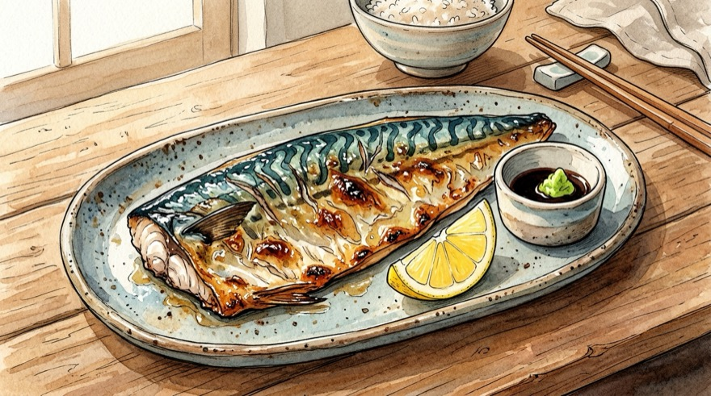
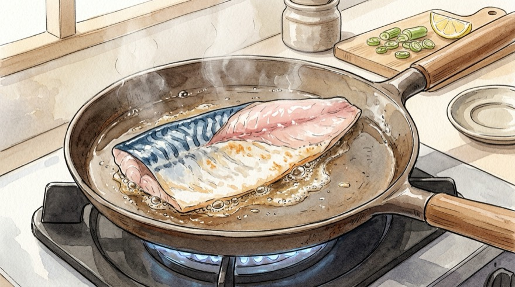

# 🐟 초간단 냉동 순살 고등어 필레 구이 레시피

냉동실에 쟁여둔 순살 고등어 필레로 겉바속촉 밥도둑을 만드는 초간단 레시피입니다.

---

## 📌 개요
가시가 발라져 있는 순살 필레를 번거로운 내장 손질 없이 해동·수분 제거만으로 바로 굽는 가장 현실적인 자취·가정식 레시피입니다.

* **핵심 포인트:** 키친타올로 겉수분 완벽 제거, 부침가루 얇게 입혀 기름 튐 방지, **껍질 3분 + 살 1분**으로 육즙 사수
* **조리 분량:** 1인분 기준
* **조리 시간:** 약 10분 (굽는 시간 총 4분)
* **난이도:** 매우 쉬움
* **코멘트:** 
* **분류:** 한식

---

## 🛒 재료 (1인분 기준)

> [!IMPORTANT]
> **🧂 소금 & 부침가루 계량 포인트 (`{{servings}}` · `{{fillet:main}}` 기준)**
> * **소금 간 기준:** 시판 **자반(간 고등어)** 제품은 이미 천일염 간이 되어 있으므로 **소금을 뿌리지 않습니다.** **무염·저염 필레**일 경우에만 **소금 `{{salt}}`**을 위에서 솔솔 뿌려 앞뒤로 가볍게 밑간해 주세요.
> * **부침가루 묻히는 정도:** 튀김처럼 두껍게 묻히면 가루가 뭉치고 쉽게 탑니다. **부침가루 `{{flour}}`**만 사용하여 **표면에 하얀 분이 살짝 내려앉은 정도로 아주 얇게 묻힌 뒤, 손바닥으로 톡톡 쳐서 여분의 가루를 털어내는 것**이 핵심입니다.

### 1. 주재료 및 밑간·코팅
| 변수 | 재료 | 수량 / 분량 (g·ml) | 손질 및 비고 |
| :--- | :--- | :--- | :--- |
| `fillet` | **냉동 순살 고등어 필레** | 1쪽 (약 130~150g) | 냉장해동 또는 찬물 10분 유수해동 후 물기 완벽 제거 |
| `salt` | **소금 (맛소금/꽃소금)** | 1~2꼬집 (약 1~1.5g) | **무염/저염 필레만 사용** *(자반 고등어는 생략)* |
| `flour` | **부침가루 (또는 전분/밀가루)** | 0.5~1큰술 (약 5~8g) | 살이 살짝 비칠 정도로 얇게 코팅 후 털어냄 |
| `oil` | **식용유** | 1~1.5큰술 (약 10~15ml) | 팬 바닥이 코팅될 정도로 두르기 |

### 2. 선택 양념 / 곁들임
| 변수 | 재료 | 수량 / 분량 (g·ml) | 비고 |
| :--- | :--- | :--- | :--- |
| `mirin` | **맛술 (또는 소주)** | 0.5~1큰술 (약 10~15ml) | 선택 (비린내 제거용 밑간) |
| `pepper` | **후춧가루** | 약간 (1~2번 톡톡) | 선택 |
| `dip_soy` | **진간장 (와사비 간장용)** | 1큰술 (약 15ml) | 선택 (생와사비·식초 `{{dip_vinegar}}` 섞어 찍먹) |
| `dip_vinegar` | **식초 (와사비 간장용)** | 0.5큰술 (약 7ml) | 선택 (기름진 맛 잡아주는 새콤함) |

### 🥣 미리 준비할 용기
| 용기 | 용도 및 준비 포인트 |
| :--- | :--- |
| **해동용 볼** | *(냉동 상태일 때)* 포장된 고등어 필레(`{{fillet:main}}`)를 찬물에 담가 유수해동할 볼 |
| **넓은 접시** | 수분 닦은 고등어에 밑간하고 부침가루(`{{flour}}`)를 얇게 묻힐 접시 |
| **코팅 프라이팬 (및 종이호일 선택)** | 고등어(`{{fillet:main}}`)를 껍질부터 바삭하게 구울 팬 |
| **소스 종지 (선택)** | 와사비 간장(`{{dip_soy}}` + 식초 `{{dip_vinegar}}`)을 곁들일 작은 그릇 |

---

## 🍳 조리 순서 (Instructions)

### Step 1. [재료 손질] 고등어 유수해동, 수분 완벽 제거 및 밑간
1. **해동하기:** **냉동 순살 고등어 필레(`{{fillet}}`)**는 진공 포장째 찬물이 담긴 볼에 **10분간 담가 유수해동**하거나 조리 전날 미리 냉장 해동합니다.
2. **⭐ 수분 완벽 닦기:** 팩을 뜯고 **키친타올로 고등어 앞뒤의 물기와 핏물을 꾹꾹 눌러 완전히 닦아냅니다.** *(수분이 없어야 기름이 안 튀고 비린내가 사라집니다.)*
3. **소금 밑간 (무염일 때만):** 무염·저염 필레라면 **소금 `{{salt}}`**과 **맛술 `{{mirin}}`**(선택)을 앞뒤로 가볍게 뿌려 **5분간** 재운 뒤 다시 한 번 물기를 톡톡 닦아줍니다. *(자반 고등어는 소금 생략!)*

### Step 2. 부침가루 얇게 옷 입히기
1. **얇게 묻히기:** 수분을 닦아낸 고등어(`{{fillet:main}}`) 앞뒤 표면에 **부침가루 `{{flour}}`**를 골고루 묻힙니다.
2. **여분 털어내기:** 가루가 뭉친 곳이 없도록 **손으로 살살 펴 바른 뒤 톡톡 털어내어** 생선 결이 비칠 정도의 얇은 코팅막만 남깁니다.

### Step 3. 프라이팬에 굽기 (껍질 3분 + 살 1분 = 총 4분 컷!)
1. **팬 예열:** 프라이팬을 중불로 달군 뒤 **식용유 `{{oil}}`**을 두릅니다.
2. **껍질(등) 쪽 먼저 3분:** 고등어(`{{fillet:main}}`)의 **껍질 쪽이 바닥을 향하도록 먼저 올리고**, 지글지글 소리가 나면 **중약불**로 줄여 **약 3분간** 건드리지 않고 굽습니다. *(이 3분 동안 껍질은 과자처럼 바삭해지고, 생선 두께의 70~80%까지 열기가 올라와 익습니다.)*
3. **뒤집어서 살 쪽 1분:** 가장자리가 노릇하게 익어 올라오면 뒤집어서 **살 쪽은 딱 1분 정도만** 가볍게 구워 마무리합니다. *(순살 필레는 두께가 얇아 살 쪽을 1분만 구워도 속까지 다 익으며, 오래 구우면 수분이 빠져 퍽퍽해집니다.)*

---

## 🔄 베리에이션

### [모드] ♨️ 에어프라이어 고등어 구이 (연기·기름 튐 걱정 제로!)
바쁜 아침이나 환기가 어려울 때 뒤집기 한 번으로 겉바속촉하게 완성하는 에어프라이어 모드입니다.

| 변수 | 재료 | 수량 / 분량 (1인분 기준) | 비고 |
| :--- | :--- | :--- | :--- |
| `af_fillet` | **냉동 순살 고등어 필레** | 1쪽 (약 130~150g) | 해동 후 키친타올로 수분 제거 |
| `af_salt` | **소금 (무염 필레일 때만)** | 1~2꼬집 (약 1~1.5g) | 자반 고등어는 생략 |
| `af_oil` | **식용유** | 0.7큰술 (약 10ml) | 양면에 얇게 발라 바삭함 유지 |

#### 🥣 미리 준비할 용기
| 용기 | 용도 및 준비 포인트 |
| :--- | :--- |
| **해동용 볼** | 냉동 필레(`{{af_fillet:main}}`) 찬물 10분 유수해동용 |
| **에어프라이어 바스켓 & 종이호일** | 고등어 기름 받침 및 들러붙음 방지용 |

#### Step 1. [재료 손질] 고등어 해동, 수분 제거 및 오일 코팅
1. **고등어 필레(`{{af_fillet}}`)**를 찬물에 **10분간** 유수해동한 뒤 키친타올로 물기를 꼼꼼히 닦아냅니다. *(무염 필레는 소금 `{{af_salt}}` 밑간)*
2. 고등어 양면에 **식용유 `{{af_oil}}`**을 살짝 발라 코팅합니다.

#### Step 2. 에어프라이어 180°C 굽기 (7~8분 + 2분)
1. 에어프라이어 바스켓에 종이호일을 깔고 고등어(`{{af_fillet:main}}`)의 **껍질이 위를 향하게** 놓은 뒤 **180°C에서 7~8분** 조리합니다.
2. 뒤집어서 살 쪽을 **180°C에서 2분**만 더 구워주면 육즙 가득 촉촉하게 완성됩니다!

---

## 💡 맛있는 팁
* **와사비 간장 소스:** **진간장 `{{dip_soy}}` + 식초 `{{dip_vinegar}}`** + 생와사비 살짝 섞어 찍어 먹으면 고등어의 기름진 맛을 상큼하게 잡아주어 밥도둑이 따로 없습니다.
* **기름 튐 방지:** 부침가루를 얇게 털어 묻히거나 팬 위에 종이호일을 한 장 깔고 구우면 기름 튐과 연기 없이 깔끔하게 구울 수 있습니다.
