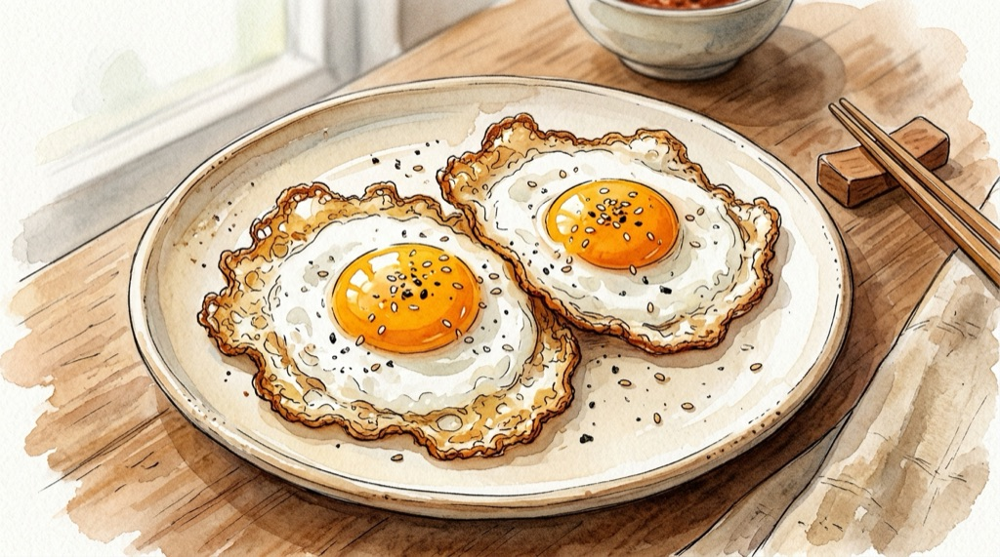
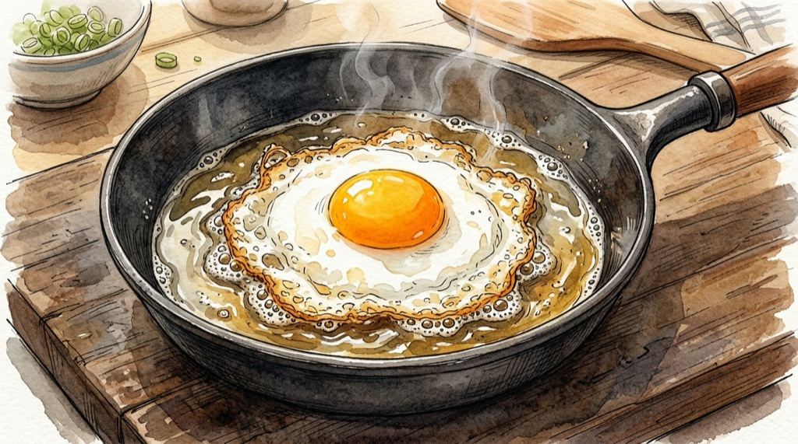

# 🍳 실패 없는 황금 계란 프라이 레시피

흰자 테두리는 튀기듯 바삭하고 노른자는 주르륵 흐르는 **겉바속촉 반숙(써니사이드업)**부터, 기름이 튀지 않는 **촉촉 물 반숙(스팀 에그)**, 노른자까지 고소하게 익힌 **양면 완숙**까지 취향별 3가지 모드를 원터치 타이머로 완성하는 기본기 레시피입니다.

---

## 📌 개요
계란 프라이는 **팬 예열 온도**와 **기름의 양**, 그리고 **딱 1분 30초의 타이밍**만 맞추면 비린내 없이 식당처럼 완벽하게 구워집니다. 달걀을 팬에 직접 깨지 않고 작은 그릇에 먼저 깨서 담으면 껍질이 들어갈 일이 없고 노른자가 터지지 않습니다!

* **핵심 포인트:** 작은 그릇에 달걀 먼저 깨두기, 겉바속촉은 기름 넉넉히 두르고 중강불 1분 30초 / 촉촉 반숙은 물 1큰술 + 뚜껑 덮고 1분 스팀
* **조리 분량:** 1인분 기준 (달걀 2개)
* **조리 시간:** 약 3분
* **난이도:** 매우 쉬움
* **코멘트:** 
* **분류:** 한식

---

## 🛒 재료 (1인분 · 겉바속촉 반숙 2개 기준)

> [!NOTE]
> **모드 안내:** 기본 모드는 비빔밥·김치볶음밥·간장계란밥 위에 올리기 가장 좋은 **겉바속촉 반숙(써니사이드업)** 기준입니다. 기름기 없이 깔끔한 **물 반숙(스팀)**이나 **양면 완숙**은 상단 조리 모드 탭에서 선택하세요!

### 1. 주재료 및 밑간
| 변수 | 재료 | 수량 / 분량 (g·ml) | 손질 및 비고 |
| :--- | :--- | :--- | :--- |
| `egg` | **달걀** | 2개 (약 110-120g) | 냉장고에서 미리 꺼내두거나 작은 볼에 먼저 깨두기 |
| `oil` | **식용유** | 1큰술 (약 15ml) | 흰자 테두리를 바삭하게 튀기듯 구울 넉넉한 분량 |
| `salt` | **가는 소금 (또는 맛소금)** | 1-2꼬집 (약 0.5g) | **노른자 피해서 흰자 위에만** 솔솔 뿌리기 |
| `pepper` | **후춧가루** | 약간 | 마무리 풍미용 (선택) |

### 🥣 미리 준비할 용기
| 용기 | 용도 및 준비 포인트 |
| :--- | :--- |
| **작은 그릇 / 볼** | 달걀(`{{egg}}`)을 팬에 넣기 전 껍질 확인 및 노른자 보호를 위해 먼저 깨서 담아둘 그릇 |
| **코팅 프라이팬 & 뒤집개** | 달걀이 들러붙지 않도록 코팅이 잘 된 프라이팬 |

---

## 🍳 조리 순서 (Instructions)

### Step 1. [재료 손질] 작은 그릇에 달걀 먼저 깨두기
1. **달걀 미리 깨두기:** 달군 팬 위에서 바로 달걀을 깨면 노른자가 깨지거나 껍질이 들어갈 수 있으므로, 준비한 작은 그릇에 **달걀 `{{egg}}`**을 먼저 조심스럽게 깨서 담아둡니다. *(찬 기운이 살짝 가시면 흰자가 팬에서 사방으로 퍼지지 않고 도톰하게 모입니다.)*

### Step 2. 팬 예열 및 달걀 붓고 흰자에만 밑간하기
1. 코팅 프라이팬에 **식용유 `{{oil}}`**를 두르고 **중강불**에서 **약 30초간** 기름이 물처럼 매끄럽게 흐를 때까지 충분히 예열합니다.
2. 그릇에 담아둔 **달걀(`{{egg}}`)**을 팬에 낮게 미끄러지듯 붓고, **소금 `{{salt}}`**을 **흰자 부분에만** 골고루 뿌려줍니다. *(노른자 위에 소금을 뿌리면 노른자 표면에 하얀 반점이 생겨 덜 예뻐집니다!)*

### Step 3. 뒤집지 않고 1분 30초 구워 겉바속촉 반숙 완성
1. 달걀을 **절대 뒤집지 말고** 중강불을 유지한 채 **약 1분 30초간** 그대로 구워줍니다.
2. 흰자 가장자리가 갈색빛으로 바삭하게 레이스처럼 튀겨지고, 안쪽 흰자는 불투명하게 다 익으면서 노른자는 말랑하게 살아있을 때 불을 끄고 **후춧가루(`{{pepper}}`)**를 살짝 뿌려 `{{servings}}` 계란 프라이를 담아냅니다!

---

## 🔄 베리에이션

### [모드] 💧 기름 안 튀는 촉촉 물 반숙 프라이 (호텔 브런치 스팀 에그)
기름을 적게 쓰고 **물 1큰술과 팬 뚜껑의 수증기**로 쪄내듯 익히는 방식입니다. 기름이 사방으로 튀지 않고, 뒤집지 않아도 노른자 윗면에 얇은 핑크빛 막이 씌워져 브런치 카페처럼 깔끔하고 부드러운 반숙이 됩니다!

| 변수 | 재료 | 수량 / 분량 (1인분 기준) | 비고 |
| :--- | :--- | :--- | :--- |
| `s_egg` | **달걀** | 2개 (약 110-120g) | 작은 그릇에 먼저 깨두기 |
| `s_oil` | **식용유 (또는 버터)** | 0.5큰술 (약 7ml) | 바닥 코팅용 소량만 사용 |
| `s_water` | **물 (스팀용)** | 1큰술 (약 15ml) | 팬 가장자리에 부어 수증기 발생 |
| `s_salt` | **소금·후추** | 1-2꼬집 | 밑간용 |

#### 🥣 미리 준비할 용기
| 용기 | 용도 및 준비 포인트 |
| :--- | :--- |
| **작은 그릇 & 물 1큰술 담을 종지** | 달걀(`{{s_egg}}`)과 스팀용 물(`{{s_water}}`)을 미리 준비할 그릇 |
| **코팅 프라이팬 & 팬 뚜껑 (필수!)** | 수증기를 가두어 노른자 윗면을 익혀줄 뚜껑 |

#### Step 1. [재료 손질] 작은 그릇에 달걀 깨두기 및 스팀용 물 준비
1. 작은 그릇에 **달걀 `{{s_egg}}`**을 노른자가 터지지 않게 깨서 담아두고, 바로 옆에 스팀용 **물 `{{s_water}}`**과 팬 뚜껑을 준비해 둡니다.

#### Step 2. 중불에서 흰자 바닥면 익히기 (30초)
1. 팬에 **식용유 `{{s_oil}}`**를 얇게 두르고 **중불**로 달군 뒤 달걀(`{{s_egg}}`)을 붓고 소금(`{{s_salt}}`)을 살짝 뿌립니다.
2. 흰자 바닥면이 하얗게 자리 잡을 때까지 **약 30초간** 구워줍니다.

#### Step 3. 물 붓고 뚜껑 덮어 1분간 스팀으로 익히기
1. 불을 **중약불**로 줄이고 달걀 위가 아닌 **빈 팬 가장자리**에 **물 `{{s_water}}`**을 부은 뒤 **즉시 뚜껑을 덮습니다.**
2. 뚜껑을 덮은 채 **약 1분간** 수증기로 익혀 노른자 윗면에 뽀얀 반투명 막이 생기면 불을 끄고 부드럽게 덜어냅니다!

### [모드] 🥞 노른자까지 고소한 양면 완숙(오버하드) 프라이
흐르는 노른자를 좋아하지 않거나 샌드위치·김밥·도시락 반찬에 넣을 때 추천하는 **양면 구이(오버미디엄-오버하드)** 모드입니다.

| 변수 | 재료 | 수량 / 분량 (1인분 기준) | 비고 |
| :--- | :--- | :--- | :--- |
| `w_egg` | **달걀** | 2개 (약 110-120g) | |
| `w_oil` | **식용유** | 0.8큰술 (약 12ml) | |
| `w_salt` | **가는 소금·후추** | 1-2꼬집 | |

#### 🥣 미리 준비할 용기
| 용기 | 용도 및 준비 포인트 |
| :--- | :--- |
| **작은 그릇** | 달걀(`{{w_egg}}`)을 먼저 깨둘 그릇 |
| **코팅 프라이팬 & 넓은 뒤집개** | 달걀을 안정적으로 뒤집을 넓은 뒤집개 |

#### Step 1. [재료 손질] 작은 그릇에 달걀 먼저 깨두기
1. 작은 그릇에 **달걀 `{{w_egg}}`**을 먼저 깨서 담아둡니다.

#### Step 2. 중약불에서 앞면 노릇하게 굽기 (1분 30초)
1. 팬에 **식용유 `{{w_oil}}`**를 두르고 **중약불**에서 달걀(`{{w_egg}}`)을 부은 뒤 소금(`{{w_salt}}`)을 뿌립니다. *(완숙은 센 불에서 구우면 노른자가 익기 전에 바닥만 타므로 중약불이 핵심입니다!)*
2. 흰자가 80% 이상 단단하게 익을 때까지 **약 1분 30초간** 구워줍니다. *(노른자까지 납작하게 익히고 싶다면 뒤집개 끝으로 노른자를 살짝 톡 터뜨려 주세요.)*

#### Step 3. 뒤집어서 뒷면 40초-1분 더 익히기
1. 뒤집개를 흰자 밑으로 깊숙이 넣어 한 번에 가볍게 뒤집습니다.
2.- **촉촉한 완숙(오버미디엄):** 뒤집은 뒤 **약 30-40초간**만 익혀 노른자 중심이 젤리처럼 촉촉할 때 꺼냅니다.
  - **완전 완숙(오버하드):** 뒤집은 뒤 **약 1분간** 구워 노른자 속까지 포슬포슬하고 고소하게 다 익혀 꺼냅니다.

### [옵션] 🌿 파기름(또는 들기름) 풍미 추가 (한식 덮밥·비빔밥 특화)
식용유에 송송 썬 대파나 들기름을 살짝 더해 구우면 계란 비린내가 100% 사라지고 한식 비빔밥·볶음밥과 찰떡궁합인 고소한 풍미가 살아납니다.

| 변수 | 재료 | 수량 / 분량 (g·ml) | 비고 |
| :--- | :--- | :--- | :--- |
| `green_onion` | **대파 (또는 쪽파)** | 1큰술 분량 (약 10g) | 잘게 송송 썰기 |
| `perilla_oil` | **들기름 (또는 참기름)** | 0.5큰술 (약 5g) | 식용유와 함께 섞어 사용 (단독 사용 시 쉽게 탐) |

#### [Step 1에 추가] 대파 잘게 송송 썰어두기
1. **대파(`{{green_onion}}`)**를 잘게 송송 썰어 준비합니다.

#### [Step 2에 추가] 식용유에 들기름·대파를 먼저 넣고 달걀 붓기
1. 팬에 식용유를 두를 때 **들기름 `{{perilla_oil}}`**과 송송 썬 **대파(`{{green_onion:main}}`)**를 함께 넣고 **20초간** 먼저 향을 낸 뒤, 그 파기름 위에 달걀을 부어 구워주면 향긋한 파기름 계란 프라이가 됩니다!

---

## 💡 실패 없는 계란 프라이 팁 (Tips)
* **흰자가 볼록하고 예쁘게 모이게 하려면:** 신선한 달걀일수록 수분이 적고 탄력이 좋아 팬에 부었을 때 퍼지지 않고 동그랗게 모입니다.
* **스테인리스 팬에 구울 때 안 붙는 법:** 스텐 팬은 기름을 두르기 전에 빈 팬을 먼저 충분히 달군 뒤(물방울을 떨어뜨렸을 때 구슬처럼 굴러다니는 상태), 기름을 두르고 10초 뒤 달걀을 넣으면 코팅 팬처럼 매끄럽게 떨어집니다!
