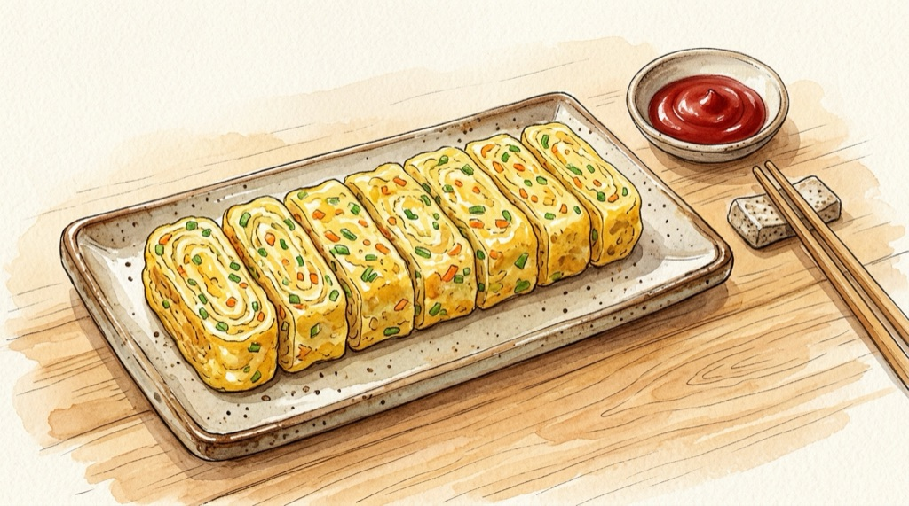
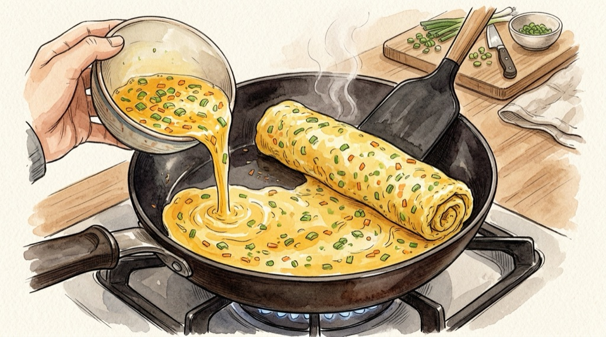

# 🍱 도톰하고 촉촉한 분식집·백반집 계란말이 레시피

식어도 퍽퍽하거나 찢어지지 않고 폭신폭신한 **정통 한식 야채 계란말이** 레시피입니다. 달걀물에 **맛술과 물(또는 우유) 1큰술**을 더하는 비법으로 일반 둥근 프라이팬에서도 찢어짐 없이 도톰하고 예쁜 사각 계란말이를 완성할 수 있습니다!

---

## 📌 개요
계란말이가 팬에서 찢어지거나 속이 비는 이유는 **1) 채소를 너무 크게 썰었거나, 2) 수분 없이 달걀만 풀었거나, 3) 센 불에서 너무 바싹 익힌 뒤 말았기 때문**입니다. 채소는 좁쌀만큼 곱게 다지고, **약불에서 윗면이 아직 촉촉한 반숙(70% 익음) 상태일 때** 말기 시작하면 접착제처럼 층층이 착 달라붙습니다!

* **핵심 포인트:** 달걀물에 맛술+물 넣어 촉촉함과 탄력 높이기, 채소는 아주 곱게 다지기, 약불에서 3번에 나누어 붓고 윗면이 촉촉할 때 돌돌 말기
* **조리 분량:** 2인분 기준 (달걀 4개 · 도톰한 1줄)
* **조리 시간:** 약 10분
* **난이도:** 보통
* **코멘트:** 
* **분류:** 한식

---

## 🛒 재료 (2인분 · 도톰한 계란말이 1줄 기준)

> [!NOTE]
> **달걀 개수 팁:** 지름 20-24cm 일반 프라이팬이나 사각 계란말이 팬에서 도톰한 두께를 만들려면 **최소 달걀 3-4개**가 가장 말기 쉽고 모양이 예쁘게 나옵니다.

### 1. 달걀물 및 채소 재료
| 변수 | 재료 | 수량 / 분량 (g·ml) | 손질 및 비고 |
| :--- | :--- | :--- | :--- |
| `egg` | **달걀** | 4개 (약 220-240g) | 알끈이 풀리도록 젓가락으로 충분히 저어주기 |
| `mirin` | **맛술 (미림)** | 1큰술 (약 15ml) | 비린내 제거 및 은은한 감칠맛·윤기 |
| `water` | **물 (또는 우유)** | 1큰술 (약 15ml) | ⭐ 식어도 퍽퍽하지 않고 찢어지지 않게 하는 핵심 수분! |
| `salt` | **가는 소금 (또는 맛소금)** | 0.3작은술 (약 1.5-2g) | 달걀 1개당 한 꼬집 기준 |
| `scallion` | **대파 (또는 쪽파)** | 1/4대 (약 12g) | **좁쌀 크기로 아주 곱게** 다지기 *(크면 말 때 찢어짐)* |
| `carrot` | **당근 (선택)** | 1/6개 (약 15g) | **아주 곱게** 다지기 (색감 포인트 · 생략 가능) |
| `oil` | **식용유** | 1큰술 (약 15ml) | 키친타올로 팬 바닥에 얇게 코팅하며 사용 |

### 📌 조리 내 계량 변수
| 변수 | 항목 | 기준 분량 | 역할 |
| :--- | :--- | :--- | :--- |
| `ketchup_serve` | 곁들임 케첩 | 1.5-2큰술 (약 25-30g) | mild_seasoning |

### 🥣 미리 준비할 용기
| 용기 | 용도 및 준비 포인트 |
| :--- | :--- |
| **주둥이가 있거나 따르기 편한 믹싱볼** | 달걀물(`{{egg}}` + `{{mirin}}` + `{{water}}`)과 다진 채소를 섞어 팬에 3번에 나누어 부을 그릇 |
| **접은 키친타올 & 작은 종지 (기름 코팅용)** | 식용유(`{{oil}}`)를 묻혀 팬에 기름이 고이지 않게 얇게 닦아내며 코팅할 도구 |
| **코팅 프라이팬 (또는 사각 에그팬) & 뒤집개 2개** | 뒤집개와 젓가락(또는 뒤집개 2개)을 양손에 들면 초보자도 쉽게 말 수 있습니다 |

---

## 🍳 조리 순서 (Instructions)

### Step 1. [재료 손질] 촉촉한 달걀물 먼저 배합 및 대파·당근 곱게 다지기
1. **달걀물 먼저 풀기:** 준비한 볼에 **달걀 `{{egg}}`**을 깨 넣고 **소금 `{{salt}}`**, **맛술 `{{mirin}}`**, **물(또는 우유) `{{water}}`**을 가장 먼저 넣은 뒤, 젓가락을 좌우로 빠르게 움직여 흰자 뭉침이 없고 소금이 완전히 녹도록 **1분간** 충분히 풀어줍니다. *(거품이 너무 많이 나지 않게 젓가락 끝을 볼 바닥에 붙여서 저어주세요.)*
2. **채소 곱게 다지기:** **대파(`{{scallion}}`)**와 **당근(`{{carrot}}`)**은 계란을 말 때 옆구리가 터지지 않도록 **2-3mm 이하의 좁쌀 크기로 아주 곱게** 다져서 풀어둔 달걀물에 넣고 고루 섞습니다.
3. **기름 키친타올 준비:** 작은 종지에 **식용유 `{{oil}}`**을 부어두고 키친타올을 도톰하게 접어 기름을 적셔둡니다.

### Step 2. 약불 팬 코팅 후 첫 번째 달걀물(1/3) 붓고 기본 심지 말기
1. 프라이팬을 **중약불**로 달군 뒤, 기름 적신 키친타올로 팬 바닥 전체를 얇게 닦아 코팅합니다. *(팬에 기름이 흥건하게 고여 있으면 계란 표면에 기포 구멍이 숭숭 뚫립니다!)*
2. 불을 **약불**로 줄이고 준비한 달걀물의 **1/3 분량**만 팬에 부어 얇고 넓게 펴줍니다.
3. 바닥은 익고 **윗면이 아직 축축한 반숙 상태(약 70% 익음, 40-50초 후)**일 때, 끝에서부터 뒤집개와 젓가락으로 3-4cm 폭으로 접어가며 돌돌 말아 팬 한쪽 끝(앞쪽)으로 밀어둡니다. *(첫 심지는 조금 찢어져도 다음 층이 감싸주므로 걱정하지 마세요!)*

### Step 3. 남은 달걀물 2번에 나누어 이어 붓고 도톰하게 말기
1. 빈 팬 바닥을 기름 묻힌 키친타올로 다시 한 번 가볍게 닦아준 뒤, 남은 달걀물의 절반(전체 **1/3 분량**)을 부어 **말아둔 계란 밑바닥을 살짝 들어 달걀물이 아래로 스며들게 연결**합니다.
2. 역시 윗면이 촉촉한 반숙 상태일 때 앞서 말아둔 계란을 굴려 덮어가며 말아주고, 다시 팬 끝으로 밀어 마지막 남은 **1/3 달걀물**도 똑같이 이어 부어 도톰하게 말아줍니다.

### Step 4. 네 면 모양 잡으며 익히고 한 김 식혀 썰기 (핵심!)
1. 다 말아진 계란말이를 팬의 경사진 모서리 쪽으로 밀어 뒤집개로 위와 옆면을 가볍게 토닥토닥 눌러가며 **약불에서 각 면을 20-30초씩 총 1분간** 구워 각진 사각 모양을 잡고 속까지 익힙니다.
2. **식혀서 썰기:** 팬에서 꺼낸 직후 바로 칼로 썰면 속이 뜨거워 모양이 흐트러지므로, 도마 위에서 **약 2-3분간 한 김 식혀 조직이 단단해진 뒤** 1.5-2cm 두께로 썰어(기호에 따라 케첩 `{{ketchup_serve}}` 곁들임) `{{servings}}` 계란말이를 완성합니다!

---

## 🔄 베리에이션

### [모드] 🧀 김·치즈 품은 단면 예쁜 계란말이 (인기 도시락·안주)
다진 채소 대신 계란말이 한가운데에 **구운 김과 슬라이스 체다(또는 모짜렐라) 치즈**를 깔고 말아내어, 썰었을 때 검은색 김과 노란 치즈 소용돌이 단면이 예쁘게 나오는 베리에이션입니다!

| 변수 | 재료 | 수량 / 분량 (2인분 기준) | 비고 |
| :--- | :--- | :--- | :--- |
| `c_egg` | **달걀** | 4개 (약 220-240g) | 체에 한 번 거르면 카스테라처럼 곱게 말림! |
| `c_cheese` | **슬라이스 치즈 (또는 모짜렐라)** | 2장 (약 36g) | 첫 번째 층 위에 나란히 올리기 |
| `c_gim` | **김밥용 김 (또는 조미김)** | 1장 | 팬 너비에 맞게 반으로 자르기 (생략 가능) |
| `c_mirin` | **맛술** | 1큰술 (약 15ml) | |
| `c_water` | **물 (또는 우유)** | 1큰술 (약 15ml) | |
| `c_salt` | **가는 소금** | 1-2꼬집 (약 0.7g) | ⚠️ 치즈와 조미김에 짠맛이 있으므로 소금은 절반으로 감량! |
| `c_oil` | **식용유** | 1큰술 (약 15ml) | 키친타올 코팅용 |

#### 🥣 미리 준비할 용기
| 용기 | 용도 및 준비 포인트 |
| :--- | :--- |
| **믹싱볼 & 고운 체 (선택)** | 달걀물(`{{c_egg}}`)을 풀어 체에 한 번 내려 알끈을 제거하면 단면이 호텔식으로 매끈해집니다 |
| **기름 적신 키친타올 & 코팅 팬** | 팬 코팅 및 조리용 |

#### Step 1. [재료 손질] 저염 달걀물 먼저 풀기 및 김·치즈 준비
1. 볼에 **달걀 `{{c_egg}}`, 맛술 `{{c_mirin}}`, 물(또는 우유) `{{c_water}}`, 소금 `{{c_salt}}`**을 먼저 넣고 곱게 풀어줍니다. *(고운 체에 한 번 걸러내면 흰자 얼룩 없이 샛노란 계란말이가 됩니다.)*
2. **김(`{{c_gim}}`)**은 팬 크기에 맞게 손질하고 **슬라이스 치즈(`{{c_cheese}}`)**는 비닐을 벗겨 바로 올릴 수 있게 준비해 둡니다.

#### Step 2. 첫 번째 달걀물 위에 김과 치즈 올리고 말기
1. 약불로 예열하고 기름 코팅한 팬에 달걀물의 **1/3 분량**을 얇게 펴서 붓습니다.
2. 달걀이 반쯤 익으면 그 위에 준비한 **김(`{{c_gim}}`)**과 **슬라이스 치즈 `{{c_cheese}}`**를 나란히 올리고, 치즈가 사르르 녹기 시작할 때 끝에서부터 돌돌 말아줍니다.

#### Step 3. 남은 달걀물 2번 이어 부어 감싸고 식혀 썰기
1. 남은 달걀물을 2번에 나누어 이어 부으면서 치즈가 밖으로 새어 나오지 않도록 도톰하게 감싸 말아줍니다.
2. 도마에서 **2-3분간** 한 김 식힌 뒤 칼에 물을 살짝 묻혀 썰어내면 치즈와 김이 소용돌이 모양으로 박힌 계란말이가 완성됩니다!

### [옵션] 🥫 스팸(또는 참치·명란) 감칠맛 속재료 추가
계란말이 하나로 밥 한 공기를 뚝딱 비우게 해주는 짭조름한 감칠맛 토핑 옵션입니다.

| 변수 | 재료 | 수량 / 분량 (g) | 비고 |
| :--- | :--- | :--- | :--- |
| `spam_fill` | **스팸 (또는 기름 뺀 참치/명란)** | 50g (약 1/4캔) | 스팸은 아주 곱게 다지거나 길쭉한 스틱 모양으로 썰기 |

#### [Step 1에 추가] 스팸 곱게 다지거나 스틱으로 썰기 & 소금 줄이기
1. **스팸(`{{spam_fill}}`)**을 달걀물에 섞으려면 좁쌀 크기로 곱게 다져 달걀물에 함께 넣고, 가운데 심지로 넣으려면 손가락 굵기로 길쭉하게 썰어 준비합니다. *(스팸이 짭조름하므로 기본 소금 양을 절반으로 줄여주세요!)*

#### [Step 2에 추가] 첫 번째 달걀물 말 때 스팸 심지 넣기
1. 스틱 모양으로 썬 스팸(또는 명란)을 사용할 경우, 첫 번째 달걀물(1/3)을 부은 뒤 시작 부분에 **스팸(`{{spam_fill:main}}`)**을 가로로 올려 중심 심지로 삼아 돌돌 말아줍니다.

---

## 💡 찢어지지 않는 계란말이 비법 팁 (Tips)
* **원형 프라이팬에서 사각 모양 만드는 법:** 첫 번째와 두 번째 층을 부었을 때 팬의 둥근 양옆 날개 부분을 안쪽으로 2cm씩 먼저 접어 직사각형 길이를 맞춘 뒤 돌돌 말아주면, 사각 에그팬 없이도 반듯한 사각형 계란말이가 나옵니다!
* **혹시 말다가 옆구리가 찢어졌다면:** 당황하지 말고 마지막 달걀물을 얇게 부어 찢어진 계란말이를 감싼 뒤, **김발이나 종이호일(또는 랩)**로 감싸 사탕처럼 양끝을 조여 3분간 두면 달걀의 잔열과 단백질 응고력으로 감쪽같이 하나로 붙습니다!
