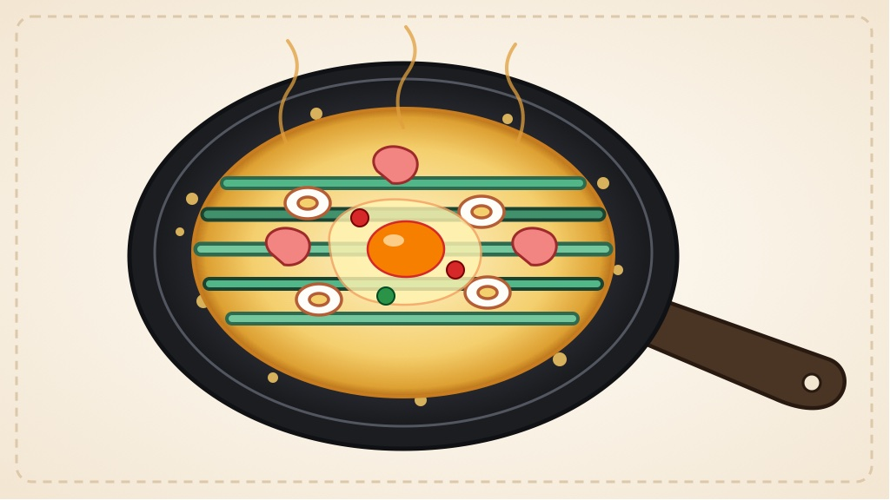

# 🥞 겉바속촉 주막 스타일 바삭한 해물파전 레시피

밀가루 떡처럼 두껍고 눅눅한 전이 아니라, **파의 향긋한 단맛과 탱글한 해물 위로 달걀을 톡 깨서 올려 튀기듯 바삭하게 부쳐내는 정통 해물파전** 레시피입니다. 집에 해물이나 쪽파가 없을 때 **일반 대파와 스팸·베이컨·참치·어묵으로 10분 만에 부쳐 먹는 초간단 베리에이션 모드 3종**까지 모두 담았습니다!

---

## 📌 개요
파전이 눅눅해지는 가장 큰 이유는 **반죽물에 파를 다 넣고 휘저어 반죽이 두꺼워지기 때문**입니다. 반죽물은 **차가운 얼음물**로 묽게 만들어 **파와 파 사이를 이어주는 접착제 역할**로만 얇게 붓고, 해물은 마른 부침가루로 가볍게 코팅해 올려야 뒤집을 때 해물이 후두둑 떨어지지 않고 끝까지 바삭합니다!

* **핵심 포인트:** 조리 전 초간장과 차가운 얼음물 반죽 먼저 만들어 두기, 해물에 마른 가루 1큰술 코팅해 탈락 방지, 파를 먼저 깔고 반죽물은 사이사이에만 얇게 붓기
* **조리 분량:** 2인분 기준 (큼직한 파전 1장 · 지름 24-26cm 팬)
* **조리 시간:** 약 15분
* **난이도:** 쉬움
* **코멘트:** 
* **분류:** 한식

---

## 🛒 재료 (2인분 · 해물파전 1장 기본 기준)

> [!NOTE]
> **해물이나 쪽파가 없다면?**
> - **쪽파 대신 일반 대파 1.5-2대**를 반 갈라 길쭉하게(또는 어슷하게) 썰어 쓰셔도 똑같이 맛있습니다!
> - 해물 대신 집에 있는 재료로 바로 만드시려면 상단 조리 모드 탭에서 **`🥓 스팸·베이컨(삼겹) 파전`**, **`🐟 참치·어묵 파전`**, **`🌿 초간단 옛날 대파전`** 모드를 선택하세요!

### 1. 주재료 (파·해물·달걀)
| 변수 | 재료 | 수량 / 분량 (g·ml) | 손질 및 비고 |
| :--- | :--- | :--- | :--- |
| `scallion` | **쪽파 (또는 일반 대파)** | 1줌 (쪽파 10-12줄기 · 대파는 1.5대, 약 120g) | 팬 지름보다 살짝 짧게(15-18cm) 썰기 |
| `seafood` | **오징어·새우 (또는 냉동 해물믹스)** | 1컵 (약 150g) | 물기 완벽 제거 후 한 입 크기로 썰기 |
| `egg` | **달걀 (위에 올릴 토핑용)** | 1개 | 반죽에 섞지 않고 **파전 윗면에 톡 깨서 펴 바르기** |
| `coat_flour` | **부침가루 (파·해물 마른 코팅용)** | 1.5큰술 (약 15g) | 파와 해물에 먼저 묻혀 반죽이 착 달라붙게 함 *(핵심!)* |
| `oil` | **식용유** | 3-4큰술 (약 45-60ml) | 처음 2.5큰술 + 뒤집은 뒤 가장자리에 1큰술 보충 |

### 2. 바삭한 얼음물 반죽 재료
| 변수 | 재료 | 수량 / 분량 (g·ml) | 비고 |
| :--- | :--- | :--- | :--- |
| `pancake_flour` | **부침가루** | 1/2컵 (약 50g, 5큰술) | 기본 간이 되어 있는 가루 |
| `fry_flour` | **튀김가루 (또는 감자전분)** | 2큰술 (약 20g) | ⭐ 부침가루에 튀김가루(전분)를 섞어야 식어도 바삭함! *(없으면 부침가루로 대체)* |
| `ice_water` | **차가운 얼음물 (또는 냉수)** | 1/2컵 + 1큰술 (약 100-110ml) | 반죽이 주르륵 흐를 정도의 묽은 농도 |

### 3. 미리 섞어둘 파전 초간장
| 변수 | 재료 | 수량 / 분량 (g·ml) | 비고 |
| :--- | :--- | :--- | :--- |
| `dip_soy` | **진간장** | 1.5큰술 (약 22ml) | 찍어 먹는 초간장 베이스 |
| `dip_vinegar` | **식초** | 0.8큰술 (약 12ml) | 기름진 맛을 잡아주는 새콤함 |
| `dip_water` | **물** | 0.5큰술 (약 7ml) | 짠맛을 부드럽게 중화 |
| `dip_sugar` | **설탕 (또는 매실청/올리고당)** | 0.3큰술 (약 3g) | 신맛과 짠맛의 밸런스 |
| `dip_chili` | **고춧가루·통깨** | 약간 | 칼칼함과 고소한 토핑 |

### 🥣 미리 준비할 용기
| 용기 | 용도 및 준비 포인트 |
| :--- | :--- |
| **작은 종지 (초간장 배합용)** | 조리 시작 전 **파전 초간장**을 가장 먼저 섞어 설탕을 녹여둘 그릇 |
| **믹싱볼 (얼음물 반죽용)** | 차가운 반죽물을 풀어 글루텐이 생기지 않게 잠시 냉장고에 넣어둘 볼 |
| **지름 24-26cm 코팅 프라이팬 & 넓은 뒤집개** | 파전을 바삭하게 굽고 한 번에 뒤집을 팬과 뒤집개 (어려우면 큰 접시 활용) |

---

## 🍳 조리 순서 (Instructions)

### Step 1. [재료 손질] 초간장·얼음물 반죽 먼저 섞어두기 및 파·해물 코팅
1. **초간장 먼저 섞기:** 준비한 작은 종지에 **진간장 `{{dip_soy}}`, 식초 `{{dip_vinegar}}`, 물 `{{dip_water}}`, 설탕 `{{dip_sugar}}`, 고춧가루·통깨 `{{dip_chili}}`**를 가장 먼저 넣고 설탕이 녹도록 섞어둡니다.
2. **얼음물 반죽 배합:** 믹싱볼에 **부침가루 `{{pancake_flour}}`, 튀김가루 `{{fry_flour}}`, 차가운 얼음물 `{{ice_water}}`**을 넣고 거품기나 젓가락으로 대충만 가볍게 섞어둡니다. *(⚠️ 너무 오래 저으면 글루텐이 생겨 떡처럼 질겨집니다! 날가루가 살짝 보여도 괜찮으며, 파·해물을 손질하는 동안 냉장고에 넣어 차갑게 유지하세요.)*
3. **파·해물 손질 및 마른 가루 코팅:** **쪽파(또는 길게 썬 대파) `{{scallion}}`**는 물기를 털어 팬 길이에 맞게 썰고, **해물(`{{seafood}}`)**은 한 입 크기로 썰어 **키친타올로 물기를 완벽히 닦아냅니다.** 손질한 파와 해물에 **마른 부침가루 `{{coat_flour}}`**를 솔솔 뿌려 가볍게 묻혀둡니다. *(이렇게 마른 가루 옷을 먼저 입혀야 반죽과 해물이 분리되지 않습니다!)*

### Step 2. 중불 팬에 기름 넉넉히 두르고 파와 반죽물 얇게 깔기
1. 프라이팬에 **식용유(`{{oil}}`)의 2/3 분량(약 2.5큰술)**을 두르고 **중불**로 충분히 달굽니다. *(전은 '지진다'가 아니라 '기름에 튀기듯 굽는다'고 생각해야 바삭합니다!)*
2. 마른 가루를 묻힌 **쪽파(`{{scallion}}`)**를 차가운 반죽물 볼에 한 번 푹 적셔 건진 뒤 팬 바닥에 빈틈없이 나란히 펼쳐 깔아줍니다.
3. 파와 파 사이의 빈 공간에만 볼에 남은 **반죽물을 국자로 조금씩 흘려 부어** 파들이 서로 이어지도록 얇게 채워줍니다.

### Step 3. 해물 올리고 달걀 1개 톡 깨서 펴 바른 뒤 바닥 바삭하게 굽기 (3-4분)
1. 반죽이 굳기 전에 그 위에 가루 코팅한 **해물(`{{seafood}}`)**을 골고루 올리고 뒤집개로 살짝 눌러 반죽에 밀착시킵니다.
2. 해물 위로 **달걀 `{{egg}}`**을 톡 깨서 올린 뒤, 젓가락이나 뒤집개 끝으로 노른자를 터뜨려 파전 윗면 전체에 얇게 펴 발라줍니다. *(달걀이 해물을 단단히 고정해 주고 고소한 맛과 노란 색감을 살려줍니다!)*
3. 바닥면이 황금빛으로 바삭하게 익고 가장자리가 노릇해질 때까지 **중불에서 약 3-4분간** 건드리지 않고 구워줍니다.

### Step 4. 뒤집어서 가장자리 기름 보충하고 바싹 구워 완성하기
1. 팬을 살짝 흔들었을 때 파전이 통째로 미끄러지듯 움직이면 넓은 뒤집개로 **한 번에 확 뒤집습니다.** *(뒤집개로 뒤집기 어렵다면 팬보다 큰 접시에 파전을 미끄러뜨려 옮긴 뒤, 팬을 덮어 뒤집으세요!)*
2. 뒤집은 직후 팬 가장자리를 따라 **남은 식용유(약 1큰술)**를 한 바퀴 둘러 보충하고, 뒤집개로 파전 가운데를 꾹꾹 눌러가며 **중강불에서 약 2-3분간** 해물과 달걀 면을 바삭하게 구워냅니다.
3. 마지막에 한 번 더 뒤집어 **센 불에서 20초만** 수분을 날려주면 겉은 바삭하고 속은 촉촉한 `{{servings}}` 해물파전 완성입니다! 미리 만들어 둔 초간장과 함께 뜨거울 때 드세요.

---

## 🔄 베리에이션

### [모드] 🥓 해물 없이 10분 완성! 대파·스팸(또는 베이컨/삼겹살) 파전
집에 오징어·새우나 쪽파가 없을 때 가장 추천하는 **해물 대체 1순위 모드**입니다! 일반 **대파**의 달큰한 향에 **스팸(또는 베이컨/대패삼겹살)**의 고소한 기름과 짭조름한 감칠맛이 어우러져 해물파전 못지않은 맥주·막걸리 안주 겸 밥반찬이 됩니다.

| 변수 | 재료 | 수량 / 분량 (2인분 · 1장 기준) | 비고 |
| :--- | :--- | :--- | :--- |
| `m_scallion` | **대파 (또는 쪽파)** | 1.5대 (약 100g) | 길이 5-6cm로 토막 낸 뒤 세로로 얇게 채 썰기(파채 모양) 또는 어슷썰기 |
| `m_meat` | **스팸 (또는 베이컨/대패삼겹살)** | 80-100g (스팸 1/2캔 또는 베이컨 4줄) | 가늘게 채 썰거나 한 입 크기로 썰기 |
| `m_egg` | **달걀** | 1개 | 파전 위에 톡 깨서 펴 바르기 |
| `m_flour` | **부침가루** | 1/2컵 (약 50g, 5큰술) | 스팸·베이컨이 짭조름하므로 추가 소금 불필요! |
| `m_fry_flour` | **튀김가루 (또는 전분)** | 2큰술 (약 20g) | 바삭함 유지 |
| `m_water` | **차가운 얼음물 (또는 냉수)** | 1/2컵 (약 100ml) | |
| `m_oil` | **식용유** | 2큰술 (약 30ml) | 고기에서도 고소한 기름이 나오므로 기본보다 기름 소폭 감량 |
| `m_dip_soy` | **초간장 (진간장 1.5 + 식초 1 + 고춧가루)** | 2.5큰술 분량 | 새콤하게 맞추면 고기 기름기를 싹 잡아줌 |

#### 🥣 미리 준비할 용기
| 용기 | 용도 및 준비 포인트 |
| :--- | :--- |
| **작은 종지 & 믹싱볼** | 새콤한 초간장 배합용 종지 및 얼음물 반죽(`{{m_flour}}` + `{{m_water}}`)에 채 썬 대파를 버무릴 볼 |
| **코팅 프라이팬 & 뒤집개** | 스팸·베이컨을 먼저 볶고 파전을 부칠 팬 |

#### Step 1. [재료 손질] 초간장·얼음물 반죽 먼저 섞기 및 대파·스팸 채 썰기
1. **초간장 & 반죽물 먼저 준비:** 작은 종지에 **초간장(`{{m_dip_soy}}`)**을 먼저 섞어두고, 믹싱볼에 **부침가루 `{{m_flour}}`, 튀김가루 `{{m_fry_flour}}`, 차가운 물 `{{m_water}}`**을 넣어 가볍게 풀어둡니다.
2. **대파·스팸 손질:** **대파(`{{m_scallion}}`)**는 반죽과 잘 엉기도록 5-6cm 길이로 썬 뒤 세로로 도톰하게 채 썰어(또는 큼직하게 어슷썰어) 반죽물 볼에 넣고, **스팸(또는 베이컨/삼겹살) `{{m_meat}}`**도 비슷하게 채 썰어 따로 준비합니다.

#### Step 2. 팬에 스팸(베이컨) 먼저 1분 구워 고소한 기름 내기
1. 팬에 **식용유(`{{m_oil}}`)의 절반(1큰술)**만 두르고 **중불**에서 채 썬 **스팸(또는 베이컨/대패삼겹) `{{m_meat}}`**을 먼저 넣고 **약 1분간** 노릇하게 구워 팬에 고소한 고기 풍미 기름을 냅니다.
2. 구운 스팸(베이컨)의 **절반은 작은 접시에 잠시 덜어두고**, 나머지 절반은 팬 바닥에 고루 펼쳐둡니다.

#### Step 3. 대파 반죽 붓고 덜어둔 스팸·달걀 올려 앞뒤로 바삭하게 굽기
1. 스팸이 깔린 팬에 남은 식용유(1큰술)를 보충하고, 반죽물에 버무린 **대파(`{{m_scallion}}`)**를 얇고 넓게 펼쳐 올립니다.
2. 그 위에 아까 덜어두었던 **구운 스팸(베이컨) 절반**을 토핑으로 골고루 올리고 **달걀 `{{m_egg}}`**을 깨서 윗면에 펴 바릅니다.
3. **중불에서 앞면 3분 → 뒤집어서 꾹꾹 누르며 뒷면 2-3분간** 노릇하고 바삭하게 구워 초간장과 함께 담아냅니다!

### [모드] 🐟 캔·냉장고 재료로 쫄깃 고소하게! 참치캔(또는 사각어묵) 파전
해물 손질이 번거로울 때 **기름 뺀 참치캔 1캔**이나 **길쭉하게 채 썬 사각어묵 2장**으로 해물을 완벽하게 대체하는 모드입니다. 특히 **어묵을 가늘게 채 썰어 넣으면 식감과 감칠맛이 오징어 해물파전과 99% 똑같이** 나옵니다!

| 변수 | 재료 | 수량 / 분량 (2인분 · 1장 기준) | 비고 |
| :--- | :--- | :--- | :--- |
| `t_scallion` | **쪽파 또는 대파** | 1줌 (대파 1.5대, 약 100-120g) | 길쭉하게 채 썰거나 송송 썰기 |
| `t_sub` | **참치캔 1캔 또는 사각어묵 2장** | 85-100g | 참치는 기름 빼기 / 어묵은 오징어 다리처럼 5mm 폭으로 길게 채 썰기 |
| `t_egg` | **달걀** | 1개 | 파전 위에 톡 깨서 올리기 |
| `t_flour` | **부침가루** | 1/2컵 (약 50g, 5큰술) | |
| `t_fry_flour` | **튀김가루 (또는 전분)** | 2큰술 (약 20g) | |
| `t_water` | **차가운 물 (얼음물)** | 1/2컵 (약 100ml) | |
| `t_oil` | **식용유** | 3큰술 (약 45ml) | 참치캔 사용 시 **참치캔 기름 1큰술**을 섞어 구우면 감칠맛 폭발! |
| `t_dip_soy` | **초간장 (진간장 1.5 + 식초 0.8 + 물 0.5 + 고춧가루)** | 2.8큰술 분량 | 미리 섞어두기 |

#### 🥣 미리 준비할 용기
| 용기 | 용도 및 준비 포인트 |
| :--- | :--- |
| **작은 종지 & 믹싱볼** | 초간장 배합용 종지 및 얼음물 반죽 볼 |
| **코팅 프라이팬 & 뒤집개** | 파전 조리용 |

#### Step 1. [재료 손질] 초간장·반죽물 먼저 섞기 및 참치(또는 어묵)·파 손질
1. **초간장 & 반죽물 먼저 배합:** 종지에 **초간장(`{{t_dip_soy}}`)**을 섞어두고, 볼에 **부침가루 `{{t_flour}}`, 튀김가루 `{{t_fry_flour}}`, 차가운 물 `{{t_water}}`**을 가볍게 풀어둡니다.
2. **참치/어묵 및 파 손질:** **참치캔(`{{t_sub}}`)**을 쓸 경우 기름을 따라내고 살만 큼직하게 준비하며(참치 기름 1큰술은 부침용으로 남겨두면 더 고소합니다!), **사각어묵(`{{t_sub}}`)**을 쓸 경우 오징어 채처럼 5mm 두께로 길쭉하게 채 썰어둡니다. **파(`{{t_scallion}}`)**도 먹기 좋게 썰어 반죽물에 가볍게 적십니다.

#### Step 2. 파 반죽 먼저 깔고 참치(어묵)와 달걀 올려 바삭하게 굽기
1. 달군 팬에 **식용유 `{{t_oil}}`**(약 2큰술)을 두르고 반죽 묻힌 **파(`{{t_scallion}}`)**를 얇게 펼쳐 깐 뒤 남은 반죽물을 빈틈에 살짝 채웁니다.
2. 그 위에 준비한 **참치 살(또는 채 썬 어묵) `{{t_sub}}`**을 듬뿍 올리고, **달걀 `{{t_egg}}`**을 톡 깨서 골고루 펴 발라 토핑을 고정합니다.
3. **중불에서 바닥면이 바삭해질 때까지 3분 굽고 → 뒤집어서 남은 기름(1큰술)을 둘러 2-3분간** 노릇하게 구워 완성합니다!

### [모드] 🌿 부재료 없이 파와 달걀만으로! 초간단 옛날 대파전 (백종원식 파전)
해물도 고기도 캔도 없을 때, 집에 늘 있는 **대파 + 부침가루 + 달걀**만으로 7분 만에 바삭하고 달큰하게 부쳐내는 옛날 주막식 대파전 모드입니다. 반죽물에 **진간장(또는 참치액/멸치액젓) 0.5큰술**만 넣으면 해물 없이도 깊은 감칠맛이 납니다!

| 변수 | 재료 | 수량 / 분량 (1-2인분 · 1장 기준) | 비고 |
| :--- | :--- | :--- | :--- |
| `p_scallion` | **대파 (또는 쪽파)** | 1.5-2대 (약 100-120g) | 세로로 길게 반 갈라 5-6cm 길이로 썰거나 어슷썰기 |
| `p_egg` | **달걀** | 1개 | 파전 위에 톡 깨서 펴 바르기 |
| `p_flour` | **부침가루 (또는 밀가루)** | 1/2컵 (약 50g, 5큰술) | |
| `p_fry_flour` | **튀김가루 (또는 전분)** | 2큰술 (약 20g) | 없으면 부침가루로 대체 |
| `p_water` | **차가운 얼음물** | 1/2컵 (약 100ml) | |
| `p_umami` | **참치액 (또는 멸치액젓/진간장)** | 0.5큰술 (약 7ml) | ⭐ 해물 없이도 감칠맛을 확 살려주는 비밀 한 스푼! |
| `p_oil` | **식용유 (듬뿍)** | 3큰술 (약 45ml) | 튀기듯 바삭하게 구울 분량 |

#### 🥣 미리 준비할 용기
| 용기 | 용도 및 준비 포인트 |
| :--- | :--- |
| **믹싱볼** | 감칠맛 반죽물(`{{p_flour}}` + `{{p_water}}` + `{{p_umami}}`)을 먼저 섞고 썬 대파를 버무릴 볼 |
| **코팅 프라이팬 & 뒤집개** | 대파전 조리용 |

#### Step 1. [재료 손질] 감칠맛 반죽물 먼저 배합 및 대파 길쭉하게 썰기
1. **감칠맛 반죽물 먼저 풀기:** 볼에 **부침가루 `{{p_flour}}`, 튀김가루 `{{p_fry_flour}}`, 차가운 얼음물 `{{p_water}}`**, 그리고 해물 감칠맛을 대신할 **참치액(또는 액젓/진간장) `{{p_umami}}`**을 가장 먼저 넣고 가볍게 섞어둡니다.
2. **대파 손질:** **대파(`{{p_scallion}}`)**는 반으로 가른 뒤 5-6cm 길이로 길쭉하게 썰어(또는 어슷썰어) 만들어 둔 반죽물 볼에 넣고 대파 표면에만 반죽이 얇게 코팅되도록 버무립니다.

#### Step 2. 기름 넉넉한 팬에 대파 얇게 펴고 달걀 올려 바삭하게 지지기
1. 팬에 **식용유(`{{p_oil}}`) 2큰술**을 두르고 **중강불**로 달군 뒤, 반죽에 버무린 **대파(`{{p_scallion}}`)**를 겹치지 않게 얇고 넓게 펼쳐 올립니다.
2. 바로 위에 **달걀 `{{p_egg}}`**을 깨서 노른자를 터뜨려 고루 펴 바르고 **중불에서 약 3분간** 바닥을 바삭하게 굽습니다.
3. 뒤집개로 한 번에 뒤집은 뒤 가장자리에 **남은 식용유(1큰술)**를 둘러 **2-3분간** 앞뒤 모두 바삭한 갈색빛이 나도록 구워내면 초간단 옛날 대파전이 완성됩니다!

### [옵션] 🌶️ 청양고추·홍고추 토핑 추가 (느끼함 잡는 주막 스타일)
바삭하고 고소한 파전에 칼칼한 청양고추와 붉은 홍고추를 송송 썰어 올리면 색감도 살고 마지막 한 조각까지 전혀 느끼하지 않습니다!

| 변수 | 재료 | 수량 / 분량 (g) | 비고 |
| :--- | :--- | :--- | :--- |
| `add_chili` | **청양고추 (및 선택: 홍고추)** | 1-2개 (약 15g) | 얇게 송송(또는 어슷) 썰기 |

#### [Step 1에 추가] 고추 얇게 썰고 일부는 초간장에 넣기
1. **청양고추(`{{add_chili}}`)**를 얇게 송송 썰어, 서너 조각은 **초간장 종지**에 먼저 띄워두고 나머지는 파전 토핑용으로 준비합니다.

#### [Step 3에 추가] 달걀 펴 바른 직후 고추 토핑 올리기
1. 파전 윗면에 달걀을 톡 깨서 펴 바른 직후, 썰어둔 **고추(`{{add_chili:main}}`)**를 골고루 뿌리고 뒤집개로 살짝 눌러 달걀물에 고정해 줍니다.

### [옵션] 🥬 잘게 썬 신김치 추가 (바삭 매콤 김치해물파전)
파전 위에 잘게 썬 신김치를 함께 올려 구우면 파전과 김치전의 매력을 동시에 즐길 수 있습니다.

| 변수 | 재료 | 수량 / 분량 (g) | 비고 |
| :--- | :--- | :--- | :--- |
| `add_kimchi` | **신김치 (국물 짠 것)** | 1/2컵 (약 70g) | 국물을 꼭 짜고 손톱 크기로 잘게 썰기 |
| `add_kimchi_sugar` | **설탕 (김치 밑간용)** | 0.2큰술 (약 2g) | 신김치에 미리 버무려 신맛 중화 |

#### [Step 1에 추가] 신김치 국물 짜고 잘게 썰어 설탕 살짝 버무리기
1. **신김치(`{{add_kimchi}}`)**는 파전이 눅눅해지지 않도록 김칫국물을 손으로 꼭 짠 뒤, 가위로 잘게 잘라 **설탕 `{{add_kimchi_sugar}}`**을 살짝 버무려 준비합니다.

#### [Step 3에 추가] 해물 올릴 때 신김치 함께 토핑하기
1. 파 위에 해물(또는 대체 재료)을 올릴 때 준비한 **신김치(`{{add_kimchi:main}}`)**도 골고루 펼쳐 올린 뒤 달걀을 깨서 덮어 구워줍니다.

---

## 💡 해물파전 절대 실패 안 하는 셰프의 비법 팁 (Tips)
* **해물이 자꾸 떨어지고 파전이 질척거린다면:** 냉동 해물믹스나 냉동 오징어를 해동한 뒤 그냥 올리면 굽는 도중 해물에서 수분이 쏟아져 나와 반죽과 분리됩니다. 해동 후 **키친타올로 물기를 꽉 짜거나 끓는 물에 15초만 데쳐 물기를 뺀 뒤 마른 부침가루 1큰술에 버무려 올리면** 절대 떨어지지 않습니다!
* **식었을 때 에어프라이어 소생술:** 남은 파전은 전자레인지에 돌리면 눅눅해지므로, **에어프라이어 180°C에서 3-4분**(또는 기름 없는 마른 팬 약불)에 데우면 갓 부친 것처럼 다시 바삭해집니다.
