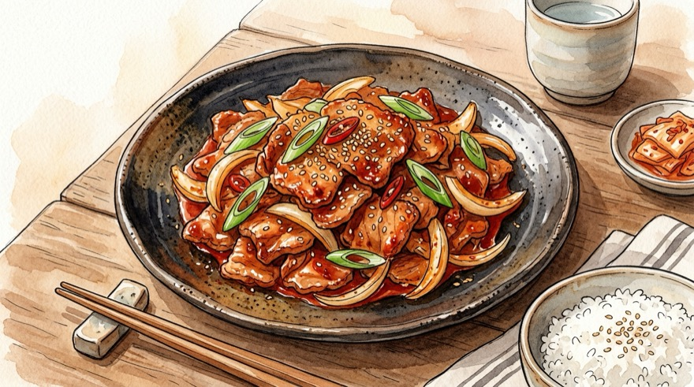
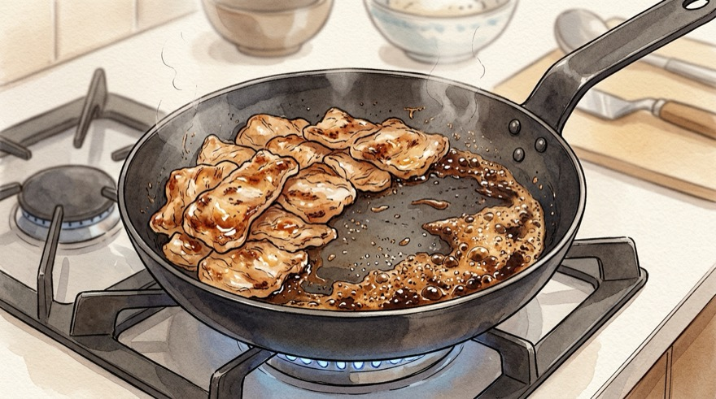

# 🥩 기사식당 불맛 & 숙성 제육볶음 레시피

그날 바로 강불에 구워 먹는 **즉석 불맛 제육볶음**부터, 미리 재워두는 **숙성 양념육**, 병에 만들어 두는 **만능 제육 소스**까지 3가지 조리 모드를 모두 지원하는 완벽 레시피입니다.

---

## 📌 개요
상황에 따라 원하는 조리 모드 탭을 선택하면 재료와 조리 순서가 자동으로 맞춤 전환됩니다!

* **핵심 포인트:** 즉석 조리 시 생고기 수분 먼저 날리고 설탕·간장 태우기 / 숙성 조리 시 채소 분리 보관 및 중불→강불 조리
* **조리 분량:** 2인분 기준 (고기 300g)
* **조리 시간:** 약 15분
* **난이도:** 쉬움
* **검증 상태:** 미검증
* **코멘트:** 
* **분류:** 한식

---

## 🛒 재료 (2인분 · 즉석 불맛 조리 기준)

> [!NOTE]
> **계량 기준:** 1큰술(1T) = 계량스푼 15ml 기준입니다. **양념육 미리 재우기** 또는 **소스만 미리 만들기**는 베리에이션 모드 탭에서 선택하세요!

### 1. 주재료 및 채소
| 재료 | 수량 / 분량 (g·ml) | 손질 및 비고 |
| :--- | :--- | :--- |
| **돼지고기 (앞다리살 또는 삼겹살)** | 300g | 불고기용·구이용(3~4mm 두께), 한 입 크기 |
| **양파** | 1/2개 (약 100g) | 도톰하게 채 썰기 |
| **대파** | 1대 (약 40~50g) | 큼직하게 어슷썰기 |
| **청양고추 (선택)** | 1~2개 (약 15g) | 어슷썰기 *(칼칼한 매운맛)* |
| **식용유** | 1큰술 (약 15ml) | 앞다리살일 때 사용 *(삼겹살은 생략 가능)* |
| **참기름 & 통깨** | 1큰술 (10g) / 약간 | 불 끄고 마지막 마무리용 |

### 2. 양념 재료 (큰술 & 그램 병기)
| 재료 | 수량 / 분량 (g·ml) | 비고 |
| :--- | :--- | :--- |
| **설탕 (고기에 먼저 투입)** | 1큰술 (약 10~12g) | 고기 표면 카라멜라이징(불맛 코팅) |
| **진간장 (팬 가장자리에 투입)** | 2큰술 (약 30g / 30ml) | 태우듯 끓여 깊은 불향 생성 |
| **고춧가루** | 2큰술 (약 14~16g) | 깔끔한 붉은 색감과 칼칼함 |
| **고추장** | 0.8큰술 (약 16g) | 깎아서 계량 *(많이 넣으면 텁텁해짐 · 비율 옵션 연동)* |
| **굴소스** | 0.5큰술 (약 7~8g) | 기사식당 감칠맛 비법 *(생략 시 간장 0.5T 추가)* |
| **다진 마늘** | 1큰술 (약 15g) | 풍미 상승 |
| **맛술 (미림)** | 1큰술 (약 15g / 15ml) | 돼지고기 잡내 제거 |
| **물엿 (또는 올리고당)** | 1큰술 (약 15~20g) | 매콤달콤한 밸런스와 윤기 |
| **물** | 2~3큰술 (약 30~45ml) | 양념이 타지 않고 착 감기게 하는 수분 |
| **후춧가루** | 약간 (3~4번 톡톡) | 잡내 제거 |

---

## 🍳 조리 순서 (Instructions)

### Step 1. 채소 손질 및 붉은 양념장 섞기
1. **채소·고기 손질:** 양파(1/2개)는 도톰하게 채 썰고 대파(1대)·청양고추는 어슷썰며, 돼지고기(300g)는 한 입 크기(4~5cm)로 썰어 핏물을 닦습니다.
2. **양념장 섞기:** 먼저 따로 넣을 **설탕·진간장을 제외한** 나머지 양념(고춧가루 2T, 고추장 0.8T, 굴소스 0.5T, 다진 마늘 1T, 맛술 1T, 물엿 1T, 물 2~3T, 후추)을 그릇에 섞어둡니다.

### Step 2. 생고기 먼저 노릇하게 구워 수분 날리기
1. 달군 팬에 식용유 1큰술을 두르고 **강불**에서 돼지고기를 넓게 펼쳐 올립니다.
2. 고기에서 나온 하얀 육수가 다 증발하고 고기 겉면이 **노릇노릇한 갈색빛이 돌 때까지 약 3~4분간** 충분히 구워줍니다. *(삼겹살 기름이 너무 많으면 키친타올로 반만 닦아내세요.)*

### Step 3. 설탕 코팅 & 간장 불향 입히기 (핵심!)
1. **설탕 볶기:** 노릇해진 고기 위에 **설탕 1큰술(10~12g)**을 뿌리고 **강불에서 30초간** 볶아 윤기와 불맛 코팅을 입힙니다.
2. **간장 태우기:** 고기를 한쪽으로 밀고 빈 팬 바닥에 **진간장 2큰술(30g)**을 떨어뜨려 바글바글 끓으며 구수한 향이 올라올 때(**약 10초**) 고기와 빠르게 섞습니다.

### Step 4. 양념장·채소 넣고 강불에 빠르게 볶기
1. 불을 **중불**로 잠시 줄여 섞어둔 **붉은 양념장**을 넣고 **1분간** 고루 입힙니다.
2. **양파·대파·청양고추**를 모두 넣고 다시 **강불**로 올려 채소가 아삭하게 반쯤 익도록 **1분 30초~2분간** 빠르게 볶은 뒤 불을 끕니다.
3. 마지막으로 **참기름 1큰술(10g)**과 통깨를 둘러 완성합니다.

---

## 🔄 베리에이션

### [모드] 🥩 양념육만 먼저 만들기 (숙성 밀프렙)
전날이나 주말에 **돼지고기에 양념장을 미리 버무려 냉장 숙성(또는 소분 냉동)**해 두는 방식입니다. 고기 속살까지 양념이 쏙 배고 육질이 훨씬 야들야들해집니다! *(채소는 물이 생기지 않도록 볶기 직전에 따로 넣는 것이 핵심입니다.)*

| 재료 | 수량 / 분량 (고기 300g · 2인분 기준) | 비고 |
| :--- | :--- | :--- |
| **돼지고기 (앞다리살·삼겹살·목살)** | 300g | 한 입 크기로 썰어 키친타올로 핏물 제거 |
| **고추장** | 1.2큰술 (약 24g) | 고기에 착 달라붙는 녹진한 재움 베이스 *(비율 옵션 연동)* |
| **고춧가루** | 2큰술 (약 14~16g) | 칼칼함과 붉은 색감 |
| **진간장** | 2큰술 (약 30g / 30ml) | 깊은 감칠맛과 간 |
| **굴소스** | 0.5큰술 (약 7~8g) | 식당 스타일 감칠맛 |
| **설탕** | 1큰술 (약 10~12g) | 연육 작용 및 단맛 |
| **물엿 (또는 올리고당/매실청)** | 1.5큰술 (약 22~25g) | 촉촉한 윤기 및 육질 연화 |
| **맛술 (미림)** | 1.5큰술 (약 22g / 22ml) | 잡내 제거 및 연육 |
| **다진 마늘** | 1큰술 (약 15g) | 한국식 제육 풍미 |
| **후춧가루** | 약간 (3~4번 톡톡) | 잡내 제거 |
| **양파 / 대파 (나중에 볶을 때 사용)** | 양파 1/2개(100g) / 대파 1대(45g) | **재울 때는 넣지 말고** 볶을 때 투입! |

#### Step 1. 양념장 배합 및 고기 버무리기
1. 돼지고기(300g)의 겉 핏물을 키친타올로 닦아 잡내를 예방합니다.
2. 밀폐용기나 볼에 분량의 양념 재료를 모두 섞은 뒤, 고기를 한 장씩 떼어가며 양념이 빈틈없이 묻도록 조물조물 버무립니다.
   *(⚠️ 양파·대파를 같이 버무려 오래 재우면 삼투압으로 물바다가 되므로 **반드시 고기만** 재워주세요!)*

#### Step 2. 냉장 숙성 및 소분 보관
1. 뚜껑을 덮어 냉장고에서 **최소 30분 ~ 24시간 숙성**합니다.
2. 대용량으로 만드셨다면 1회분씩 지퍼백에 납작하게 담아 **냉장 3일, 냉동 최대 3주** 보관 가능합니다. (냉동 시 먹기 하루 전 냉장 해동)

#### Step 3. 숙성 양념육 안 태우고 볶는 법 (중불 → 강불)
1. 달군 팬에 식용유 1큰술을 두르고 반드시 **중불**에서 재워둔 양념육을 올려 **약 4~5분간** 고기가 80% 익을 때까지 타지 않게 볶습니다. *(강불로 시작하면 고추장·설탕이 먼저 탑니다!)*
2. 고기가 거의 다 익으면 썰어둔 **양파·대파·청양고추**를 넣고 **강불**로 올려 **1분 30초~2분간** 수분을 날리며 바싹 볶은 뒤 불을 끄고 참기름 1큰술·통깨로 마무리합니다.

### [모드] 🫙 제육 소스(양념장)만 미리 만들기
고기 없이 **만능 제육 양념장만 유리병이나 밀폐용기에 미리 만들어 냉장 숙성**해 두는 레시피입니다. 하루 이상 숙성되면 고춧가루와 마늘·간장이 어우러져 바로 만든 양념보다 훨씬 깊고 둥근 감칠맛이 납니다! *(인분 조절을 `6인분`·`10인분` 등으로 올리면 병에 담아둘 대용량 배합비가 자동 계산됩니다.)*

| 재료 | 수량 / 분량 (고기 300g · 2인분 1회치 기준) | 비고 |
| :--- | :--- | :--- |
| **고춧가루** | 2.5큰술 (약 18~20g) | 숙성 시 수분을 흡수해 꾸덕한 농도 형성 |
| **고추장** | 1.2큰술 (약 24g) | 깎아서 계량 *(비율 옵션 연동)* |
| **진간장** | 2.5큰술 (약 38g / 38ml) | 염도 및 깊은 감칠맛 (보관성 향상) |
| **굴소스** | 0.5큰술 (약 7~8g) | 감칠맛 부스터 |
| **설탕** | 1.5큰술 (약 15~18g) | 단맛 베이스 |
| **물엿 (또는 올리고당/매실청)** | 1.5큰술 (약 22~25g) | 윤기와 점도 |
| **맛술 (미림)** | 2큰술 (약 30g / 30ml) | 양념 농도 조절 및 고기 잡내 제거 |
| **다진 마늘** | 1큰술 (약 15g) | 오래 보관(2주 이상)할 경우 볶을 때 따로 넣어도 좋음 |
| **생강가루 (또는 다진 생강)** | 0.2작은술 (약 1g) | 선택 (잡내 제거) |
| **후춧가루** | 0.3작은술 (약 1g) | 알싸한 풍미 |

#### Step 1. 만능 제육 소스 배합 및 숙성
1. 물기 없는 깨끗한 용기에 모든 재료를 넣고 설탕이 완전히 녹을 때까지 **1~2분간** 골고루 저어줍니다.
2. 뚜껑을 닫아 **냉장고에서 하루(24시간) 이상 숙성**하면 색깔이 훨씬 진하고 먹음직스러운 다대기 상태가 됩니다.
   *(보관 기한: 다진 마늘 포함 시 **냉장 10~14일**, 다진 마늘을 빼고 만들었다가 조리할 때 신선한 마늘을 넣으면 **냉장 1개월 이상** 보관 가능!)*

#### Step 2. 미리 만든 제육 소스 사용법 (고기 300g 기준)
1. **고기 300g(2인분)당 숙성 소스 약 4~4.5큰술 듬뿍 (약 135~145g)**을 사용합니다.
2. 생고기를 팬에 먼저 노릇하게 구운 뒤 숙성 소스와 물 2큰술, 채소를 넣고 **강불에서 2분간** 볶거나, 생고기에 소스를 버무려 재워두었다가 볶아 드시면 됩니다!

---

## 💡 요리 팁 & 더 맛있게 먹는 법 (Tips)
* **고기 부위 추천:** 기름기와 살코기 비율이 좋은 **앞다리살(전지)**이 가장 부드럽고 가성비가 좋으며, 고소한 맛을 원하시면 **삼겹살**이나 **목살**을 추천합니다.
* **제육덮밥 활용:** 넓은 대접에 밥과 제육볶음을 담고 반숙 계란후라이와 김가루를 얹어 비벼 먹으면 완벽한 한 그릇 요리가 됩니다.
