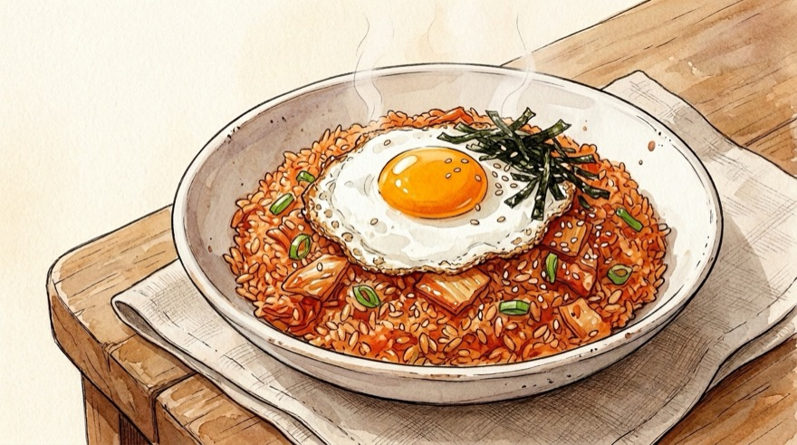
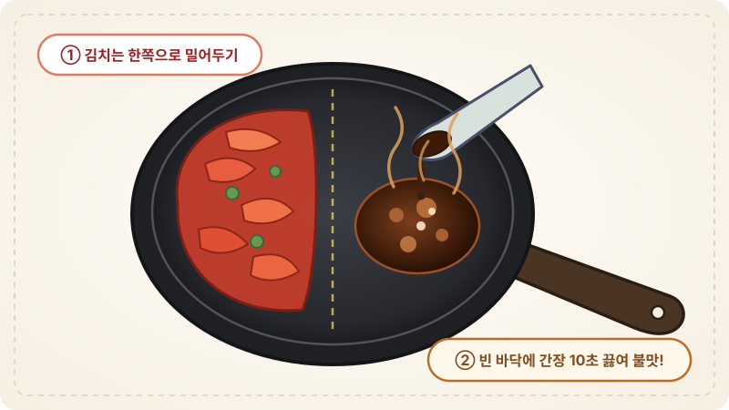

# 🍳 매콤고소 김치볶음밥 레시피

잘 익은 신김치와 파기름, 진간장 불맛으로 10분 만에 만드는 황금 레시피입니다. 취향에 따라 **참치**, **스팸(햄)**, **반숙 계란후라이** 옵션을 자유롭게 켜고 끌 수 있습니다.

---

## 📌 개요
집에 있는 신김치와 밥만으로 실패 없이 고깃집·분식집 스타일의 감칠맛 나는 볶음밥을 만드는 기본 레시피입니다.

* **핵심 포인트:** 향긋한 파기름 내기, 진간장을 팬 가장자리에서 태우듯 눌러 불맛 입히기, 고춧가루로 색감과 칼칼함 살리기
* **조리 분량:** 1인분 기준
* **조리 시간:** 약 10분
* **난이도:** 매우 쉬움
* **코멘트:** 
* **분류:** 한식

---

## 🛒 재료 (1인분 기본 베이스)

> [!NOTE]
> 기본 레시피는 **깔끔한 오리지널 김치볶음밥** 기준이며, **참치 추가 / 스팸 추가 / 계란후라이 토핑**은 베리에이션 옵션에서 선택하면 재료와 준비 용기, 조리 순서가 자동으로 추가됩니다!

### 1. 주재료
| 변수 | 재료 | 수량 / 분량 (g·ml) | 비고 |
| :--- | :--- | :--- | :--- |
| `rice` | **밥** | 1공기 (약 200g) | 식은 밥이나 즉석밥(데우지 않은 것) 권장 |
| `kimchi` | **신김치 (또는 묵은지)** | 1컵 (약 150g) | 그릇에 담고 가위로 잘게 썰기 |
| `scallion` | **대파** | 1/2대 (약 20g) | 송송 썰기 (파기름용) |
| `oil` | **식용유** | 1.5~2큰술 (약 20~25ml) | 파기름 및 볶음용 |

### 2. 양념 재료
| 변수 | 재료 | 수량 / 분량 (g·ml) | 비고 |
| :--- | :--- | :--- | :--- |
| `soy` | **진간장** | 1큰술 (약 15ml) | 팬 가장자리에 둘러 눌러붙이며 불맛 내기 |
| `chili_powder` | **고춧가루** | 0.5~1큰술 (약 4~7g) | 먹음직스러운 색감 및 칼칼함 |
| `sugar` | **설탕** | 0.5큰술 (약 5~6g) | 신김치의 신맛 중화 및 감칠맛 |
| `sesame_oil` | **참기름** | 1큰술 (약 10g) | 불 끄고 마지막 고소한 향 |
| `topping` | **통깨 / 김가루** | 취향껏 | 마무리 토핑 (선택) |

### 📌 조리 내 계량 변수
| 변수 | 항목 | 기준 분량 | 역할 |
| :--- | :--- | :--- | :--- |
| `vinegar_tip` | 덜 익은 김치 보정 식초 | 0.5큰술 (약 7ml) | mild_seasoning |

### 🥣 미리 준비할 용기
| 용기 | 용도 및 준비 포인트 |
| :--- | :--- |
| **오목한 그릇 (김치 가위 손질용)** | 도마에 김칫국물이 물들지 않게 신김치(`{{kimchi}}`)를 담아 가위로 잘게 자를 그릇 |
| **넓은 접시 (갓 지은 밥일 때)** | 뜨거운 밥(`{{rice}}`)을 펼쳐 수분을 한 김 날려 식혀둘 용기 |
| **넓은 프라이팬 또는 웍** | 파기름·간장 불맛 볶음용 |

---

## 🍳 조리 순서 (Instructions)

### Step 1. [재료 손질] 신김치 잘게 썰기, 대파 송송 썰기 및 밥 식히기
1. **김치 손질:** **신김치(`{{kimchi}}`)**는 도마 대신 준비한 오목한 그릇에 담고 주방가위로 손톱 크기만큼 잘게 잘라줍니다.
2. **대파·밥 준비:** **대파(`{{scallion}}`)**는 송송 썰고, 갓 지은 뜨거운 밥(`{{rice}}`)이라면 넓은 접시에 펼쳐 한 김 식혀둡니다. *(수분이 날아가야 고슬고슬하게 볶아집니다.)*

### Step 2. 향긋한 파기름 내기
1. 팬에 **식용유 `{{oil}}`**을 두르고 송송 썬 **대파(`{{scallion}}`)**를 넣은 뒤 **중불에서 약 1분간** 볶아 향긋한 파기름을 냅니다.

### Step 3. 김치 볶기 & 간장 불맛 입히기 (핵심 비법)
1. **김치 볶기:** 파가 노릇해지면 썰어둔 **신김치(`{{kimchi}}`)**와 **설탕 `{{sugar}}`**, **고춧가루 `{{chili_powder}}`**을 넣고 김치가 나른해질 때까지 **중불에서 2분간** 달달 볶습니다.
2. **간장 태우기:** 김치를 팬 한쪽으로 밀어두고 빈 바닥에 **진간장 `{{soy}}`**을 떨어뜨립니다.
3. **불맛 섞기:** 간장이 지글지글 끓으며 눌어붙는 향이 올라올 때(**약 10초** 후), 김치와 빠르게 섞어 불맛을 입힙니다.

### Step 4. 밥 넣고 고슬고슬하게 볶아 마무리
1. **밥 풀기:** 불을 **약불**로 줄이거나 잠시 끈 뒤, **밥 `{{rice}}`**을 넣고 주걱을 세워 자르듯이 밥알을 풀어가며 양념과 고루 섞습니다.
2. **강불 마무리:** 밥이 고루 비벼지면 다시 **중강불**로 올려 **1~2분간** 빠르게 볶아 수분을 날립니다.
3. **참기름 코팅:** 불을 완전히 끄고 **참기름 `{{sesame_oil}}`**과 통깨·김가루를 둘러 가볍게 섞어 `{{servings}}` 김치볶음밥을 담아냅니다.

---

## 🔄 베리에이션

### [옵션] 🐟 참치 넣기 (참치 김치볶음밥)
고소하고 담백한 참치캔을 넣는 베리에이션입니다. 참치를 처음부터 넣고 오래 볶으면 살이 다 부서지고 비린내가 날 수 있으므로 **김치를 다 볶은 뒤 넣는 것**이 핵심입니다!

| 변수 | 재료 | 수량 / 분량 (g·ml) | 비고 |
| :--- | :--- | :--- | :--- |
| `tuna` | **참치캔** | 1작은캔 (약 85~100g) | 기름은 반만 따라내고 살 위주로 준비 |
| `tuna_oil` | **참치캔 속 기름** | 1큰술 (약 15ml) | 파기름 낼 때 식용유 일부 대신 활용 |

#### [Step 1에 추가] 참치캔 기름 덜어두기
1. **참치캔(`{{tuna}}`)**을 따서 **참치 기름 `{{tuna_oil}}`**만 작은 그릇에 따로 덜어두고, 남은 기름은 가볍게 따라내어 살 위주로 준비합니다.

#### [Step 2에 추가] 참치 기름으로 감칠맛 파기름 내기
1. 파기름을 낼 때 식용유 일부 대신 덜어둔 **참치 기름 `{{tuna_oil}}`**을 함께 넣어 대파를 볶으면 고소한 감칠맛이 배가됩니다.

#### [Step 3에 추가] 밥 넣기 직전 참치 살 가볍게 섞기
1. 김치에 간장 불맛까지 다 입힌 직후, **기름 뺀 참치 살(`{{tuna:main}}`)**을 넣고 **30초만** 가볍게 섞어줍니다. *(오래 볶지 않아야 참치 덩어리가 부서지지 않고 큼직하게 살아있습니다!)*

### [옵션] 🍳 마지막에 계란후라이 올리기
매콤한 김치볶음밥 위에 노른자가 주르륵 흐르는 **겉바속촉 반숙 계란후라이**를 얹어 완성하는 국룰 토핑입니다.

| 변수 | 재료 | 수량 / 분량 (g·ml) | 비고 |
| :--- | :--- | :--- | :--- |
| `fry_egg` | **달걀** | 1개 | 반숙 계란후라이용 |
| `fry_oil` | **식용유 (후라이용)** | 0.5~1큰술 (약 8~10ml) | 흰자 테두리를 바삭하게 구울 분량 |
| `fry_salt` | **소금** | 1꼬집 | 흰자에만 살짝 밑간 |

#### Step 1. 겉바속촉 반숙 계란후라이 구워 올리기
1. 작은 팬(또는 완성된 볶음밥을 그릇에 덜어낸 팬)에 **식용유 `{{fry_oil}}`**를 두르고 **중강불**로 달군 뒤 **달걀 `{{fry_egg}}`**을 깨 넣고 소금 `{{fry_salt}}`을 뿌립니다.
2. 흰자 가장자리가 튀기듯 바삭해지고 노른자는 말랑한 반숙 상태가 되도록 **약 1분 30초간** 뒤집지 않고 구워 완성된 볶음밥 위에 올려냅니다!

### [옵션] 🥓 스팸/베이컨 넣기
짭조름한 햄의 감칠맛을 더하고 싶을 때 선택하는 옵션입니다.

| 변수 | 재료 | 수량 / 분량 (g·ml) | 비고 |
| :--- | :--- | :--- | :--- |
| `spam` | **스팸 (또는 베이컨/소시지)** | 1/3캔 (약 65g) | 김치 크기에 맞춰 잘게 깍둑썰기 |

#### [Step 1에 추가] 스팸 잘게 깍둑썰기
1. 김치 크기에 맞춰 **스팸(햄) `{{spam}}`**을 잘게 깍둑썰어 준비합니다.

#### [Step 2에 추가] 파기름에 스팸 먼저 노릇하게 굽기
1. 파기름 향이 올라오면 깍둑썬 **스팸(`{{spam:main}}`)**을 먼저 넣고 겉면이 노릇해질 때까지 **약 1분간** 구워 햄 풍미를 기름에 입힌 뒤 다음 단계로 넘어갑니다.

---

## 💡 맛있는 팁
* **덜 익은 김치 해결법:** 김치가 덜 익었을 때는 김치를 볶을 때 **식초 `{{vinegar_tip}}`**을 살짝 넣으면 잘 익은 신김치 풍미가 살아납니다.
* **고깃집 누룽지 만들기:** 불을 끄기 전 볶음밥을 팬 바닥에 꾹꾹 펴고 **약불에서 1분 30초간** 그대로 두면 바닥이 바삭하게 눌어붙은 누룽지 볶음밥이 됩니다!
