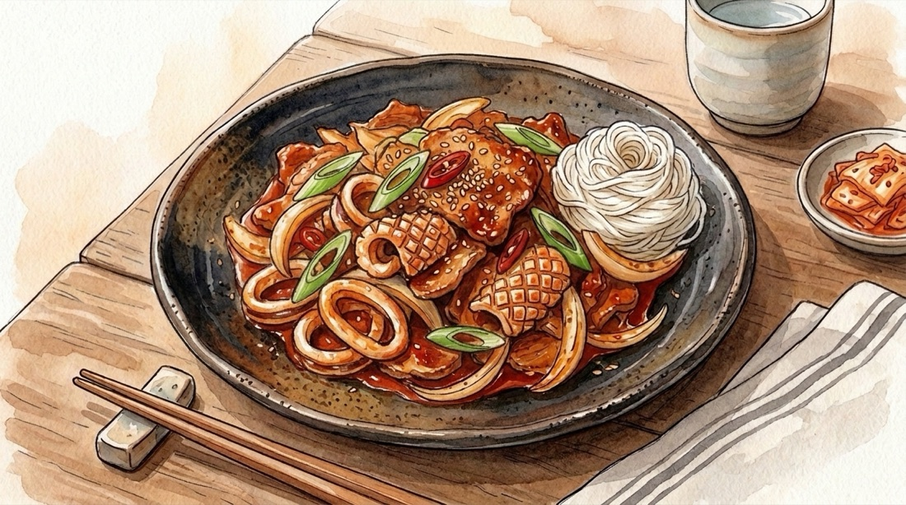
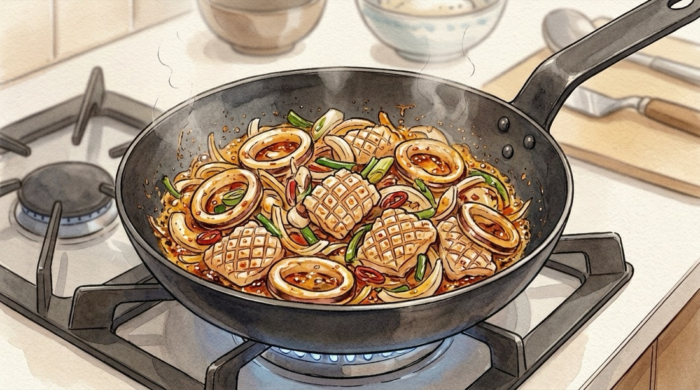

# 🦑 물 안 생기는 직화풍 불맛 오징어볶음 레시피

질겨지거나 흥건한 오징어탕이 되지 않도록 **천연 파·고추기름 코팅**과 **간장 불향**, **강불 단시간 조리**로 오징어는 탱글야들하고 채소는 아삭하게 살아있는 기사식당·포차 스타일 오징어볶음입니다.

---

## 📌 개요
집에서 오징어볶음을 할 때 물이 흥건하게 생기는 이유는 오징어·채소·고추장 양념을 중불에서 한꺼번에 오래 끓이기 때문입니다. **오징어 물기 제거 → 파·고추기름 내기 → 설탕·간장 불향 입히기 → 강불 2분 컷** 순서만 지키면 텁텁함 없이 착 감기는 불맛 오징어볶음이 완성됩니다!

* **핵심 포인트:** 오징어 안쪽 칼집 및 수분 제거, 고춧가루 기름 내기, 팬 가장자리 간장 태우기, 강불 단시간 조리
* **조리 분량:** 2인분 기준 (손질 오징어 2마리 · 약 320g)
* **조리 시간:** 약 15분
* **난이도:** 쉬움
* **코멘트:** 
* **분류:** 한식

---

## 🛒 재료 (2인분 기준)

> [!NOTE]
> **계량 & 고추장 비율 팁:** 1큰술(1T) = 계량스푼 15ml 기준입니다. 오징어볶음은 고추장을 많이 넣으면 텁텁해지고 수분이 쉽게 생기므로 **고춧가루 중심에 고추장은 소량(0.7T)만** 넣어 칼칼하고 깔끔하게 잡았습니다. *(앱 설정의 **고추장 비율** 옵션과 자동 연동됩니다.)*

### 1. 주재료 및 채소
| 재료 | 수량 / 분량 (g·ml) | 손질 및 비고 |
| :--- | :--- | :--- |
| **손질 오징어 (생물 또는 해동)** | 2마리 (손질 후 약 300~350g) | 안쪽 면 격자 칼집 후 한 입 크기로 썰기 *(물기 닦기 필수!)* |
| **양파** | 1/2개 (약 100g) | 1cm 두께로 도톰하게 채 썰기 |
| **양배추 (선택, 강력 추천)** | 2~3장 (약 80~100g) | 한 입 크기(3~4cm)로 큼직하게 썰기 *(아삭한 단맛)* |
| **당근** | 1/5개 (약 30g) | 납작하게 편 썰기 (색감용, 생략 가능) |
| **대파** | 1대 (약 45g) | 흰 부분은 송송 썰기(파기름용), 초록 부분은 큼직하게 어슷썰기 |
| **청양고추 (및 홍고추)** | 청양고추 1~2개 (약 15g) | 어슷썰기 *(매운맛 취향껏 가감)* |
| **식용유** | 2큰술 (약 30ml) | 파·고추기름 베이스용 |
| **참기름 & 통깨** | 1큰술 (10g) / 약간 | 불 끄고 마지막 고소한 풍미 코팅 |

### 2. 불향 코팅 & 양념 재료
| 재료 | 수량 / 분량 (g·ml) | 비고 |
| :--- | :--- | :--- |
| **다진 마늘 (파기름에 투입)** | 1큰술 (약 15g) | 파기름 낼 때 함께 볶기 |
| **고춧가루 (1차 고추기름용)** | 1큰술 (약 7~8g) | 기름에 먼저 풀어 붉은 윤기와 매콤한 향 추출 |
| **설탕 (오징어 코팅용)** | 1큰술 (약 10~12g) | 오징어 수분 유출 방지 및 카라멜라이징 |
| **진간장 (팬 가장자리 불향용)** | 2큰술 (약 30g / 30ml) | 달궈진 팬 바닥에 끓여 직화 불향 생성 |
| **고춧가루 (2차 양념장용)** | 1.5큰술 (약 11~12g) | 칼칼하고 깔끔한 매운맛 |
| **고추장 (양념장용)** | 0.7큰술 (약 14g) | 깎아서 계량 *(텁텁하지 않게 감칠맛·농도만 부여 · 비율 옵션 연동)* |
| **굴소스 (양념장용)** | 0.5큰술 (약 7~8g) | 해물 감칠맛 극대화 *(없으면 진간장 0.5T 대체)* |
| **맛술 (미림 · 양념장용)** | 1큰술 (약 15ml) | 오징어 비린내 제거 |
| **물엿 또는 올리고당 (양념장용)** | 1~1.5큰술 (약 18~22g) | 매콤달콤한 윤기 *(양파·양배추가 많으면 1T 권장)* |
| **후춧가루** | 약간 (3~4번 톡톡) | 비린내 제거 및 알싸한 향 |

---

## 🍳 조리 순서 (Instructions)

### Step 1. 오징어 칼집 손질(물기 제거) & 양념장 배합
1. **오징어 손질:** 손질된 오징어 몸통을 펼친 뒤 **매끈한 바깥 껍질 쪽이 아닌 안쪽 면(내장이 닿던 하얀 면)**에 칼을 뉘어 촘촘하게 사선 격자 칼집을 넣습니다. 길이 방향으로 반을 가른 뒤 **1.5~2cm 폭의 한 입 크기**로 썰고, 다리는 빨판의 딱딱한 링 제거 후 먹기 좋은 길이(5~6cm)로 자릅니다.
2. **⭐ 물기 완벽 제거:** 썬 오징어를 **키친타올로 꾹꾹 눌러 겉면 수분을 꼼꼼히 닦아둡니다.** *(냉동 오징어라 물이 많이 나온다면 끓는 물에 맛술 1T를 넣고 오징어를 **딱 20초만** 살짝 굴려 데친 뒤 찬물에 헹구지 말고 체에 밭쳐 물기를 빼두면 볶을 때 물이 전혀 안 생깁니다!)*
3. **채소 & 양념장 준비:** 대파 흰 부분은 송송 썰고 나머지 채소(양파·양배추·당근·대파 초록 부분·청양고추)는 큼직하게 썰어둡니다. 작은 볼에 **2차 양념장 재료**(고춧가루 1.5T, 고추장 0.7T, 굴소스 0.5T, 맛술 1T, 물엿 1~1.5T, 후추)만 미리 섞어둡니다. *(물 반 스푼도 넣지 마세요! 채소 수분만으로 충분합니다.)*

### Step 2. 파·마늘 기름 내고 천연 고추기름 만들기
1. 넓고 오목한 팬(웍)에 **식용유 2큰술(30ml)**과 송송 썬 **대파 흰 부분**, **다진 마늘 1큰술**을 넣고 **중불에서 약 1분간** 파와 마늘이 노릇해지며 고소한 향이 올라올 때까지 볶습니다.
2. **고추기름 추출:** 고춧가루가 타지 않도록 **불을 약불로 줄인 뒤** **1차 고춧가루 1큰술**을 기름 위에 넣고 **약 15초간** 빠르게 저어 붉고 고소한 천연 고추기름을 만듭니다.

### Step 3. 강불 오징어 설탕 코팅 & 간장 태워 불향 입히기 (핵심!)
1. 즉시 불을 **최대 강불**로 올리고 물기 닦은 **오징어**와 **설탕 1큰술(10~12g)**을 함께 넣은 뒤 **약 1분간** 재빠르게 볶아 고추기름과 설탕 코팅을 입힙니다.
2. 오징어 살이 하얗게 오그라들며 칼집 모양이 살아나기 시작하면, 오징어를 팬 한쪽으로 밀어 빈 바닥을 만들고 **진간장 2큰술(30ml)**을 부어 바글바글 끓어오르게 **10초간** 태우듯 졸인 뒤 오징어와 확 섞어 깊은 불향을 입힙니다.

### Step 4. 채소·양념장 넣고 강불에서 1분 30초~2분 바싹 볶기
1. 팬의 온도가 떨어지지 않도록 **최대 강불을 그대로 유지**한 채 썰어둔 **양파·양배추·당근·대파 초록 부분·청양고추**와 미리 섞어둔 **양념장**을 한꺼번에 넣습니다.
2. 주걱 두 개나 집게로 아래위를 크게 뒤집어가며 채소가 아삭하게 반쯤 익고 양념이 오징어에 쫙 감길 때까지 **딱 1분 30초~2분간만** 빠르게 볶고 **즉시 불을 끕니다.** *(오래 볶을수록 오징어가 질겨지고 채소에서 물이 쏟아집니다!)*
3. 불을 끈 상태에서 **참기름 1큰술(10g)**과 통깨를 듬뿍 둘러 잔열로 섞어 접시에 담아냅니다.

---

## 🔄 베리에이션

### [옵션] 🍜 소면 사리 추가 (남은 양념에 비벼 먹는 필승 조합)
매콤하고 불향 가득한 오징어볶음 양념에 쫄깃한 소면을 비벼 먹으면 밥 없이도 완벽한 일품요리가 됩니다.

| 재료 | 수량 / 분량 (g) | 비고 |
| :--- | :--- | :--- |
| **소면 (또는 중면)** | 1인분 사리 (약 90~100g, 동전 500원 크기) | 중면 사용 시 30초 더 삶기 |
| **참기름 (면 코팅용)** | 0.3큰술 (약 3g) | 면발이 불거나 떡지지 않게 코팅 |

#### Step 1. 소면 쫄깃하게 삶아 사리 곁들이기
1. 오징어를 볶기 직전, 다른 냄비에 넉넉한 물을 끓여 소면을 펼치듯 넣고 **약 3분~3분 30초간** 삶습니다. *(물이 끓어 넘치려 할 때 찬물 반 컵을 부어주면 속까지 탱글하게 익습니다.)*
2. 삶은 면을 즉시 찬물에 옮겨 손으로 빨래하듯 바락바락 비벼 전분기를 완전히 씻어낸 뒤, 물기를 꽉 짜고 **참기름 몇 방울**로 버무려 돌돌 말아 완성된 오징어볶음 접시 가장자리에 곁들입니다.

### [옵션] 🥩 삼겹살 추가 (기사식당 오삼불고기)
돼지고기의 고소한 기름과 오징어의 쫄깃한 감칠맛이 어우러지는 밥도둑 **오삼불고기** 베리에이션입니다.

| 재료 | 수량 / 분량 (g) | 비고 |
| :--- | :--- | :--- |
| **삼겹살 (또는 대패삼겹살)** | 150~200g | 구이용은 한 입 크기로 썰기 |
| **고춧가루 & 진간장 (추가분)** | 고춧가루 0.5큰술 / 진간장 0.5큰술 | 고기 양만큼 간 보충 |

#### Step 1. 삼겹살 먼저 노릇하게 구워 돼지기름 내기 (`Step 2` 연동)
1. 식용유를 넣지 않고 팬에 **삼겹살(150~200g)**을 먼저 올려 **강불에서 약 3분간** 노릇노릇하게 구워 고소한 돼지기름을 충분히 냅니다. *(기름이 너무 많으면 식용유 2큰술 분량만 남기고 키친타올로 닦아주세요.)*
2. 구운 삼겹살이 담긴 상태에서 그대로 대파·다진 마늘을 넣어 파기름을 내고, 이후 `Step 2~4`와 동일하게 고추기름·오징어·채소를 순서대로 넣어 강불에 빠르게 볶아냅니다!

### [옵션] 🧀 모짜렐라 치즈 토핑 (매운맛 중화 · 철판 치즈 오징어)
매콤한 불맛 오징어볶음 위에 고소하게 늘어나는 치즈를 얹어 술안주로도 인기 만점인 스타일입니다.

| 재료 | 수량 / 분량 (g) | 비고 |
| :--- | :--- | :--- |
| **슈레드 모짜렐라 치즈** | 80~100g | 전자레인지 또는 뚜껑 활용 |

#### Step 1. 완성 직후 잔열에 치즈 녹이기
1. `Step 4`에서 참기름을 두른 오징어볶음 가운데(또는 가장자리)에 **모짜렐라 치즈**를 듬뿍 뿌립니다.
2. 팬 뚜껑을 덮고 **약불에서 1분간** 치즈만 사르르 녹여 그대로 식탁에 올립니다.

### [모드] 🫙 만능 오징어·해물 볶음 소스 미리 만들기 (숙성 밀프렙)
오징어볶음은 물론 **낙지볶음·주꾸미볶음**에도 그대로 쓸 수 있는 만능 해물 볶음 다대기를 미리 배합해 냉장 숙성해 두는 모드입니다. 하루 이상 숙성되면 고춧가루가 불어나 양념이 해물 표면에 겉돌지 않고 착 달라붙습니다! *(인분을 `6인분`·`10인분`으로 올리면 유리병 대용량 배합비가 자동 계산됩니다.)*

| 재료 | 수량 / 분량 (오징어 2마리 · 2인분 1회치 기준) | 비고 |
| :--- | :--- | :--- |
| **고춧가루** | 3큰술 (약 22g) | 숙성 후 수분을 잡아주는 핵심 베이스 |
| **고추장** | 0.8큰술 (약 16g) | 깎아서 계량 *(비율 옵션 연동)* |
| **진간장** | 2.5큰술 (약 38g / 38ml) | 깊은 간과 보관성 향상 |
| **굴소스** | 0.5큰술 (약 8g) | 해물 감칠맛 |
| **설탕** | 1큰술 (약 12g) | 깔끔한 단맛 |
| **물엿 (또는 올리고당)** | 1.5큰술 (약 24g) | 매끄러운 윤기와 점도 |
| **맛술 (미림)** | 1.5큰술 (약 22ml) | 농도 조절 및 해물 비린내 제거 |
| **다진 마늘** | 1큰술 (약 15g) | 2주 이상 장기 보관 시에는 조리할 때 넣기 |
| **생강가루 (또는 다진 생강)** | 0.2작은술 (약 1g) | 선택 (해물 비린내 깔끔 제거) |
| **후춧가루** | 0.3작은술 (약 1g) | 칼칼한 마무리 |

#### Step 1. 만능 해물 볶음 소스 배합 및 냉장 숙성
1. 물기 없는 깨끗한 유리병이나 밀폐용기에 분량의 양념 재료를 모두 넣고 **1~2분간** 설탕 입자가 녹을 때까지 고루 섞습니다.
2. 뚜껑을 닫고 냉장고에서 **최소 반나절~24시간 숙성**하면 빛깔이 선명하고 쫀득한 다대기가 완성됩니다. *(다진 마늘 포함 시 **냉장 10~14일**, 마늘 제외 시 **냉장 1개월** 보관 가능)*

#### Step 2. 숙성 소스로 3분 만에 오징어볶음 완성하기
1. 달군 팬에 식용유 2큰술과 대파를 넣어 **중불에서 1분간** 파기름을 냅니다.
2. **최대 강불**로 올리고 물기 닦은 **오징어 2마리(320g)**를 넣어 **1분간** 먼저 볶은 뒤, **숙성 소스 3.5~4큰술 듬뿍(약 120g)**과 채소를 넣고 **강불에서 1분 30초~2분간** 바싹 볶아 참기름·통깨로 마무리합니다!

---

## 💡 요리 팁 & 더 맛있게 먹는 법 (Tips)
* **왜 오징어 안쪽 면에 칼집을 내나요?** 오징어는 열을 받으면 근육 결 방향 때문에 **안쪽 면이 바깥으로 말리는 성질**이 있습니다. 내장이 닿던 안쪽 하얀 면에 사선 격자 칼집을 내야 익었을 때 솔방울처럼 예쁘게 벌어지고 그 사이로 불향 양념이 쏙쏙 배어듭니다.
* **오징어덮밥 꿀조합:** 따뜻한 흰쌀밥 위에 김가루와 콩나물무침(또는 채 썬 상추)을 살짝 깔고 오징어볶음과 반숙 계란후라이를 올려 쓱쓱 비벼 드시면 실패 없는 기사식당 오징어덮밥이 됩니다!
