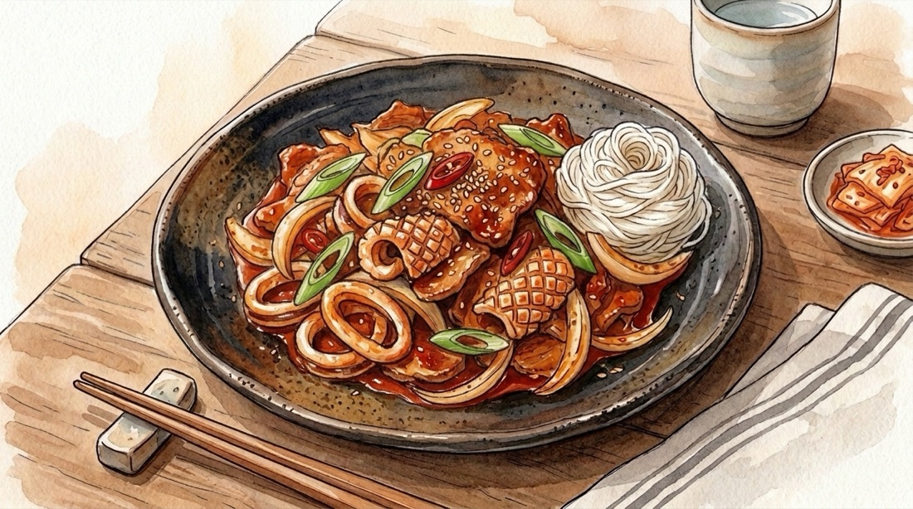
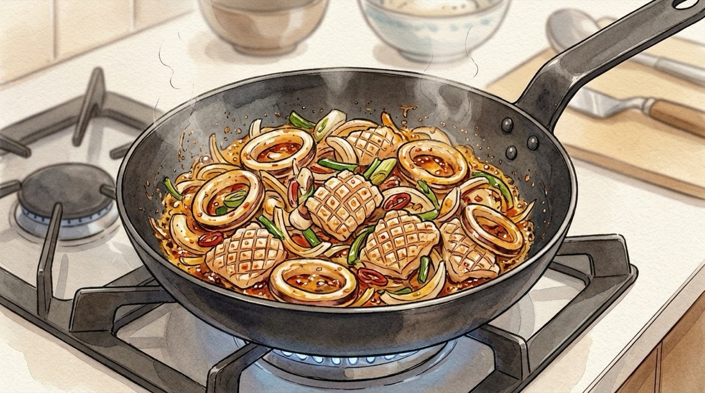

# 🦑 물 안 생기는 직화풍 불맛 & 숙성 오징어볶음 레시피

그날 바로 강불에 볶아 먹는 **즉석 직화풍 불맛 오징어볶음**부터, 오징어에 양념을 미리 버무려 두는 **숙성 양념 오징어**, 병에 만들어 두는 **만능 오징어 양념장(소스)**까지 3가지 조리 모드를 모두 지원하는 레시피입니다.

---

## 📌 개요
상황에 따라 상단 **조리 모드 탭**을 선택하면 재료와 준비 용기, 조리 순서 내 모든 계량값이 인분 및 선호 단위(`큰술·작은술` / `g·ml`)에 맞춰 자동으로 전환됩니다!

* **핵심 포인트:** 즉석 조리 시 파·고추기름 코팅 후 설탕·간장 태우기 / 숙성 조리 시 오징어 기름 코팅 후 양념 버무리기 & 채소 분리 보관
* **조리 분량:** 2인분 기준
* **조리 시간:** 약 15분
* **난이도:** 쉬움
* **코멘트:** 
* **분류:** 한식

---

## 🛒 재료 (2인분 · 즉석 불맛 조리 기준)

> [!NOTE]
> **계량 & 밀프렙 안내:** 1큰술(1T) = 계량스푼 15ml 기준입니다. **양념 오징어 미리 재우기** 또는 **양념장(소스)만 미리 만들기**는 상단 베리에이션 모드 탭에서 선택하세요! *(고추장 투입량은 설정 및 상단 **고추장 비율** 옵션과 자동 연동됩니다.)*

### 1. 주재료 및 채소
| 변수 | 재료 | 수량 / 분량 (g·ml) | 손질 및 비고 |
| :--- | :--- | :--- | :--- |
| `squid` | **손질 오징어 (생물 또는 해동)** | 2마리 (약 300-350g) | 안쪽 면 격자 칼집 후 한 입 크기 썰기 *(물기 닦기 필수!)* |
| `onion` | **양파** | 1/2개 (약 100g) | 1cm 두께로 도톰하게 채 썰기 |
| `cabbage` | **양배추 (선택, 강력 추천)** | 2-3장 (약 80-100g) | 한 입 크기(3-4cm)로 큼직하게 썰기 *(아삭한 단맛)* |
| `carrot` | **당근** | 1/5개 (약 30g) | 납작하게 편 썰기 (색감용, 생략 가능) |
| `scallion` | **대파** | 1대 (약 45g) | 흰 부분은 송송 썰기(파기름용), 초록 부분은 어슷썰기 |
| `chili` | **청양고추 (및 홍고추)** | 1-2개 (약 15g) | 어슷썰기 *(매운맛 취향껏 가감)* |
| `oil` | **식용유** | 1.5큰술 (약 20ml) | 파·고추기름 베이스용 |
| `sesame_oil` | **참기름** | 0.7큰술 (약 7g) | 불 끄고 마지막 고소한 풍미 코팅 |
| `sesame_seed` | **통깨** | 약간 | 마무리 토핑 |

### 2. 불향 코팅 & 양념 재료
| 변수 | 재료 | 수량 / 분량 (g·ml) | 비고 |
| :--- | :--- | :--- | :--- |
| `garlic` | **다진 마늘 (파기름에 투입)** | 0.8큰술 (약 12g) | 파기름 낼 때 함께 볶기 |
| `chili_oil_powder` | **고춧가루 (고추기름 추출용)** | 0.7큰술 (약 5g) | 기름에 먼저 풀어 붉은 윤기와 매콤한 향 추출 |
| `sugar` | **설탕 (오징어 코팅용)** | 0.7큰술 (약 8g) | 오징어 수분 유출 방지 및 카라멜라이징 |
| `soy` | **진간장 (팬 가장자리 불향용)** | 1.5큰술 (약 22ml) | 달궈진 팬 바닥에 끓여 직화 불향 생성 *(짜지 않은 정량)* |
| `chili_sauce_powder` | **고춧가루 (양념장 배합용)** | 1.3큰술 (약 9-10g) | 칼칼하고 깔끔한 매운맛 |
| `gochujang` | **고추장 (양념장 배합용)** | 0.5큰술 (약 10g) | 깎아서 계량 *(텁텁함 없이 감칠맛만 부여 · 비율 옵션 연동)* |
| `oyster` | **굴소스 (양념장 배합용)** | 0.5큰술 (약 7g) | 해물 감칠맛 극대화 *(없으면 진간장으로 대체)* |
| `mirin` | **맛술 (미림 · 양념장 배합용)** | 1큰술 (약 15ml) | 오징어 비린내 제거 |
| `syrup` | **물엿 또는 올리고당 (양념장 배합용)** | 0.8-1큰술 (약 12-15g) | 과하지 않은 매콤달콤한 윤기 |
| `pepper` | **후춧가루** | 약간 | 비린내 제거 및 알싸한 향 |

### 📌 조리 내 계량 변수
| 변수 | 항목 | 기준 분량 | 역할 |
| :--- | :--- | :--- | :--- |
| `blanch_mirin` | 냉동 오징어 데침용 맛술 | 1큰술 (약 15ml) | mild_seasoning |
| `seafood_sauce_use` | 숙성 해물 소스 사용량 | 2.5-3큰술 (약 80-90g) | strong_seasoning |

### 🥣 미리 준비할 용기
| 용기 | 용도 및 준비 포인트 |
| :--- | :--- |
| **작은 볼 / 종지** | 물 없이 꾸덕한 **양념장**을 미리 섞어둘 그릇 |
| **넓고 오목한 팬(웍)** | 최대 강불에서 오징어(`{{squid:main}}`)와 채소를 튀지 않게 뒤집을 팬 |
| **작은 냄비 & 채반(체)** | *(냉동 오징어를 살짝 데쳐 쓸 경우)* 20초 데친 뒤 물기 빼둘 용기 |

---

## 🍳 조리 순서 (Instructions)

### Step 1. [재료 손질] 양념장 먼저 섞어두기, 채소 썰기 및 오징어 칼집·물기 제거
1. **양념장 먼저 배합:** 오징어나 채소를 손질하기 전에, 준비한 작은 볼에 **양념장 재료(고춧가루 `{{chili_sauce_powder}}`, 고추장 `{{gochujang}}`, 굴소스 `{{oyster}}`, 맛술 `{{mirin}}`, 물엿 `{{syrup}}`**, 후추)를 **가장 먼저 섞어둡니다.** *(물은 넣지 마세요! 오징어를 손질하는 동안 고춧가루가 촉촉하게 불어나 양념이 겉돌지 않습니다.)*
2. **채소 썰기:** **대파(`{{scallion}}`)** 흰 부분은 송송 썰고 초록 부분은 어슷썰며, **양파(`{{onion}}`)·양배추(`{{cabbage}}`)·당근(`{{carrot}}`)·청양고추(`{{chili}}`)**를 큼직하게 썰어둡니다.
3. **오징어 칼집 손질:** **손질 오징어(`{{squid}}`)** 몸통을 펼친 뒤 **매끈한 바깥 껍질 쪽이 아닌 안쪽 면(내장이 닿던 하얀 면)**에 칼을 뉘어 촘촘하게 사선 격자 칼집을 넣습니다. 길이 방향으로 반을 가른 뒤 **1.5-2cm 폭의 한 입 크기**로 썰고, 다리는 빨판의 딱딱한 링 제거 후 먹기 좋은 길이(5-6cm)로 자릅니다.
4. **⭐ 물기 완벽 제거:** 썬 오징어를 **키친타올로 꾹꾹 눌러 겉면 수분을 꼼꼼히 닦아둡니다.** *(냉동 오징어라 물이 많이 나온다면 끓는 물에 맛술 `{{blanch_mirin}}`을 넣고 오징어를 **딱 20초만** 살짝 굴려 데친 뒤 찬물에 헹구지 말고 체에 밭쳐 물기를 빼두면 볶을 때 물이 전혀 안 생깁니다!)*

### Step 2. 파·마늘 기름 내고 천연 고추기름 만들기
1. 넓고 오목한 팬(웍)에 **식용유 `{{oil}}`**과 송송 썬 **대파 흰 부분**, **다진 마늘 `{{garlic}}`**을 넣고 **중불에서 약 1분간** 파와 마늘이 노릇해지며 고소한 향이 올라올 때까지 볶습니다.
2. **고추기름 추출:** 고춧가루가 타지 않도록 **불을 약불로 줄인 뒤** **고추기름용 고춧가루 `{{chili_oil_powder}}`**을 기름 위에 넣고 **약 15초간** 빠르게 저어 붉고 고소한 천연 고추기름을 만듭니다.

### Step 3. 강불 오징어 설탕 코팅 & 간장 태워 불향 입히기 (핵심!)
1. 즉시 불을 **최대 강불**로 올리고 물기 닦은 **오징어(`{{squid}}`)**와 **설탕 `{{sugar}}`**을 함께 넣은 뒤 **약 1분간** 재빠르게 볶아 고추기름과 설탕 코팅을 입힙니다.
2. 오징어 살이 하얗게 오그라들며 칼집 모양이 살아나기 시작하면, 오징어를 팬 한쪽으로 밀어 빈 바닥을 만들고 **진간장 `{{soy}}`**을 부어 바글바글 끓어오르게 **10초간** 태우듯 졸인 뒤 오징어와 확 섞어 깊은 불향을 입힙니다.

### Step 4. 채소·양념장 넣고 강불에서 1분 30초-2분 바싹 볶기
1. 팬의 온도가 떨어지지 않도록 **최대 강불을 그대로 유지**한 채 썰어둔 **양파(`{{onion}}`)·양배추(`{{cabbage}}`)·당근(`{{carrot}}`)·대파 초록 부분·청양고추(`{{chili}}`)**와 미리 섞어둔 **양념장**을 한꺼번에 넣습니다.
2. 주걱 두 개나 집게로 아래위를 크게 뒤집어가며 채소가 아삭하게 반쯤 익고 양념이 오징어에 쫙 감길 때까지 **딱 1분 30초-2분간만** 빠르게 볶고 **즉시 불을 끕니다.** *(오래 볶을수록 오징어가 질겨지고 채소에서 물이 쏟아집니다!)*
3. 불을 끈 상태에서 **참기름 `{{sesame_oil}}`**과 통깨를 듬뿍 둘러 잔열로 섞어 `{{servings}}` 오징어볶음을 접시에 담아냅니다.

---

## 🔄 베리에이션

### [옵션] 🍜 소면 사리 추가 (남은 양념에 비벼 먹는 필승 조합)
매콤하고 불향 가득한 오징어볶음 양념에 쫄깃한 소면을 비벼 먹으면 밥 없이도 완벽한 일품요리가 됩니다.

| 변수 | 재료 | 수량 / 분량 (g) | 비고 |
| :--- | :--- | :--- | :--- |
| `somyeon` | **소면 (또는 중면)** | 1인분 사리 (약 90-100g) | 중면 사용 시 30초 더 삶기 |
| `somyeon_oil` | **참기름 (면 코팅용)** | 0.3큰술 (약 3g) | 면발이 불거나 떡지지 않게 코팅 |

#### 🥣 미리 준비할 용기
| 용기 | 용도 및 준비 포인트 |
| :--- | :--- |
| **소면 삶는 냄비 & 채반(체)** | 소면(`{{somyeon}}`)을 삶아 찬물에 비벼 헹구고 물기를 뺄 용기 |

#### [Step 1 다음] 소면 미리 삶아 참기름 코팅해 두기
1. 오징어 볶음은 강불에서 순식간에 끝나므로 **볶기를 시작하기 전에 먼저 면을 삶아둡니다.** 냄비에 넉넉한 물을 끓여 **소면(`{{somyeon}}`)**을 펼치듯 넣고 **약 3분-3분 30초간** 삶습니다. *(물이 끓어 넘치려 할 때 찬물 반 컵을 부어주면 속까지 탱글하게 익습니다.)*
2. 삶은 면을 즉시 찬물에 옮겨 손으로 빨래하듯 바락바락 비벼 전분기를 완전히 씻어낸 뒤, 체에 밭쳐 물기를 꽉 짜고 **참기름 `{{somyeon_oil}}`**로 버무려 한 입 크기로 돌돌 말아 준비해 둡니다.

#### [Step 4에 추가] 접시 가장자리에 소면 사리 곁들이기
1. 완성된 오징어볶음을 접시에 담을 때 미리 말아둔 **소면 사리**를 가장자리에 나란히 곁들여 양념에 비벼 드세요!

### [옵션] 🥩 삼겹살 추가 (기사식당 오삼불고기)
돼지고기의 고소한 기름과 오징어의 쫄깃한 감칠맛이 어우러지는 밥도둑 **오삼불고기** 베리에이션입니다.

| 변수 | 재료 | 수량 / 분량 (g) | 비고 |
| :--- | :--- | :--- | :--- |
| `osam_pork` | **삼겹살 (또는 대패삼겹살)** | 150-200g | 구이용은 한 입 크기로 썰기 |
| `osam_chili` | **고춧가루 (고기용 추가)** | 0.5큰술 (약 4g) | 고기 양만큼 양념 보충 |
| `osam_soy` | **진간장 (고기용 추가)** | 0.5큰술 (약 7ml) | 고기 양만큼 간 보충 |

#### [Step 1에 추가] 삼겹살 썰기 및 고기용 고춧가루 보충
1. 구이용 **삼겹살(`{{osam_pork}}`)**을 한 입 크기로 썰어 준비하고, 양념장을 섞을 때 고기용 추가 **고춧가루 `{{osam_chili}}`**를 함께 넣어 섞어둡니다.

#### [Step 2에 추가] 삼겹살 먼저 구워 고소한 돼지기름 내기
1. 식용유를 넣지 않고 달군 팬에 **삼겹살(`{{osam_pork}}`)**을 먼저 올려 **강불에서 약 3분간** 노릇하게 구워 돼지기름을 냅니다. *(기름이 너무 많이 나왔다면 `{{oil}}` 정도만 남기고 키친타올로 살짝 닦아낸 뒤, 그 돼지기름에 대파·마늘·고춧가루를 똑같이 볶아 고추기름을 내세요!)*

#### [Step 3에 추가] 간장 불향 낼 때 고기용 진간장 더하기
1. 팬 가장자리에서 간장을 태워 불향을 낼 때 기본 진간장에 **고기용 추가 진간장 `{{osam_soy}}`**을 함께 부어 삼겹살과 오징어에 간이 딱 맞게 입힙니다.

### [옵션] 🧀 모짜렐라 치즈 토핑 (매운맛 중화 · 철판 치즈 오징어)
매콤한 불맛 오징어볶음 위에 고소하게 늘어나는 치즈를 얹어 술안주로도 인기 만점인 스타일입니다.

| 변수 | 재료 | 수량 / 분량 (g) | 비고 |
| :--- | :--- | :--- | :--- |
| `mozza_cheese` | **슈레드 모짜렐라 치즈** | 80-100g | 팬 뚜껑 또는 전자레인지 활용 |

#### 🥣 미리 준비할 용기
| 용기 | 용도 및 준비 포인트 |
| :--- | :--- |
| **팬 뚜껑 (또는 내열 접시)** | 모짜렐라 치즈(`{{mozza_cheese}}`)를 팬 잔열로 녹이기 위한 뚜껑 |

#### Step 1. 완성된 오징어볶음 위에 모짜렐라 치즈 녹이기
1. 참기름까지 두른 완성 오징어볶음 위에 **모짜렐라 치즈 `{{mozza_cheese}}`**를 듬뿍 뿌리고 팬 뚜껑을 덮어 **약불(또는 잔열)에서 1분간** 치즈만 사르르 녹여 그대로 식탁에 올립니다.

### [모드] 🦑 양념 오징어만 먼저 만들기 (숙성 밀프렙)
전날이나 주말·캠핑 전에 **손질한 오징어에 양념장을 미리 버무려 냉장 숙성(또는 소분 냉동)**해 두는 방식입니다. 오징어에 **기름 코팅을 먼저 입힌 뒤 무수분 양념장**으로 버무리면 삼투압으로 물이 빠지지 않고 속살까지 양념이 쏙 배어듭니다! *(채소는 물이 생기지 않도록 반드시 볶기 직전에 따로 넣으세요.)*

| 변수 | 재료 | 수량 / 분량 (2인분 기준) | 비고 |
| :--- | :--- | :--- | :--- |
| `m_squid` | **손질 오징어 (생물 또는 해동)** | 2마리 (약 300-350g) | 안쪽 격자 칼집 후 키친타올로 물기 완벽 제거 |
| `m_coat_oil` | **참기름 (오징어 수분 차단 코팅용)** | 0.5큰술 (약 5g) | 양념 버무리기 전 오징어에 먼저 코팅 *(핵심!)* |
| `m_chili_powder` | **고춧가루** | 2큰술 (약 14-15g) | 숙성 중 수분을 흡수해 꾸덕한 양념 유지 |
| `m_gochujang` | **고추장** | 0.5큰술 (약 10g) | 깎아서 계량 *(비율 옵션 연동)* |
| `m_soy` | **진간장** | 1.5큰술 (약 22ml) | 깊은 감칠맛과 적당한 간 |
| `m_oyster` | **굴소스** | 0.5큰술 (약 7g) | 해물 감칠맛 |
| `m_sugar` | **설탕** | 0.7큰술 (약 8g) | 감칠맛과 윤기 |
| `m_syrup` | **물엿 (또는 올리고당)** | 1큰술 (약 15g) | 쫀득한 농도와 단맛 |
| `m_mirin` | **맛술 (미림)** | 1큰술 (약 15ml) | 비린내 제거 |
| `m_garlic` | **다진 마늘** | 0.8큰술 (약 12g) | 칼칼한 마늘 풍미 |
| `m_oil` | **식용유 (볶을 때)** | 1.5큰술 (약 20ml) | 파기름 및 강불 볶음용 |
| `m_sesame` | **참기름 (마무리용)** | 0.5큰술 (약 5g) | 불 끄고 마지막 풍미 코팅 |
| `m_onion` | **양파 (나중에 볶을 때 투입)** | 1/2개 (약 100g) | **재울 때는 넣지 말고** 볶을 때 투입! |
| `m_cabbage` | **양배추 (선택 · 나중에 볶을 때 투입)** | 2-3장 (약 80-100g) | **재울 때는 넣지 말고** 볶을 때 투입! |
| `m_scallion` | **대파 (나중에 볶을 때 투입)** | 1대 (약 45g) | **재울 때는 넣지 말고** 볶을 때 투입! |

#### 🥣 미리 준비할 용기
| 용기 | 용도 및 준비 포인트 |
| :--- | :--- |
| **넉넉한 믹싱볼 및 밀폐용기** | 물기 뺀 오징어(`{{m_squid}}`)와 양념장을 버무려 냉장 숙성할 용기 |
| **냉동용 지퍼백 (캠핑·소분 보관 시)** | 1회분씩 납작하게 담아 냉동 보관할 용기 |
| **넓고 오목한 팬(웍)** | 숙성된 양념 오징어를 강불에 빠르게 볶아낼 팬 |

#### Step 1. [재료 손질] 숙성 양념장 먼저 섞어두기 및 오징어 물기 제거·기름 코팅 후 버무리기
1. **양념장 먼저 배합:** 오징어를 손질하기 전에, 믹싱볼에 양념 재료(**고춧가루 `{{m_chili_powder}}`, 고추장 `{{m_gochujang}}`, 진간장 `{{m_soy}}`, 굴소스 `{{m_oyster}}`, 설탕 `{{m_sugar}}`, 물엿 `{{m_syrup}}`, 맛술 `{{m_mirin}}`, 다진 마늘 `{{m_garlic}}`**, 후추)를 가장 먼저 넣고 설탕이 녹도록 고루 섞어둡니다.
2. **오징어 손질 & 물기 제거:** **오징어(`{{m_squid}}`)** 안쪽 면에 사선 격자 칼집을 내어 한 입 크기로 썬 뒤, 키친타올로 꾹꾹 눌러 **물기를 완벽히 제거**합니다. *(냉동 오징어는 끓는 물에 15-20초만 살짝 데쳐 식힌 뒤 물기를 닦아 재우면 숙성 후에도 물이 전혀 안 생깁니다!)*
3. **⭐ 기름 보호막 코팅 후 양념 버무리기:** 물기를 뺀 오징어에 **코팅용 참기름 `{{m_coat_oil}}`**을 먼저 둘러 조물조물 코팅한 뒤, 미리 섞어둔 양념장 볼에 넣어 고루 버무립니다. *(기름 막이 숙성 중 수분이 빠져나오는 것을 막아주며, 양파·양배추·대파는 미리 넣으면 물이 생기므로 **반드시 오징어만** 버무려 주세요!)*

#### Step 2. 냉장 숙성 및 소분 보관
1. 밀폐용기에 담아 냉장고에서 **최소 30분 - 24시간 숙성**합니다.
2. 바로 드시지 않거나 캠핑용으로 준비할 때는 지퍼백에 1회분씩 납작하게 담아 **냉장 2일, 냉동 최대 3주** 보관 가능합니다. (볶기 직전에 **양파 `{{m_onion}}`·양배추 `{{m_cabbage}}`·대파 `{{m_scallion}}`**를 썰어 준비하세요.)

#### Step 3. 숙성 양념 오징어 안 질기게 볶는 법 (중강불 → 최대 강불)
1. 충분히 달군 팬에 **식용유 `{{m_oil}}`**을 두르고 **대파(`{{m_scallion}}`) 흰 부분**을 먼저 **30초간** 볶아 파기름을 낸 뒤, 숙성된 **양념 오징어(`{{m_squid}}`)**를 넣고 **중강불에서 약 1분 30초간** 타지 않게 볶습니다.
2. 오징어가 반쯤 익으며 탱글해지면 썰어둔 **양파(`{{m_onion}}`)·양배추(`{{m_cabbage}}`)·대파 초록 부분**을 모두 넣고 **최대 강불**로 올려 **1분-1분 30초간** 재빠르게 볶은 뒤 불을 끄고 **참기름 `{{m_sesame}}`**·통깨로 마무리합니다.

### [모드] 🫙 오징어 소스(양념장)만 미리 만들기
오징어 없이 **만능 오징어·해물 볶음 양념장만 유리병이나 밀폐용기에 미리 만들어 냉장 숙성**해 두는 레시피입니다. 하루 이상 숙성되면 고춧가루가 촉촉하게 불어나 오징어·낙지·주꾸미 어디에 넣어도 겉돌지 않고 착 감기는 깊은 다대기가 됩니다! *(인분 조절을 올리면 병에 담아둘 대용량 배합비가 자동 계산됩니다.)*

| 변수 | 재료 | 수량 / 분량 (2인분 1회치 기준) | 비고 |
| :--- | :--- | :--- | :--- |
| `hs_chili` | **고춧가루** | 2큰술 (약 14-15g) | 숙성 후 수분을 잡아주는 핵심 베이스 |
| `hs_gochujang` | **고추장** | 0.6큰술 (약 12g) | 깎아서 계량 *(비율 옵션 연동)* |
| `hs_soy` | **진간장** | 1.5-1.8큰술 (약 22-27ml) | 짜지 않고 깊은 간과 보관성 |
| `hs_oyster` | **굴소스** | 0.5큰술 (약 7g) | 해물 감칠맛 부스터 |
| `hs_sugar` | **설탕** | 0.7큰술 (약 8g) | 깔끔한 단맛 |
| `hs_syrup` | **물엿 (또는 올리고당)** | 1큰술 (약 15g) | 매끄러운 윤기와 점도 |
| `hs_mirin` | **맛술 (미림)** | 1큰술 (약 15ml) | 농도 조절 및 해물 비린내 제거 |
| `hs_garlic` | **다진 마늘** | 0.8큰술 (약 12g) | 2주 이상 장기 보관 시에는 볶을 때 따로 넣기 |
| `hs_ginger` | **생강가루 (또는 다진 생강)** | 0.2작은술 (약 1g) | 선택 (해물 비린내 깔끔 제거) |
| `hs_pepper` | **후춧가루** | 0.2작은술 (약 0.7g) | 칼칼한 마무리 |

#### 🥣 미리 준비할 용기
| 용기 | 용도 및 준비 포인트 |
| :--- | :--- |
| **물기 없는 깨끗한 유리병 또는 밀폐용기** | 만능 오징어 양념장(`{{servings}}` 분량)을 배합해 냉장 숙성·보관할 용기 |

#### Step 1. [재료 손질] 만능 오징어·해물 양념장 배합 및 숙성
1. 물기 없는 깨끗한 유리병이나 밀폐용기에 분량의 양념 재료(**고춧가루 `{{hs_chili}}`, 고추장 `{{hs_gochujang}}`, 진간장 `{{hs_soy}}`, 굴소스 `{{hs_oyster}}`, 설탕 `{{hs_sugar}}`, 물엿 `{{hs_syrup}}`, 맛술 `{{hs_mirin}}`, 다진 마늘 `{{hs_garlic}}`, 생강 `{{hs_ginger}}`, 후추 `{{hs_pepper}}`**)를 모두 넣고 **1-2분간** 설탕 입자가 녹을 때까지 고루 섞습니다.
2. 뚜껑을 닫고 냉장고에서 **최소 반나절-24시간 숙성**하면 빛깔이 선명하고 쫀득한 다대기가 완성됩니다.
   *(보관 기한: 다진 마늘 포함 시 **냉장 10-14일**, 다진 마늘 제외 시 **냉장 1개월 이상** 보관 가능!)*

#### Step 2. 미리 만든 양념장 사용법 (`{{servings}}` 조리 기준)
1. **손질 오징어 `{{squid}}`(`{{servings}}`)당 숙성 양념장 약 `{{seafood_sauce_use}}`**을 사용합니다.
2. 달군 팬에 **식용유 `{{oil}}`**과 대파(`{{scallion}}` 흰 부분)를 넣어 **중불에서 1분간** 파기름을 낸 뒤, **최대 강불**로 올려 물기 닦은 **오징어(`{{squid}}`)**를 **1분간** 먼저 볶고 **숙성 양념장(`{{seafood_sauce_use}}`)**과 채소(`{{onion}}`, `{{cabbage}}`)를 넣어 **강불에서 1분 30초-2분간** 바싹 볶거나, 생오징어에 양념장을 미리 버무려 재워두었다가 볶아 드시면 됩니다!

---

## 💡 요리 팁 & 더 맛있게 먹는 법 (Tips)
* **왜 오징어 안쪽 면에 칼집을 내나요?** 오징어는 열을 받으면 근육 결 방향 때문에 **안쪽 면이 바깥으로 말리는 성질**이 있습니다. 내장이 닿던 안쪽 하얀 면에 사선 격자 칼집을 내야 익었을 때 솔방울처럼 예쁘게 벌어지고 그 사이로 불향 양념이 쏙쏙 배어듭니다.
* **오징어덮밥 꿀조합:** 따뜻한 흰쌀밥 위에 김가루와 콩나물무침(또는 채 썬 상추)을 살짝 깔고 오징어볶음과 반숙 계란후라이를 올려 쓱쓱 비벼 드시면 실패 없는 기사식당 오징어덮밥이 됩니다!
