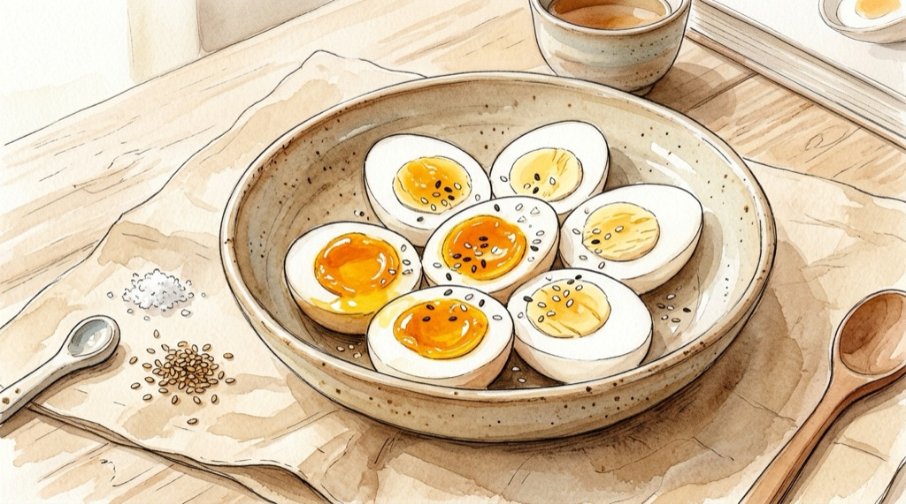
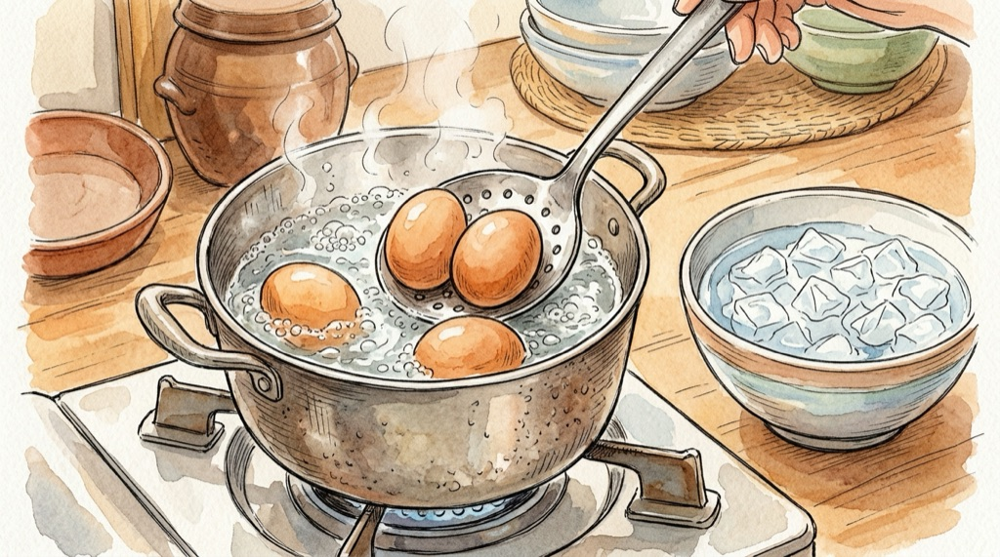

# 🥚 시간별 완벽 타이머 삶은 계란(반숙·감동란·완숙) 레시피

라면·떡볶이·덮밥에 올리기 딱 좋은 **7분 30초 젤리 반숙란**부터, 편의점 스타일 **6분 30초 촉촉 감동란**, 퍽퍽하지 않고 고소한 **11분 완숙란**까지 초 단위 타이머로 실패 없이 삶아내는 레시피입니다. 껍질이 1초 만에 쏙 벗겨지는 비법까지 모두 담았습니다!

---

## 📌 개요
삶은 계란이 터지거나 노른자 익힘이 매번 달라지는 이유는 **찬물부터 삶기 때문**입니다. **물이 팔팔 끓을 때 달걀을 넣어야** 달걀 개수나 냄비 크기에 상관없이 타이머 시간만으로 노른자 상태를 100% 정확하게 맞출 수 있으며, 흰자 단백질이 급격히 응고되어 **껍질도 훨씬 잘 까집니다!**

* **핵심 포인트:** 냉장 달걀 찬물에 5분 담가 냉기 빼기(깨짐 방지), 끓는 물에 소금·식초 넣고 타이머 시작, 다 삶은 즉시 얼음물(찬물)에 5분 이상 담가 잔열 차단
* **조리 분량:** 2인분 기준 (달걀 4알)
* **조리 시간:** 약 10분 (반숙 7분 30초 삶기 기준)
* **난이도:** 매우 쉬움
* **코멘트:** 
* **분류:** 한식

---

## 🛒 재료 (기본 4알 · 7분 30초 황금 젤리 반숙 기준)

> [!NOTE]
> **시간 기준 (끓는 물 투입 · 대란/특란 기준):**
> - **6분 30초:** 노른자가 주르륵 흐르는 초반숙 / 감동란 스타일 (`🟠 감동란 모드`)
> - **7분 30초 (기본):** 흰자는 탱글하고 노른자는 쫀득한 젤리 상태인 **황금 반숙**
> - **11분:** 노른자 중심까지 포슬포슬하고 촉촉하게 다 익은 **완숙** (`🌕 완숙란 모드`)

### 1. 주재료 및 삶기 보조 재료
| 변수 | 재료 | 수량 / 분량 (g·ml) | 손질 및 비고 |
| :--- | :--- | :--- | :--- |
| `egg` | **달걀 (대란 또는 특란)** | 4개 | 냉장 보관 달걀은 삶기 전 미지근한 물에 5분 담가두기 |
| `water` | **물 (삶는 물)** | 1L (약 5컵) | 달걀이 푹 잠길 정도의 넉넉한 양 |
| `vinegar` | **식초** | 1큰술 (약 15ml) | 달걀이 금 가도 흰자가 새어 나오지 않게 즉시 응고시킴 |
| `salt` | **굵은소금 (또는 꽃소금)** | 0.5큰술 (약 6g) | 물 끓는점 유지 및 껍질 분리 도움 |

### 🥣 미리 준비할 용기
| 용기 | 용도 및 준비 포인트 |
| :--- | :--- |
| **중간 볼 (냉기 빼기 & 찬물 냉각용)** | 삶기 전 냉장 달걀(`{{egg}}`)의 찬 기운을 빼고, 삶은 직후 찬물(얼음물)로 식힐 볼 |
| **달걀이 잠기는 냄비 & 국자(숟가락)** | 끓는 물에 달걀이 부딪혀 깨지지 않게 조심스럽게 넣을 국자 |

---

## 🍳 조리 순서 (Instructions)

### Step 1. [재료 손질] 냉장 달걀 미지근한 물에 5분 담가 냉기 빼기 (깨짐 방지!)
1. **냉기 제거:** 냉장고에서 갓 꺼낸 차가운 **달걀(`{{egg}}`)**을 끓는 물에 바로 넣으면 온도 차이로 껍질이 터집니다. 준비한 볼에 미지근한 수돗물을 받고 달걀을 **약 5분간** 담가 찬 기운을 먼저 빼줍니다.
2. **냄비 물 올리기:** 달걀의 냉기를 빼는 동안 냄비에 **물 `{{water}}`**과 **소금 `{{salt}}`**, **식초 `{{vinegar}}`**을 넣고 센 불에서 팔팔 끓입니다.

### Step 2. 끓는 물에 달걀 넣고 7분 30초 황금 반숙 삶기
1. 물이 팔팔 끓어오르면 불을 **중강불**로 살짝 줄이고, 국자나 큰 숟가락에 **달걀(`{{egg}}`)**을 한 알씩 올려 냄비 바닥에 부딪히지 않게 조심스럽게 넣습니다.
2. **노른자 가운데 정렬:** 달걀을 넣은 직후 **처음 1분간** 젓가락이나 국자로 달걀을 한 방향으로 살살 굴려주면 노른자가 한쪽으로 쏠리지 않고 정가운데에 예쁘게 자리 잡습니다.
3. 달걀을 넣은 시점부터 정확히 **7분 30초간** 중강불에서 삶아줍니다.

### Step 3. 즉시 얼음물(찬물)에 5분 식혀 껍질 매끈하게 까기
1. **잔열 차단 (핵심!):** 7분 30초 타이머가 울리면 **즉시 달걀을 건져 찬물(또는 얼음물)이 담긴 볼에 푹 담급니다.** *(뜨거운 물에 그대로 두면 잔열로 노른자가 완숙으로 익어버립니다!)*
2. **5분 냉각 후 껍질 까기:** 찬물에서 **약 5분간** 속까지 완전히 식힌 뒤, 달걀의 **둥글고 넓은 밑부분(공기주머니가 있는 쪽)**을 바닥에 톡 쳐서 먼저 깨뜨리고 물속에서 껍질을 벗기면 흰자 상처 없이 1초 만에 매끈하게 까집니다!

---

## 🔄 베리에이션

### [모드] 🟠 촉촉하고 짭조름한 편의점 스타일 '감동란' 만들기 (6분 30초)
껍질만 까서 한 입 베어 물면 주르륵 흐르는 반숙 노른자와 함께 **흰자 속까지 짭조름한 간이 배어 있어** 소금 없이 먹어도 맛있는 편의점 감동란 레시피입니다!

| 변수 | 재료 | 수량 / 분량 (4알 기준) | 비고 |
| :--- | :--- | :--- | :--- |
| `g_egg` | **달걀** | 4개 | 미지근한 물에 5분 담가 냉기 제거 |
| `g_boil_water` | **물 (삶는 물)** | 1L (약 5컵) | |
| `g_vinegar` | **식초 (삶을 때)** | 1큰술 (약 15ml) | 깨짐 방지 |
| `g_brine_water` | **찬물 (간수 담금용)** | 400ml (약 2컵) | 껍질 벗기지 않은 달걀이 잠길 정도의 찬물 |
| `g_brine_salt` | **가는 소금 (또는 꽃소금 · 간수용)** | 2.5-3큰술 (약 35-40g) | ⚠️ 삼투압으로 껍질 안쪽까지 간이 배게 하는 진한 소금물 |

#### 🥣 미리 준비할 용기
| 용기 | 용도 및 준비 포인트 |
| :--- | :--- |
| **밀폐용기 또는 깊은 볼 (소금물 숙성용)** | 진한 소금물(`{{g_brine_water}}` + `{{g_brine_salt}}`)을 먼저 녹여 삶은 달걀을 담가둘 용기 |
| **달걀 삶는 냄비 & 국자** | 끓는 물에 달걀을 6분 30초간 삶을 냄비 |

#### Step 1. [재료 손질] 진한 간수(소금물) 먼저 녹여두기 및 달걀 냉기 빼기
1. **진한 소금물 먼저 만들기:** 밀폐용기에 **찬물 `{{g_brine_water}}`**과 **소금 `{{g_brine_salt}}`**을 먼저 넣고 소금이 바닥에 남지 않도록 완전히 녹인 뒤 냉장고에 넣어 차갑게 준비해 둡니다. *(소금이 완전히 녹은 차가운 고농도 소금물이어야 달걀 껍질의 미세한 숨구멍으로 간이 쏙 배어듭니다!)*
2. **달걀 냉기 제거:** **달걀(`{{g_egg}}`)**은 미지근한 물에 **5분간** 담가 찬 기운을 뺍니다.

#### Step 2. 끓는 물에 6분 30초 초반숙으로 삶기
1. 냄비에 **물 `{{g_boil_water}}`**과 **식초 `{{g_vinegar}}`**을 넣고 팔팔 끓어오르면 국자로 달걀(`{{g_egg}}`)을 조심스럽게 넣습니다.
2. 처음 1분간 살살 굴려 노른자를 가운데로 모으고, 중강불에서 딱 **6분 30초간** 삶아줍니다.

#### Step 3. 껍질 벗기지 않고 차가운 소금물에 4-5시간 냉장 숙성하기
1. **열기만 빼기:** 6분 30초가 되면 달걀을 건져 일반 찬물에 **딱 1분만** 담가 겉면의 뜨거운 열기만 살짝 식힙니다. *(⚠️ 절대 껍질을 까지 마세요! 껍질째 담가야 흰자가 너무 짜지지 않고 은은하게 간이 늡니다.)*
2. **소금물 냉장 숙성:** 껍질이 붙어있는 따뜻한 달걀을 Step 1에서 만들어 둔 **차가운 진한 소금물 용기**에 푹 잠기도록 넣고, 냉장고에서 **최소 4-5시간(또는 하룻밤)** 숙성한 뒤 꺼내 까먹으면 편의점 감동란과 100% 똑같은 맛이 납니다!

### [모드] 🌕 포슬포슬하고 고소한 완숙란 (11분 · 샐러드·김밥·떡볶이용)
노른자 겉면이 거뭇거뭇(녹변 현상)해지거나 목 막히게 퍽퍽하지 않고, **노른자 끝까지 샛노랗고 고소한 정석 완숙란** 모드입니다.

| 변수 | 재료 | 수량 / 분량 (4알 기준) | 비고 |
| :--- | :--- | :--- | :--- |
| `h_egg` | **달걀** | 4개 | |
| `h_water` | **물 (삶는 물)** | 1L (약 5컵) | |
| `h_vinegar` | **식초** | 1큰술 (약 15ml) | |
| `h_salt` | **소금** | 0.5큰술 (약 6g) | |

#### 🥣 미리 준비할 용기
| 용기 | 용도 및 준비 포인트 |
| :--- | :--- |
| **중간 볼 (냉기 빼기 & 찬물 냉각용)** | 달걀 냉기 제거 및 삶은 후 즉시 찬물 냉각용 |
| **냄비 & 국자** | 완숙 삶기용 |

#### Step 1. [재료 손질] 달걀 미지근한 물에 5분 담가 냉기 빼기
1. 냉장 **달걀(`{{h_egg}}`)**을 미지근한 물에 **5분간** 담가 냉기를 빼고, 냄비에 **물 `{{h_water}}`, 식초 `{{h_vinegar}}`, 소금 `{{h_salt}}`**을 넣어 끓입니다.

#### Step 2. 끓는 물에 달걀 넣고 11분간 삶기
1. 물이 팔팔 끓으면 국자로 달걀(`{{h_egg}}`)을 넣고 **중강불에서 11분간** 삶아줍니다. *(⚠️ 12분 이상 너무 오래 삶으면 노른자 겉면이 푸르스름하게 변하고 황 냄새가 나므로 딱 10분 30초-11분이 가장 고소합니다!)*

#### Step 3. 찬물에 5분 이상 충분히 식혀 껍질 까기
1. 11분이 되면 즉시 건져 찬물(얼음물)에 **5분 이상** 담가 속 열기까지 완전히 식힌 뒤 껍질을 벗겨냅니다.

### [옵션] 🫙 반숙 마약계란장 양념 추가 (밥도둑 간장 계란장)
7분 30초 반숙란의 껍질을 까서 이 양념장에 담가두면, 노른자를 밥에 톡 터뜨려 비벼 먹는 밥도둑 **마약계란장**이 됩니다!

| 변수 | 재료 | 수량 / 분량 (달걀 4알 기준) | 비고 |
| :--- | :--- | :--- | :--- |
| `m_soy` | **진간장** | 4큰술 (약 60ml) | 짜지 않은 황금 비율 (간장 1 : 물 1) |
| `m_water` | **생수 (또는 정수 물)** | 4큰술 (약 60ml) | 끓이지 않고 바로 섞어 사용 |
| `m_syrup` | **올리고당 (또는 설탕/물엿)** | 2큰술 (약 30g) | 감칠맛과 단맛 |
| `m_scallion` | **대파 (또는 쪽파)** | 1/3대 (약 15g) | 잘게 다지기 |
| `m_chili` | **청양고추 (선택)** | 1개 (약 10g) | 잘게 다지기 (칼칼한 맛) |
| `m_garlic` | **다진 마늘** | 0.5큰술 (약 7g) | |
| `m_sesame` | **참기름·통깨** | 0.5큰술 (약 5g) | 먹을 때 뿌리면 더 고소함 |

#### 🥣 미리 준비할 용기
| 용기 | 용도 및 준비 포인트 |
| :--- | :--- |
| **달걀 4알이 꼭 맞게 들어가는 작은 밀폐용기** | 양념장(`{{m_soy}}` + `{{m_water}}`)이 달걀을 덮을 수 있도록 폭이 좁고 깊은 용기 |

#### [Step 1에 추가] 마약계란장 양념 먼저 섞어두기
1. 달걀을 삶기 전에 작은 밀폐용기에 **진간장 `{{m_soy}}`, 물 `{{m_water}}`, 올리고당 `{{m_syrup}}`, 다진 마늘 `{{m_garlic}}`**과 잘게 다진 **대파(`{{m_scallion}}`)·청양고추(`{{m_chili}}`)**, **참기름·통깨(`{{m_sesame}}`)**를 모두 넣고 먼저 고루 섞어둡니다.

#### [Step 3에 추가] 껍질 깐 반숙란을 양념장에 담가 냉장 숙성하기
1. 매끈하게 껍질을 깐 반숙란을 미리 만들어 둔 **마약계란장 용기**에 넣고 냉장고에서 **최소 3-4시간(하룻밤 숙성 시 최고!)** 재워두면 속까지 간이 밴 마약계란장이 완성됩니다.

---

## 💡 삶은 계란 실패 없는 꿀팁 (Tips)
* **갓 낳은 신선한 달걀일수록 껍질이 안 까져요:** 산란일자가 3-5일 정도 지난 달걀이 공기층이 생겨 훨씬 잘 까집니다. 아주 신선한 달걀을 삶을 때는 반드시 **끓는 물에 넣고 → 삶은 직후 얼음물에 충격**을 주어야 껍질이 깔끔하게 떨어집니다.
* **반숙란 깔끔하게 반 자르는 법:** 칼로 자르면 반숙 노른자가 칼날에 다 묻어나므로, **치실이나 바느질 실**을 달걀 한가운데에 감아 X자로 교차해 당기면 단면이 요리 잡지처럼 깨끗하게 잘립니다!
