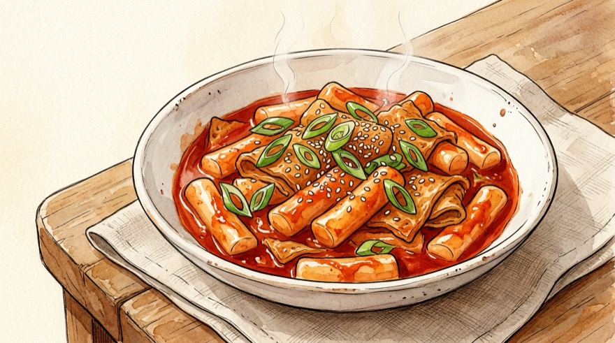
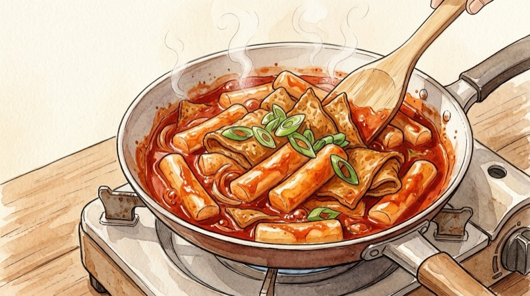

# 🥘 분식집 스타일 떡볶이 레시피

분식집 특유의 감칠맛과 쫀득하고 걸쭉한 국물 농도를 내는 황금 레시피입니다. 라면사리 추가(라볶이)와 만능 소스 미리 만들기 베리에이션을 함께 지원합니다.

---

## 📌 개요
양파의 달큰한 맛과 다시다의 감칠맛을 더해 집에서도 학교 앞 분식집 맛을 그대로 재현합니다.

* **핵심 포인트:** 다시다(또는 굴소스/치킨스톡)와 고추장·고춧가루의 황금 비율, 양파의 달큰한 감칠맛
* **조리 분량:** 2인분 기준
* **조리 시간:** 약 15~20분
* **난이도:** 쉬움
* **코멘트:** 
* **분류:** 한식

---

## 🛒 재료 (2인분 기준)

> [!NOTE]
> **계량 기준:** 1큰술(1T) = 계량스푼 15ml 기준입니다. 인분을 바꾸면 재료와 조리 순서의 계량이 함께 변경됩니다.

### 1. 주재료
| 변수 | 재료 | 수량 / 분량 (g·ml) | 손질 및 비고 |
| :--- | :--- | :--- | :--- |
| `tteok` | **떡볶이떡** | 300g (약 2줌) | 냉동떡·딱딱한 떡은 찬물에 미리 불려두기 |
| `eomuk` | **사각어묵** | 2장 (약 90g) | 먹기 좋은 한 입 크기로 썰기 |
| `onion` | **양파** | 1/2개 (약 100g) | 도톰하게 채 썰기 |
| `scallion` | **대파** | 1대 (약 40g) | 큼직하게 어슷썰기 |
| `water` | **물 (또는 육수)** | 400ml (약 2컵 반) | 냄비 증발량을 고려한 국물 베이스 |

### 2. 양념장
| 변수 | 재료 | 수량 / 분량 (g·ml) | 비고 |
| :--- | :--- | :--- | :--- |
| `gochujang` | **고추장** | 1.5큰술 (약 30g) | 깎아서 계량 *(고추장 비율 옵션 연동)* |
| `chili_powder` | **고춧가루** | 1.5큰술 (약 10~12g) | 고운 고춧가루 사용 시 색감·농도가 더 좋음 |
| `sugar` | **설탕** | 2큰술 (약 20~24g) | 단맛 취향에 따라 가감 |
| `syrup` | **물엿 (또는 올리고당)** | 1큰술 (약 15~20g) | 윤기와 쫀득한 단맛 추가 |
| `soy` | **진간장** | 1큰술 (약 15ml) | 감칠맛과 간 맞추기 |
| `dasida` | **소고기 다시다** | 0.5큰술 (약 5g) | 분식집 감칠맛의 핵심 비법 *(치킨스톡/굴소스 대체 가능)* |

### 📌 조리 내 계량 변수
| 변수 | 항목 | 기준 분량 | 역할 |
| :--- | :--- | :--- | :--- |
| `tteok_sauce_use` | 숙성 떡볶이 소스 사용량 | 4.5~5큰술 (약 95~100g) | strong_seasoning |

### 🥣 미리 준비할 용기
| 용기 | 용도 및 준비 포인트 |
| :--- | :--- |
| **중간 볼 (떡 불리기용)** | 딱딱하거나 냉동된 **떡볶이떡(`{{tteok}}`)**을 찬물에 담가 불릴 용기 |
| **넓고 낮은 팬(웍) 또는 전골냄비** | 국물(`{{water}}`)이 고루 졸아들며 떡에 양념이 잘 배는 넓은 팬 |

---

## 🍳 조리 순서 (Instructions)

### Step 1. [재료 손질] 떡 찬물 불리기 및 어묵·양파·대파 썰기
1. **떡 불리기:** 냉동 떡이나 딱딱한 **떡볶이떡(`{{tteok}}`)**은 준비한 볼에 찬물을 붓고 조리 전 **10분간** 담가 말랑하게 불려둡니다. *(물에 헹구지 말고 불린 뒤 그대로 건져 써야 표면 전분이 국물을 걸쭉하게 만듭니다.)*
2. **어묵·채소 썰기:** **사각어묵(`{{eomuk}}`)**은 한 입 크기(삼각형 또는 사각형)로 썰고, **양파(`{{onion}}`)**는 도톰하게 채 썰며, **대파(`{{scallion}}`)**는 큼직하게 어슷썰어 준비합니다.

### Step 2. 물 붓고 양념장 풀어 끓이기
1. **물 붓기:** 넓은 팬이나 냄비에 **물 `{{water}}`**를 붓습니다.
2. **양념 풀기:** 아래 분량의 양념장 재료를 모두 넣고 뭉치지 않게 잘 풀어줍니다.
   * 고추장 **`{{gochujang}}`** + 고춧가루 **`{{chili_powder}}`**
   * 설탕 **`{{sugar}}`** + 물엿 **`{{syrup}}`**
   * 진간장 **`{{soy}}`** + 소고기 다시다 **`{{dasida}}`**
3. **끓이기:** 센 불에 올려 양념 국물이 팔팔 끓기 시작할 때까지 가열합니다.

### Step 3. 떡과 양파 먼저 넣고 끓이기
1. **떡·양파 투입:** 양념 국물이 끓어오르면 불려둔 **떡(`{{tteok}}`)**과 채 썬 **양파(`{{onion}}`)**를 먼저 넣습니다.
2. **중불 조리:** 양파의 달큰한 맛과 떡의 전분기가 국물에 우러나오도록 **중불에서 3~4분간** 바닥을 저어가며 끓입니다.

### Step 4. 어묵과 대파 넣고 걸쭉하게 졸이기
1. **어묵·대파 투입:** 떡이 말랑하게 부풀고 간이 배기 시작하면 썰어둔 **어묵(`{{eomuk}}`)**과 **대파(`{{scallion}}`)**를 넣습니다.
2. **약중불 졸이기:** 불을 **약중불**로 줄이고, 바닥에 눌어붙지 않게 살살 저어가며 국물이 걸쭉해질 때까지 **3~4분간 더 졸여** `{{servings}}` 떡볶이를 완성합니다.

---

## 🔄 베리에이션

### [옵션] 🍜 라면사리 추가 (라볶이)
라면사리가 국물과 간을 빠르게 흡수하므로, **추가 물과 추가 양념을 아래 분량만큼 보충**해야 국물이 마르거나 싱거워지지 않습니다!

| 변수 | 재료 | 수량 / 분량 (g·ml) | 비고 |
| :--- | :--- | :--- | :--- |
| `ramen` | **라면사리** | 1개 (약 110g) | 사리면 또는 일반 라면 면발 |
| `add_water` | **물 (사리용 추가)** | 150ml | 면이 흡수할 국물 보충 |
| `add_gochujang` | **고추장 (사리용 추가)** | 0.4큰술 (약 8g) | 국물 농도 및 간 보충 *(비율 옵션 연동)* |
| `add_sugar` | **설탕 (사리용 추가)** | 0.5큰술 (약 5~6g) | 라볶이 특유의 달짝지근한 맛 |
| `add_soy` | **진간장 (사리용 추가)** | 0.5큰술 (약 7ml) | 라면스프 소량으로 대체하면 분식집 맛 극대화! |

#### Step 1. 라면사리 물·양념 보충 및 조리 타이밍 (`Step 2` & `Step 4` 연동)
1. **물·양념 추가 투입:** 처음 `Step 2`에서 물을 잡을 때 기본 물(`{{water}}`)에 **추가 물 `{{add_water}}`**과 추가 양념(**고추장 `{{add_gochujang}}`, 설탕 `{{add_sugar}}`, 진간장 `{{add_soy}}`**)을 함께 넣어 끓입니다.
2. **사리 넣고 3분 끓이기:** `Step 4`에서 어묵·대파를 넣을 때 **라면사리(`{{ramen}}`)**를 같이 넣고, 면발을 젓가락으로 풀어주며 **중불에서 약 3분간** 꼬들꼬들하게 끓인 뒤 국물이 자작할 때 바로 불을 끕니다. *(불을 끈 뒤에도 면이 국물을 계속 빨아들이므로 국물이 살짝 여유 있을 때 불을 끄세요!)*

### [모드] 🫙 소스(양념장)만 미리 만들기
떡볶이 생각날 때마다 계량 없이 바로 끓일 수 있도록 **만능 떡볶이 다대기(양념장)만 미리 만들어 냉장 숙성**해 두는 방법입니다. 하루 이상 숙성하면 고춧가루가 불어나 색감과 감칠맛이 훨씬 깊어집니다!

| 변수 | 재료 | 수량 / 분량 (2인분 1회치 기준) | 비고 |
| :--- | :--- | :--- | :--- |
| `ts_gochujang` | **고추장** | 1.5큰술 (약 30g) | 텁텁하지 않은 중심 베이스 *(비율 옵션 연동)* |
| `ts_chili_powder` | **고춧가루 (고운 고춧가루 권장)** | 1.5큰술 (약 10~12g) | 숙성 시 수분을 머금어 걸쭉한 농도 형성 |
| `ts_sugar` | **설탕** | 2큰술 (약 20~24g) | 방부 역할 및 단맛 베이스 |
| `ts_syrup` | **물엿 (또는 올리고당)** | 1큰술 (약 15~20g) | 윤기와 점도 유지 |
| `ts_soy` | **진간장** | 1큰술 (약 15ml) | 깊은 감칠맛 |
| `ts_dasida` | **소고기 다시다 (또는 치킨스톡)** | 0.5큰술 (약 5g) | 분식집 감칠맛 핵심 |

#### 🥣 미리 준비할 용기
| 용기 | 용도 및 준비 포인트 |
| :--- | :--- |
| **물기 없는 깨끗한 유리병 또는 밀폐용기** | 만능 떡볶이 다대기(`{{servings}}` 분량) 배합 및 냉장 숙성용 |
| **소분 지퍼백 또는 실리콘 얼음틀** | *(장기 냉동 보관 시)* 1회분씩 소분 냉동할 용기 |

#### Step 1. 만능 떡볶이 소스 배합하기
1. **가루류 먼저 섞기:** 깨끗하고 물기 없는 용기에 **설탕 `{{ts_sugar}}`, 고춧가루 `{{ts_chili_powder}}`, 소고기 다시다 `{{ts_dasida}}`**를 먼저 넣고 고루 섞습니다.
2. **액체·장류 섞기:** **진간장 `{{ts_soy}}`, 물엿 `{{ts_syrup}}`, 고추장 `{{ts_gochujang}}`**을 순서대로 넣고 설탕 알갱이와 가루 뭉침이 없도록 숟가락으로 **1~2분간** 꼼꼼히 저어 꾸덕한 페이스트 상태로 만듭니다.

#### Step 2. 냉장 숙성 및 보관 기간
1. **밀폐 숙성:** 표면이 마르지 않게 랩을 밀착시키거나 뚜껑을 꼭 닫아 **냉장고에서 최소 24시간 숙성**합니다.
2. **보관 기한:** 물이나 채소가 들어가지 않아 **냉장 보관은 최대 3~4주**, 소분 **냉동 보관 시 3개월 이상** 거뜬합니다.

#### Step 3. 미리 만든 소스로 떡볶이 끓이기 (`{{servings}}` 기준)
1. 냄비에 **물 `{{water}}`**와 **숙성 소스 `{{tteok_sauce_use}}`**를 풀고 끓입니다.
2. 불린 **떡(`{{tteok}}`)**과 **양파(`{{onion}}`)**를 넣어 **3~4분**, **어묵(`{{eomuk}}`)**과 **대파(`{{scallion}}`)**를 넣어 **3~4분** 더 졸이면 10분 만에 완성됩니다!

---

## 💡 요리 팁 & 대체 재료 (Tips)

* **다시다 대체 재료:** 소고기 다시다(`{{dasida}}`)가 없다면 같은 분량의 **치킨스톡** 또는 **굴소스**로 대체해도 깊고 친숙한 분식집 맛이 살아납니다.
* **걸쭉한 국물 비결:** 떡을 물에 헹구지 않고 불린 뒤 바로 넣으면, 떡 표면의 전분이 국물에 자연스럽게 녹아들어 양념이 떡에 착 감깁니다.
