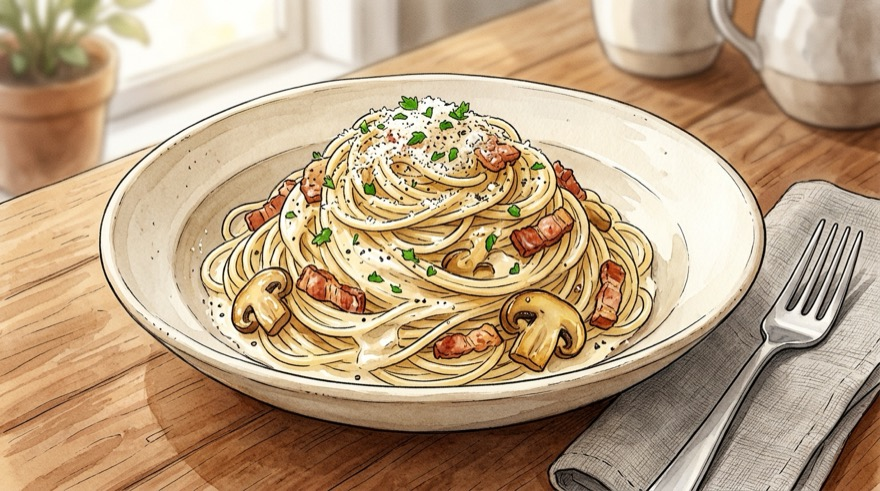
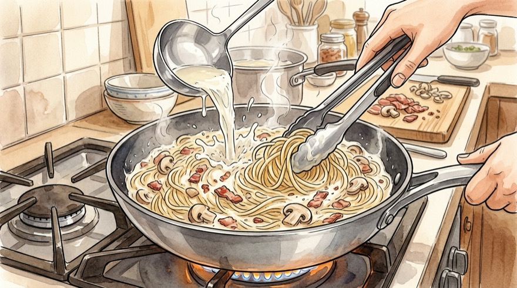

# 🍝 꾸덕하고 고소한 레스토랑급 크림파스타 레시피

생크림과 우유의 황금 비율로 느끼하지 않고 끝까지 고소한 기본 크림파스타부터, 매콤 꾸덕한 **투움바 파스타**, 향긋한 **바질 크림파스타**까지 3가지 모드를 선택할 수 있는 양식 레시피입니다.

---

## 📌 개요
집에 있는 우유·생크림(또는 우유+버터+치즈)으로 전문점 못지않은 농도와 풍미를 내는 파스타입니다. 상단 베리에이션 탭에서 **클래식 크림 / 투움바 / 바질 크림** 모드를 골라보세요!

* **핵심 포인트:** 마늘·양파를 충분히 볶아 단맛 끌어올리기, 면수(전분물)로 소스 농도 맞추기, 치즈는 불을 줄여 유화시키기
* **조리 분량:** 1인분 기준
* **조리 시간:** 약 15~20분
* **난이도:** 쉬움
* **코멘트:** 
* **분류:** 양식

---

## 🛒 재료 (1인분 · 클래식 베이컨 크림파스타 기준)

> [!NOTE]
> **우유만으로 만들고 싶을 때:** 생크림 `{{cream}}` 대신 **우유 `{{cream}}` + 슬라이스 체다/모짜렐라 치즈 `{{alt_cheese}}` + 버터 `{{alt_butter}}` 추가**로 대체해도 충분히 꾸덕해집니다!

### 1. 주재료
| 변수 | 재료 | 수량 / 분량 (g·ml) | 손질 및 비고 |
| :--- | :--- | :--- | :--- |
| `noodle` | **파스타 면 (스파게티 또는 페투치네)** | 1인분 (약 90~100g) | 500원 동전 크기 다발 (1인분 기준) |
| `bacon` | **베이컨** | 2~3줄 (약 50g) | 1.5cm 폭으로 한 입 크기 썰기 |
| `mushroom` | **양송이버섯 (선택)** | 2~3개 (약 40g) | 편 썰기 *(새송이버섯 대체 가능)* |
| `garlic` | **통마늘** | 4~5알 (약 20g) | 편 썰기 |
| `onion` | **양파** | 1/4개 (약 50g) | 얇게 채 썰기 |
| `oil` | **올리브유 (또는 식용유)** | 1.5큰술 (약 20ml) | 마늘·베이컨 볶음용 |
| `boil_water` | **면 삶는 물** | 1L (약 1000ml) | 파스타 면 삶기용 |
| `boil_salt` | **면수용 굵은 소금** | 0.7큰술 (약 8g) | 물 1L당 소금 약 0.8~1% 염도 |

### 2. 크림 소스 & 마무리 재료
| 변수 | 재료 | 수량 / 분량 (g·ml) | 비고 |
| :--- | :--- | :--- | :--- |
| `cream` | **생크림 (동물성 권장)** | 100ml (약 100g) | 깊고 진한 고소함 |
| `milk` | **우유** | 100ml (약 100g) | 생크림과 1:1 배합 시 덜 느끼하고 깔끔함 |
| `butter` | **버터 (무염/가염)** | 1조각 (약 10g) | 풍미 극대화 |
| `parmesan` | **파마산 치즈가루 (또는 그라나파다노)** | 1.5큰술 (약 12g) | 소스 농도(꾸덕함) 및 짭조름한 감칠맛 |
| `stock` | **치킨스톡 (또는 맛소금)** | 0.3작은술 (약 1.5~2g) | 액상 치킨스톡 또는 소금으로 간 맞춤 |
| `pepper` | **후춧가루 & 파슬리가루** | 약간 | 통후추 갈아 넣으면 풍미 2배 |

### 📌 조리 내 계량 변수
| 변수 | 항목 | 기준 분량 | 역할 |
| :--- | :--- | :--- | :--- |
| `pasta_water_keep` | 덜어둘 면수 | 반 컵 (약 80ml) | liquid |
| `pasta_water_adjust` | 농도 조절용 면수 추가량 | 2~3큰술 | liquid |
| `alt_cheese` | 생크림 대체 치즈 | 1장 | main |
| `alt_butter` | 생크림 대체 추가 버터 | 0.5큰술 (약 5g) | mild_seasoning |

### 🥣 미리 준비할 용기
| 용기 | 용도 및 준비 포인트 |
| :--- | :--- |
| **면 삶는 깊은 냄비** | 물 `{{boil_water}}`를 끓여 파스타 면을 삶을 냄비 |
| **내열 컵 또는 작은 그릇** | 소스 농도 조절용 뜨거운 면수(`{{pasta_water_keep}}`)를 덜어둘 용기 |
| **넓은 프라이팬 (또는 웍)** | 베이컨·채소를 볶고 크림 소스에 면을 코팅할 팬 |

---

## 🍳 조리 순서 (Instructions)

### Step 1. [재료 손질] 마늘·양파·버섯·베이컨 미리 썰기
1. **채소 썰기:** **통마늘(`{{garlic}}`)**과 **양송이버섯(`{{mushroom}}`)**은 도톰하게 편 썰고, **양파(`{{onion}}`)**는 얇게 채 썰어 준비합니다. *(버섯은 물에 오래 씻지 말고 젖은 키친타올로 겉만 닦아 썰어야 향이 살아납니다.)*
2. **베이컨 썰기:** **베이컨(`{{bacon}}`)**은 1.5cm 폭의 한 입 크기로 잘라둡니다.

### Step 2. 파스타 면 삶기 (면수 확보 필수!)
1. 냄비에 물 `{{boil_water}}`가 팔팔 끓으면 **소금 `{{boil_salt}}`**을 넣고 **파스타 면(`{{noodle}}`)**을 펼쳐 넣습니다.
2. 팬에서 소스와 함께 볶을 시간을 감안해 봉지 표기 시간보다 살짝 덜 익게 **약 7~8분간** 알단테로 삶아냅니다.
3. 면을 건지기 전 **면수(삶은 물) `{{pasta_water_keep}}`**을 내열 컵에 따로 덜어둡니다. *(절대 다 버리지 마세요!)*

### Step 3. 마늘·베이컨·채소 노릇하게 볶기
1. 팬에 **올리브유 `{{oil}}`**과 **버터 `{{butter}}`**을 두르고 **중약불**에서 편 썬 마늘(`{{garlic}}`)을 넣어 **약 1분간** 노릇하게 마늘 향을 우려냅니다.
2. 마늘 향이 올라오면 **중강불**로 올리고 썰어둔 **베이컨(`{{bacon}}`), 채 썬 양파(`{{onion}}`), 양송이버섯(`{{mushroom}}`)**을 넣어 양파가 반투명해지고 베이컨이 노릇해질 때까지 **약 2~3분간** 볶습니다.

### Step 4. 크림 소스 끓이기
1. 팬에 **생크림 `{{cream}}`, 우유 `{{milk}}`, 치킨스톡(또는 소금) `{{stock}}`**을 붓고 **중불**에서 섞어가며 끓입니다.
2. 가장자리가 보글보글 끓어오르면 불을 **약불**로 줄이고 **약 1분 30초간** 은근히 끓여 재료의 감칠맛을 소스에 우려냅니다.

### Step 5. 면·파마산 치즈 넣고 꾸덕하게 마무리
1. 삶아둔 **파스타 면(`{{noodle}}`)**과 **파마산 치즈가루 `{{parmesan}}`**, 후춧가루를 넣고 **중불에서 약 1분~1분 30초간** 면에 소스가 쏙 배도록 저어가며 볶습니다.
2. 소스가 너무 되직하면 덜어둔 **면수를 `{{pasta_water_adjust}}`씩** 추가해 농도를 맞추고(그릇에 담았을 때 살짝 흐를 정도가 딱 맞습니다!), 불을 끄고 그릇에 담아 후추·파슬리를 뿌려 완성합니다.

---

## 🔄 베리에이션

### [모드] 🌶️ 투움바 파스타 (매콤 꾸덕 아웃백 스타일)
느끼함을 싹 잡아주는 매콤달콤 특제 양념과 탱글한 새우·베이컨이 어우러진 인기 메뉴 **투움바 파스타** 버전입니다. 넓은 **페투치네 면**을 쓰면 소스가 훨씬 잘 묻어납니다!

| 변수 | 재료 | 수량 / 분량 (1인분 기준) | 비고 |
| :--- | :--- | :--- | :--- |
| `t_noodle` | **파스타 면 (페투치네 또는 스파게티)** | 1인분 (약 90~100g) | 납작한 페투치네 면 강력 추천 |
| `t_shrimp` | **칵테일 새우 (냉동 자숙/생새우)** | 5~6마리 (약 60g) | 해동 후 물기 제거 |
| `t_bacon` | **베이컨** | 2줄 (약 35g) | 1.5cm 폭 썰기 |
| `t_mushroom` | **양송이버섯** | 2개 (약 30g) | 편 썰기 |
| `t_onion` | **양파** | 1/4개 (약 50g) | 채 썰기 |
| `t_butter` | **버터** | 1조각 (약 10g) | 새우·채소 볶음용 |
| `t_oil` | **올리브유** | 1큰술 (약 15ml) | 새우·채소 볶음용 |
| `t_cream` | **생크림** | 100ml (약 100g) | |
| `t_milk` | **우유** | 100ml (약 100g) | 양념 풀어둘 베이스 |
| `t_cheddar` | **슬라이스 체다치즈 (또는 파마산)** | 1장 (약 18g) | 노란 빛깔과 진한 꾸덕함 |
| `t_ketchup` | **케첩 (투움바 양념)** | 1큰술 (약 15g) | 감칠맛과 주홍빛 색감의 핵심! |
| `t_soy` | **진간장 (투움바 양념)** | 0.5큰술 (약 7ml) | 아웃백 간장 풍미 |
| `t_chili_powder` | **고춧가루 (고운 고춧가루 권장)** | 0.5~0.8큰술 (약 4~6g) | 새우 구울 때 기름에 볶아 고추기름 생성 |
| `t_gochujang` | **고추장 (선택)** | 0.3큰술 (약 6g) | 더 진한 한국식 매콤함을 원할 때 *(비율 옵션 연동)* |
| `t_garlic` | **다진 마늘** | 0.5큰술 (약 7g) | 알싸한 마늘 향 |
| `t_boil_water` | **면 삶는 물** | 1L (약 1000ml) | |
| `t_boil_salt` | **면수용 소금** | 0.7큰술 (약 8g) | |

#### 🥣 미리 준비할 용기
| 용기 | 용도 및 준비 포인트 |
| :--- | :--- |
| **작은 볼 (투움바 양념 우유 배합용)** | 우유(`{{t_milk}}`)에 케첩·진간장·고추장을 미리 풀어둘 그릇 |
| **내열 컵** | 면수(`{{pasta_water_keep}}`)를 따로 덜어둘 용기 |
| **면 삶는 냄비 & 넓은 프라이팬** | 면 삶기 및 투움바 소스 조리용 |

#### Step 1. [재료 손질] 새우 해동·물기 제거, 채소 썰기 및 양념 우유 섞기
1. 냉동 **새우(`{{t_shrimp}}`)**는 찬물에 가볍게 해동한 뒤 **키친타올로 물기를 꾹 눌러 닦아둡니다.**
2. **베이컨(`{{t_bacon}}`)**은 1.5cm 폭으로 썰고, **양파(`{{t_onion}}`)**는 채 썰며 **양송이버섯(`{{t_mushroom}}`)**은 편 썰어둡니다.
3. 준비한 작은 볼에 **우유 `{{t_milk}}` + 케첩 `{{t_ketchup}}` + 진간장 `{{t_soy}}` + (선택)고추장 `{{t_gochujang}}`**을 미리 뭉침 없이 풀어둡니다.

#### Step 2. 파스타 면 삶기 (면수 확보)
1. 끓는 소금물(물 `{{t_boil_water}}` + 소금 `{{t_boil_salt}}`)에 **파스타 면(`{{t_noodle}}`)**을 넣고 **약 7~8분간** 삶으면서 면수 `{{pasta_water_keep}}`을 덜어둡니다.

#### Step 3. 새우·베이컨 볶으며 매콤한 고추기름 내기
1. 팬에 **올리브유 `{{t_oil}}`, 버터 `{{t_butter}}`**을 두르고 **중강불**에서 새우(`{{t_shrimp}}`), 베이컨(`{{t_bacon}}`), 양파(`{{t_onion}}`), 양송이버섯(`{{t_mushroom}}`)을 **2분간** 볶습니다.
2. 불을 **약불**로 줄인 뒤 **다진 마늘 `{{t_garlic}}`과 고춧가루 `{{t_chili_powder}}`**을 넣고 타지 않게 **30초간** 볶아 매콤한 주홍빛 기름을 냅니다.

#### Step 4. 크림·양념 우유·체다치즈 넣고 면 코팅하기
1. 팬에 **생크림 `{{t_cream}}`**과 미리 섞어둔 **우유 양념물**을 붓고 **중불**로 올린 뒤, 끓어오르면 **슬라이스 체다치즈 `{{t_cheddar}}`**을 넣어 녹이며 **약 1분 30초간** 걸쭉해질 때까지 끓입니다.
2. 삶은 면(`{{t_noodle}}`)을 넣고 **중불에서 1분~1분 30초간** 소스가 착 감기도록 볶아 완성합니다! *(뻑뻑하면 면수 `{{pasta_water_adjust}}` 추가)*

### [모드] 🌿 바질 크림파스타 (향긋한 브런치 카페 스타일)
시판 **바질페스토**로 집에서 고급 브런치 레스토랑 맛을 내는 레시피입니다. 바질페스토는 열에 오래 가열하면 향이 날아가고 색이 거뭇해지므로 **불을 끄기 직전 마지막에 섞는 것**이 핵심입니다!

| 변수 | 재료 | 수량 / 분량 (1인분 기준) | 비고 |
| :--- | :--- | :--- | :--- |
| `b_noodle` | **파스타 면 (스파게티 또는 링귀니)** | 1인분 (약 90~100g) | |
| `b_pesto` | **바질페스토 (시판 제품)** | 1.5~2큰술 (약 25~30g) | **불 끄기 직전 투입** (열 손실 방지) |
| `b_bacon` | **베이컨 (또는 칵테일 새우)** | 2줄 (약 35g) | 새우와 바질의 궁합도 최고! |
| `b_tomato` | **방울토마토 (선택)** | 4~5알 (약 50g) | 반 갈라 넣으면 상큼함과 색감 포인트 |
| `b_garlic` | **통마늘** | 4알 (약 15g) | 편 썰기 |
| `b_onion` | **양파** | 1/4개 (약 50g) | 채 썰기 |
| `b_oil` | **올리브유** | 1큰술 (약 15ml) | |
| `b_butter` | **버터** | 1조각 (약 10g) | |
| `b_cream` | **생크림** | 100ml (약 100g) | |
| `b_milk` | **우유** | 80ml (약 80g) | 페스토의 오일감을 고려해 우유 소폭 감량 |
| `b_parmesan` | **파마산 치즈가루** | 1큰술 (약 8g) | 바질페스토 자체에도 치즈·간이 들어있음 |
| `b_salt` | **소금 (소스 보조 간)** | 1꼬집 | 페스토가 짭조름하므로 맛보고 마지막에 조절 |
| `b_boil_water` | **면 삶는 물** | 1L (약 1000ml) | |
| `b_boil_salt` | **면수용 소금** | 0.7큰술 (약 8g) | |

#### 🥣 미리 준비할 용기
| 용기 | 용도 및 준비 포인트 |
| :--- | :--- |
| **면 삶는 냄비 & 넓은 프라이팬** | 파스타 면 삶기 및 크림 베이스 조리용 |
| **내열 컵** | 농도 조절용 면수(`{{pasta_water_keep}}`) 확보용 |

#### Step 1. [재료 손질] 마늘·양파·베이컨·방울토마토 손질하기
1. **통마늘(`{{b_garlic}}`)**은 편 썰고, **양파(`{{b_onion}}`)**는 채 썰며, **베이컨(`{{b_bacon}}`)**은 한 입 크기로 썰고 **방울토마토(`{{b_tomato}}`)**는 꼭지를 떼어 반으로 갈라둡니다.

#### Step 2. 면 삶기 (7~8분)
1. 끓는 물 `{{b_boil_water}}`에 소금 `{{b_boil_salt}}`을 넣고 파스타 면(`{{b_noodle}}`)을 **약 7~8분간** 삶은 뒤 면수 `{{pasta_water_keep}}`을 남겨둡니다.

#### Step 3. 마늘·베이컨(새우)·양파 볶고 화이트 크림 베이스 끓이기
1. 팬에 올리브유 `{{b_oil}}`과 버터 `{{b_butter}}`을 두르고 편 마늘(`{{b_garlic}}`)을 노릇하게 볶은 뒤, 베이컨(`{{b_bacon}}`)과 양파(`{{b_onion}}`)를 넣어 **중강불에서 2분간** 볶습니다. (방울토마토 `{{b_tomato}}`는 마지막 **30초**만 가볍게 굴려줍니다.)
2. **생크림 `{{b_cream}}`, 우유 `{{b_milk}}`**를 붓고 끓어오르면 삶은 면(`{{b_noodle}}`)과 **파마산 치즈 `{{b_parmesan}}`**을 넣어 **중약불에서 1분 30초간** 먼저 꾸덕하게 볶아줍니다.

#### Step 4. 불 끄고 바질페스토 여열에 섞기 (핵심!)
1. 소스와 면이 알맞게 어우러지면 **불을 완전히 끕니다.**
2. **바질페스토 `{{b_pesto}}`**을 넣고 팬의 여열로만 골고루 비벼 섞어주면 선명한 연둣빛과 싱그러운 바질 향이 가득 살아있는 바질 크림파스타가 완성됩니다!

---

## 💡 크림파스타 실패 없는 꿀팁 (Tips)
* **그릇에 담으면 소스가 금방 굳어요:** 파스타 면이 뜨거운 상태에서 소스를 계속 흡수하므로, 팬에서는 **"조금 묽은가?" 싶을 정도(면수를 `{{pasta_water_adjust}}` 보충한 상태)**에서 불을 꺼야 식탁에 올렸을 때 완벽한 꾸덕함이 됩니다!
