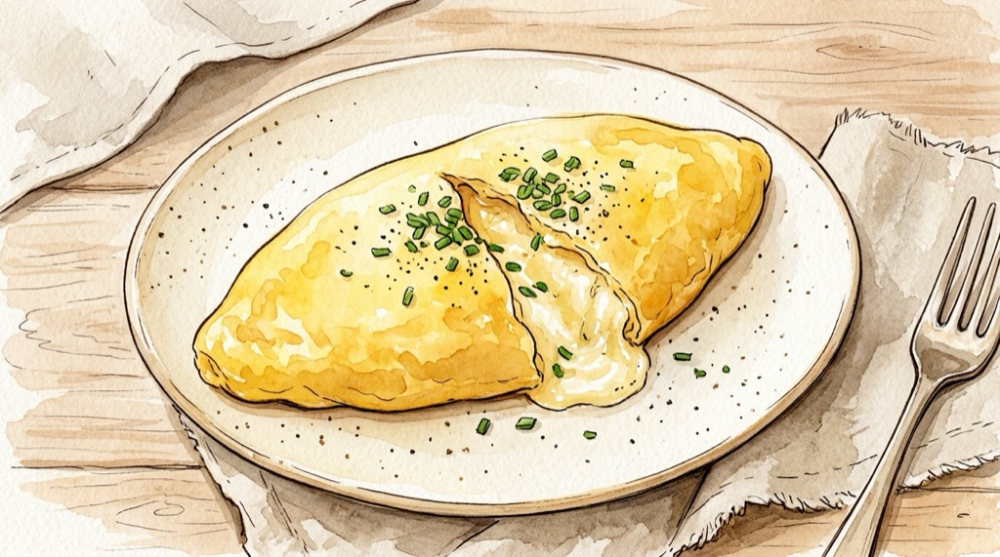
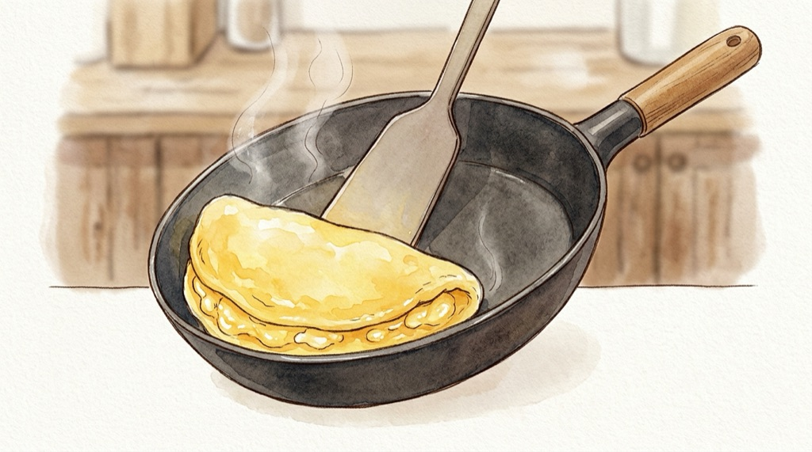

# 🧀 폭신하고 부드러운 클래식 오믈렛 레시피

겉은 주름 없이 매끈하고 샛노란 빛깔을 띠며, 반으로 가르면 속은 크리미한 반숙 달걀과 치즈가 사르르 흐르는 **호텔식 클래식 오믈렛** 레시피입니다. 집에 있는 양파·당근·햄을 볶아 넣고 케첩을 뿌려 밥반찬으로 먹는 **가정식 야채·햄 오믈렛 모드**까지 함께 지원합니다!

---

## 📌 개요
오믈렛과 계란말이의 가장 큰 차이는 **'속의 반숙 스크램블을 겉면의 얇은 달걀 막으로 감싼다'**는 점입니다! 처음 달걀물을 부었을 때 **처음 20-30초 동안 팬을 흔들며 빠르게 스크램블을 만든 뒤**, 반숙 상태에서 넓게 펴고 팬을 45도로 기울여 양쪽을 접어주기만 하면 누구나 통통한 럭비공 모양 오믈렛을 만들 수 있습니다.

* **핵심 포인트:** 달걀물에 우유(또는 물) 1큰술 먼저 섞어 알끈 풀기, 처음 25초간 빠르게 스크램블 만든 뒤 약불로 줄여 모양 잡기, 팬을 45도 기울여 가장자리로 모아 그릇에 뒤집어 담기
* **조리 분량:** 1인분 기준 (달걀 3개 · 통통한 1개)
* **조리 시간:** 약 5분
* **난이도:** 보통
* **코멘트:** 
* **분류:** 양식

---

## 🛒 재료 (1인분 · 호텔식 클래식 오믈렛 1개 기준)

> [!NOTE]
> **성공률 200% 도구 팁:** 오믈렛은 달걀이 팬에서 미끄러지듯 움직여야 하므로 **지름 20-24cm의 코팅이 잘 된 둥근 프라이팬**과 **달걀 3개**를 사용하는 것이 모양 잡기에 가장 좋습니다!

### 1. 주재료
| 변수 | 재료 | 수량 / 분량 (g·ml) | 손질 및 비고 |
| :--- | :--- | :--- | :--- |
| `egg` | **달걀** | 3개 (약 165-180g) | 통통한 럭비공 모양을 만들기에 가장 이상적인 개수 |
| `milk` | **우유 (또는 생크림/물)** | 1큰술 (약 15ml) | 부드럽고 촉촉한 식감 *(너무 많이 넣으면 찢어지므로 1큰술 정량!)* |
| `butter` | **버터 (또는 식용유)** | 1조각 (약 10g, 0.7큰술) | 버터가 없다면 식용유 1큰술 사용 가능 |
| `salt` | **가는 소금** | 1-2꼬집 (약 0.6g) | 달걀물 풀 때 미리 혼합 |
| `pepper` | **후춧가루·파슬리** | 약간 | 마무리용 (선택) |

### 📌 조리 내 계량 변수
| 변수 | 항목 | 기준 분량 | 역할 |
| :--- | :--- | :--- | :--- |
| `ketchup_top` | 토핑용 케첩 | 1.5큰술 (약 22g) | mild_seasoning |

### 🥣 미리 준비할 용기
| 용기 | 용도 및 준비 포인트 |
| :--- | :--- |
| **믹싱볼 (& 선택: 고운 체)** | 달걀(`{{egg}}`)과 우유(`{{milk}}`), 소금(`{{salt}}`)을 먼저 곱게 풀어둘 볼 |
| **지름 20-24cm 코팅 프라이팬 & 주걱(젓가락)** | 가장자리가 완만하게 둥근 코팅 프라이팬 |
| **완성 접시** | 팬에서 오믈렛을 굴려 바로 뒤집어 담아낼 접시 |

---

## 🍳 조리 순서 (Instructions)

### Step 1. [재료 손질] 매끈한 달걀물 먼저 배합하기
1. **달걀물 먼저 풀기:** 준비한 볼에 **달걀 `{{egg}}`**, **우유(또는 물) `{{milk}}`**, **소금 `{{salt}}`**을 가장 먼저 넣고 젓가락이나 포크로 노른자와 흰자가 완전히 하나가 되도록 **약 1분간** 충분히 풀어줍니다. *(시간 여유가 있다면 체에 한 번 걸러주세요. 알끈이 제거되어 호텔처럼 매끈한 표면이 나옵니다!)*

### Step 2. 중불에서 버터 녹이고 25초간 빠른 스크램블 만들기
1. 코팅 프라이팬에 **버터 `{{butter}}`**(또는 식용유)를 넣고 **중불**에서 팬 바닥과 **옆면 테두리까지** 기름기가 골고루 묻도록 팬을 돌려 코팅합니다.
2. 달걀물을 한 번에 붓고, 왼손으로는 팬을 앞뒤로 흔들면서 오른손 젓가락(또는 주걱)으로 빠르게 원을 그리며 **약 20-25초간** 전체가 몽글몽글한 반숙 스크램블 상태(약 60-70% 익음)가 될 때까지 저어줍니다.

### Step 3. 약불로 줄여 펴준 뒤 팬을 45도 기울여 럭비공 모양으로 접기 (핵심!)
1. 달걀이 부드러운 크림 반숙 상태가 되면 **즉시 불을 약불로 줄이고(또는 잠시 끄고)** 주걱으로 달걀을 팬 바닥에 둥글고 평평하게 펴줍니다. *(토핑용 치즈 옵션은 이 타이밍에 가운데에 올립니다.)*
2. 팬 손잡이 쪽을 들어 **팬을 앞으로 45도 기울이면서**, 주걱으로 손잡이 쪽 달걀 1/3을 안쪽으로 접고 팬 아래쪽 모서리로 달걀을 몰아줍니다.
3. 맞은편 가장자리도 안쪽으로 살짝 덮어 통통한 반달(럭비공) 모양으로 모아준 뒤 **약불에서 15-20초간** 바닥면만 매끈하게 익힙니다. *(겉면에 갈색 구움색이 나지 않게 약불로 익혀야 샛노랗고 부드럽습니다!)*

### Step 4. 접시에 뒤집어 굴려 담고 완성하기
1. 한 손에 완성 접시를 들고 팬 가장자리에 바짝 댄 뒤, 팬을 뒤집듯 기울여 오믈렛의 **이음새가 바닥으로 가도록** 접시 위에 또르르 굴려 담습니다.
2. 키친타올을 오믈렛 위에 덮고 양손으로 살살 감싸 통통한 모양을 한 번 다듬어주면 `{{servings}}` 클래식 오믈렛 완성입니다! *(기호에 따라 파슬리·후추 `{{pepper}}`나 케첩 `{{ketchup_top}}`을 곁들이세요.)*

---

## 🔄 베리에이션

### [모드] 🍅 케첩 솔솔! 가정식 야채·햄 밥반찬 오믈렛 (버터 없이도 OK)
프렌치 기술 없이도 실패 확률 0%! **양파·당근·대파·스팸(햄)을 먼저 고소하게 볶아 속재료로 넣거나 달걀물에 섞어** 도톰한 반달 모양으로 접어내는 든든한 한식 밥반찬·오므라이스 스타일 오믈렛입니다.

| 변수 | 재료 | 수량 / 분량 (1인분 기준) | 비고 |
| :--- | :--- | :--- | :--- |
| `v_egg` | **달걀** | 3개 (약 165-180g) | |
| `v_water` | **물 (또는 우유/맛술)** | 1큰술 (약 15ml) | 촉촉한 식감 유지 |
| `v_ham` | **스팸 (또는 베이컨/소시지)** | 40g (약 2-3큰술 분량) | 작게 깍둑썰기 |
| `v_onion` | **양파** | 1/6개 (약 30g) | 잘게 다지기 |
| `v_scallion` | **대파 (또는 당근/피망)** | 2큰술 분량 (약 15g) | 잘게 다지기 |
| `v_oil` | **식용유** | 1큰술 (약 15ml) | 채소·햄 볶음 및 달걀 굽기용 |
| `v_salt` | **가는 소금·후추** | 1꼬집 | 햄과 케첩에 간이 있으므로 소량만 사용 |
| `v_ketchup` | **케첩** | 1.5-2큰술 (약 25-30g) | 완성 후 위에 지그재그로 뿌리기 |

#### 🥣 미리 준비할 용기
| 용기 | 용도 및 준비 포인트 |
| :--- | :--- |
| **믹싱볼** | 달걀(`{{v_egg}}`)을 먼저 풀어두고, 볶은 채소·햄을 섞거나 담아둘 그릇 |
| **코팅 프라이팬 & 뒤집개** | 채소·햄을 볶고 반달 모양 오믈렛을 접을 팬 |

#### Step 1. [재료 손질] 달걀물 먼저 풀기 및 햄·양파·대파 잘게 썰기
1. **달걀물 먼저 배합:** 볼에 **달걀 `{{v_egg}}`, 물(또는 우유) `{{v_water}}`, 소금·후추 `{{v_salt}}`**를 가장 먼저 넣고 고루 풀어둡니다.
2. **속재료 손질:** **스팸(햄) `{{v_ham}}`**, **양파(`{{v_onion}}`)**, **대파(`{{v_scallion}}`)**를 5mm 크기로 잘게 깍둑썰어 준비합니다.

#### Step 2. 팬에 햄과 채소 먼저 노릇하게 볶기
1. 팬에 **식용유 `{{v_oil}}`**의 절반을 두르고 **중불**에서 썰어둔 **스팸(`{{v_ham}}`), 양파(`{{v_onion}}`), 대파(`{{v_scallion}}`)**를 넣고 양파가 투명해지고 고소한 향이 날 때까지 **약 1분 30초간** 볶습니다.
2. **초간단 합체법:** 볶은 햄·채소를 잠시 달걀물 볼에 부어 함께 섞어주면 속이 터질 걱정 없이 가장 쉽게 만들 수 있습니다! *(속을 따로 채우고 싶다면 작은 접시에 덜어두세요.)*

#### Step 3. 약중불에서 달걀 붓고 반달 모양으로 반 접어 익히기
1. 팬에 남은 식용유를 두르고 **약중불**에서 달걀물(햄·채소 섞은 것)을 붓습니다.
2. 처음 **20초간** 젓가락으로 가운데를 살살 저어 두께감을 만든 뒤, 가장자리가 익으면 뒤집개로 **반달 모양으로 반을 딱 접어** 약불에서 앞뒤로 **30-40초씩** 속까지 따뜻하게 익힙니다.
3. 접시에 담고 위에 **케첩 `{{v_ketchup}}`**을 지그재그로 뿌려내면 밥 한 공기 뚝딱하는 야채·햄 오믈렛이 완성됩니다!

### [옵션] 🧀 모짜렐라(또는 체다) 치즈 속채움 추가
오믈렛을 반으로 갈랐을 때 고소한 치즈가 쭉 늘어나는 인기 브런치 옵션입니다.

| 변수 | 재료 | 수량 / 분량 (g) | 비고 |
| :--- | :--- | :--- | :--- |
| `o_cheese` | **슈레드 모짜렐라 (또는 슬라이스 체다치즈)** | 30-40g (슬라이스는 1-2장) | 실온에 미리 꺼내두면 잔열에 훨씬 잘 녹음 |

#### [Step 1에 추가] 치즈 실온에 미리 준비하기
1. 오믈렛의 부드러운 반숙 열기만으로도 금방 녹을 수 있도록 **치즈(`{{o_cheese}}`)**를 조리 전 미리 꺼내 바로 손이 닿는 곳에 준비해 둡니다.

#### [Step 3에 추가] 오믈렛 접기 직전 한가운데에 치즈 올리기
1. 약불로 줄여 반숙 달걀을 팬에 평평하게 폈을 때, 한가운데에 **치즈 `{{o_cheese:main}}`**를 일자로 올린 뒤 양쪽 달걀로 감싸 접어주면 속에서 치즈가 사르르 녹아듭니다!

---

## 💡 오믈렛 실패 없는 비법 팁 (Tips)
* **달걀이 찢어져서 럭비공으로 말기 어렵다면:** 굳이 양쪽을 다 말려고 애쓰지 말고, 달걀이 70% 익었을 때 **그냥 반으로 딱 한 번만 접어 '통통한 반달 모양(하프문 오믈렛)'**으로 만드세요! 맛은 100% 똑같고 실패 확률은 0%입니다.
* **오므라이스로 활용하기:** [RECIPE_KIMCHI_BOKKEUMBAP.md](file:///Users/saki/workspaces/cookbook/recipe/korean/RECIPE_KIMCHI_BOKKEUMBAP.md)나 케첩 볶음밥을 밥공기에 담아 접시에 동그랗게 엎어둔 뒤, 그 위에 완성된 클래식 오믈렛을 올리고 칼로 가운데를 살짝 가르면 일식당 스타일 **반숙 회오리·오믈렛 오므라이스**가 됩니다!
