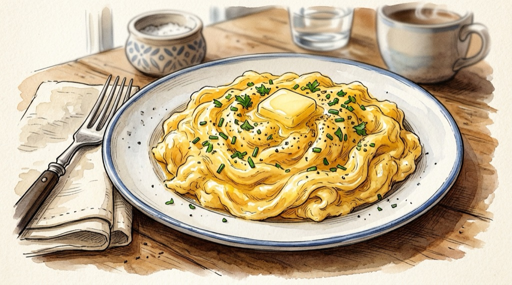
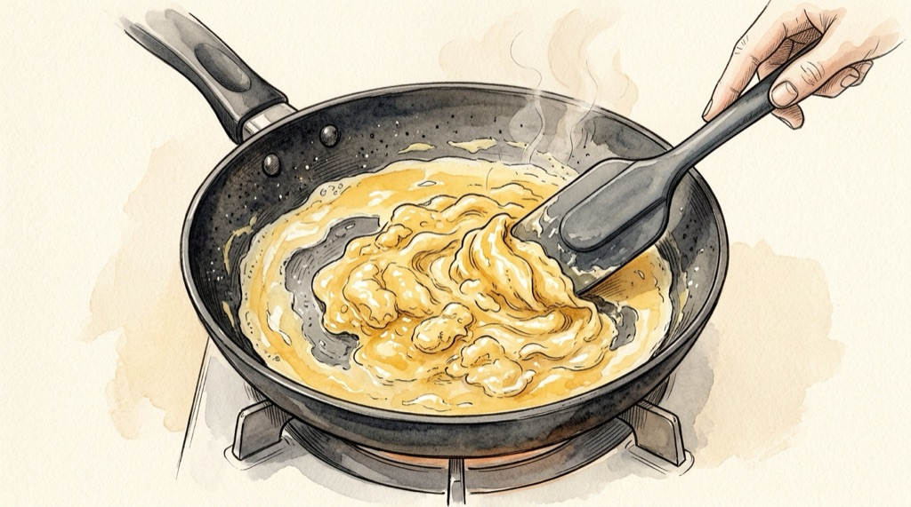

# 🍳 호텔 조식 스타일 폭신하고 부드러운 스크램블 에그 레시피

퍽퍽하게 부서지는 볶은 계란이 아니라, 5성급 호텔 조식처럼 **촉촉하고 크리미한 커드(몽글몽글한 결)가 살아있는 정통 스크램블 에그** 레시피입니다. 우유·버터 없이 대파와 식용유로 고소하게 볶아 밥반찬으로 먹는 **한식 파기름 스크램블 모드**까지 함께 지원합니다!

---

## 📌 개요
스크램블 에그가 푸석푸석해지는 가장 큰 원인은 **센 불에서 너무 오래 익히기 때문**입니다. 달걀은 70°C만 넘어도 응고되므로 **중약불**에서 주걱으로 바닥을 천천히 밀어 큰 주름(커드)을 만들고, **"조금 덜 익었나?" 싶을 때(80% 익었을 때) 바로 불을 꺼야** 팬의 잔열로 완벽하게 촉촉한 스크램블이 됩니다!

* **핵심 포인트:** 달걀물에 우유(또는 생크림) 1.5큰술 먼저 섞어두기, 중약불에서 버터 녹이고 주걱으로 바깥에서 안쪽으로 천천히 밀기, 80% 익었을 때 즉시 불 끄고 그릇으로 옮기기
* **조리 분량:** 1인분 기준 (달걀 2-3개)
* **조리 시간:** 약 4분
* **난이도:** 매우 쉬움
* **코멘트:** 
* **분류:** 양식

---

## 🛒 재료 (1인분 · 호텔 조식 스타일 기준)

> [!NOTE]
> **우유/버터가 없다면?** 상단 조리 모드 탭에서 **`🥢 담백 깔끔한 한식 파기름 스크램블 (버터·우유 없음)`** 모드를 선택하시면 집에 있는 식용유와 대파, 맛술/물만으로 촉촉한 밥반찬용 스크램블을 만드실 수 있습니다!

### 1. 주재료 및 풍미 재료
| 변수 | 재료 | 수량 / 분량 (g·ml) | 손질 및 비고 |
| :--- | :--- | :--- | :--- |
| `egg` | **달걀** | 2-3개 (약 120-165g) | 볼에 깨 넣어 노른자와 흰자가 완전히 섞이도록 풀기 |
| `milk` | **우유 (또는 생크림)** | 1.5큰술 (약 22ml) | 부드럽고 크리미한 질감 유지 *(생크림 사용 시 호텔 맛 극대화!)* |
| `butter` | **버터 (무염 또는 가염)** | 1조각 (약 10g, 0.7큰술) | 팬 코팅 및 고소한 풍미 *(가염버터 사용 시 소금 감량)* |
| `salt` | **가는 소금** | 1-2꼬집 (약 0.5g) | 달걀물 풀 때 미리 넣어 간 맞추기 |
| `pepper` | **후춧가루·파슬리가루** | 약간 | 마무리 토핑 (선택) |

### 🥣 미리 준비할 용기
| 용기 | 용도 및 준비 포인트 |
| :--- | :--- |
| **믹싱볼 & 거품기(또는 포크/젓가락)** | 달걀(`{{egg}}`)과 우유(`{{milk}}`), 소금(`{{salt}}`)을 먼저 균일하게 섞어둘 볼 |
| **코팅 프라이팬 & 실리콘 주걱** | 팬 바닥에 붙는 달걀을 부드럽게 밀어 몽글몽글한 커드를 만들 주걱 |
| **완성 접시 (미리 바로 옆에 준비!)** | 불을 끄자마자 팬의 잔열에 더 익지 않도록 즉시 옮겨 담을 접시 |

---

## 🍳 조리 순서 (Instructions)

### Step 1. [재료 손질] 크리미 달걀물 먼저 배합 및 완성 접시 준비
1. **달걀물 먼저 섞기:** 준비한 볼에 **달걀 `{{egg}}`**, **우유(또는 생크림) `{{milk}}`**, **소금 `{{salt}}`**을 가장 먼저 넣고 포크나 젓가락으로 흰자 덩어리가 남지 않게 **약 40초-1분간** 고루 섞어둡니다.
2. **접시 미리 세팅:** 스크램블 에그는 조리가 1분 만에 끝나고 팬에 두면 잔열로 금방 퍽퍽해지므로, 담아낼 **완성 접시를 가스레인지 바로 옆에 미리 준비**해 둡니다.

### Step 2. 약중불에서 버터 녹이고 달걀물 붓기
1. 코팅 프라이팬에 **버터 `{{butter}}`**를 넣고 **약중불(중약불)**에서 버터가 타지 않고 거품이 보글보글 올라올 때까지 천천히 녹여 팬 바닥을 코팅합니다.
2. 버터가 다 녹으면 미리 풀어둔 **달걀물**을 팬에 한 번에 붓고, 바닥면이 얇게 익기 시작할 때까지 **약 15-20초간 건드리지 않고 그대로 둡니다.**

### Step 3. 주걱으로 천천히 밀어 몽글몽글한 커드 만들기 (핵심!)
1. 달걀 가장자리와 바닥이 익기 시작하면(젓가락으로 막 휘젓지 말고!), 실리콘 주걱으로 **팬 바깥쪽에서 가운데 쪽으로 천천히 길게 밀어주며** 큼직하고 부드러운 주름(커드)을 만듭니다.
2. 빈 공간으로 안 익은 달걀물이 흘러내리면 다시 몇 초 기다렸다가 밀어주기를 **약 40-50초간** 반복합니다.

### Step 4. 80% 익었을 때 즉시 불 끄고 잔열로 마무리
1. 달걀 전체가 다 굳기 전, **표면이 아직 촉촉하고 윤기가 흐르는 80% 익은 상태**에서 **즉시 불을 끕니다!**
2. 불을 끈 상태에서 주걱으로 한두 번만 가볍게 접듯 섞어 팬의 잔열로 마무리한 뒤, **즉시 준비해 둔 접시로 옮겨 담고** 후춧가루(`{{pepper}}`)를 뿌려 `{{servings}}` 스크램블 에그를 완성합니다.

---

## 🔄 베리에이션

### [모드] 🥢 담백 깔끔한 한식 파기름 스크램블 (버터·우유 없이 밥반찬용)
집에 버터나 우유가 없을 때, **식용유 + 대파 + 물(또는 맛술) 1큰술 + 참기름**으로 포슬포슬하고 고소하게 볶아내는 한식 밥반찬·덮밥용 스크램블 모드입니다!

| 변수 | 재료 | 수량 / 분량 (1인분 기준) | 비고 |
| :--- | :--- | :--- | :--- |
| `k_egg` | **달걀** | 2-3개 (약 120-165g) | |
| `k_water` | **물 (또는 맛술)** | 1큰술 (약 15ml) | 우유 대신 수증기를 발생시켜 포슬포슬하고 촉촉하게 만듦! |
| `k_scallion` | **대파 (또는 쪽파)** | 1/3대 (약 15g) | 송송 썰기 |
| `k_oil` | **식용유** | 1큰술 (약 15ml) | 파기름 및 스크램블용 |
| `k_salt` | **맛소금 (또는 가는 소금)** | 0.25작은술 (약 1-1.5g) | *(또는 진간장 0.3큰술로 대체하면 감칠맛 상승)* |
| `k_sesame` | **참기름·통깨** | 0.3큰술 (약 3g) | 불 끄고 마지막 고소한 향 코팅 |

#### 🥣 미리 준비할 용기
| 용기 | 용도 및 준비 포인트 |
| :--- | :--- |
| **작은 볼** | 달걀(`{{k_egg}}`)에 물(맛술)과 소금을 넣어 먼저 풀어둘 그릇 |
| **코팅 프라이팬** | 파기름을 내고 스크램블을 볶을 팬 |

#### Step 1. [재료 손질] 촉촉한 달걀물 먼저 풀기 및 대파 송송 썰기
1. **달걀물 먼저 배합:** 볼에 **달걀 `{{k_egg}}`**, **물(또는 맛술) `{{k_water}}`**, **맛소금 `{{k_salt}}`**을 먼저 넣고 젓가락으로 고루 풀어둡니다. *(우유 대신 물이나 맛술을 1큰술 넣으면 가열할 때 수증기가 부풀어 올라 버터 없이도 폭신해집니다!)*
2. **대파 손질:** **대파(`{{k_scallion}}`)**를 송송 썰어 준비합니다.

#### Step 2. 파기름 내고 중불에서 포슬포슬하게 스크램블 만들기
1. 팬에 **식용유 `{{k_oil}}`**과 송송 썬 **대파(`{{k_scallion}}`)**를 넣고 **중불에서 약 40초-1분간** 볶아 향긋한 파기름을 냅니다.
2. 불을 **중약불**로 줄이고 달걀물을 부은 뒤, 가장자리가 익기 시작하면 젓가락이나 주걱으로 천천히 원을 그리며 **약 40-50초간** 몽글몽글하게 익힙니다.
3. 달걀이 85% 정도 익어 촉촉할 때 불을 끄고 **참기름·통깨 `{{k_sesame}}`**를 둘러 가볍게 섞어내면 고소한 한식 파기름 스크램블이 완성됩니다!

### [옵션] 🧀 체다(또는 모짜렐라·파마산) 치즈 추가
스크램블이 거의 다 익어갈 때 치즈를 넣어 잔열로 녹이면 브런치 카페처럼 깊고 고소한 풍미가 배가됩니다.

| 변수 | 재료 | 수량 / 분량 (g) | 비고 |
| :--- | :--- | :--- | :--- |
| `add_cheese` | **슬라이스 체다치즈 (또는 슈레드 모짜렐라)** | 1장 (약 18-25g) | 잘게 찢어서 준비 |

#### [Step 1에 추가] 치즈 잘게 찢어 준비하기
1. 잔열에서 10초 만에 녹을 수 있도록 **치즈(`{{add_cheese}}`)**를 손으로 작게 찢어 준비해 둡니다. *(치즈에 짠맛이 있으므로 소금은 살짝 줄여주세요.)*

#### [Step 4에 추가] 불 끄기 직전 치즈 넣고 잔열로 녹이기
1. 달걀이 80% 익어 불을 끄는 순간 찢어둔 **치즈(`{{add_cheese:main}}`)**를 넣고 잔열로 살살 접어가며 녹여냅니다.

### [옵션] 🥓 베이컨(또는 스팸/햄) 추가
고소하고 짭조름한 베이컨이나 햄을 먼저 바삭하게 구운 뒤 달걀과 함께 익히는 든든한 한 끼 옵션입니다.

| 변수 | 재료 | 수량 / 분량 (g) | 비고 |
| :--- | :--- | :--- | :--- |
| `add_bacon` | **베이컨 (또는 스팸/소시지)** | 1-2줄 (약 25-35g) | 한 입 크기로 잘게 썰기 |

#### [Step 1에 추가] 베이컨(햄) 한 입 크기로 썰기
1. **베이컨(`{{add_bacon}}`)**을 1cm 폭으로 잘게 썰어 준비합니다.

#### [Step 2에 추가] 버터 넣기 전 베이컨 먼저 노릇하게 굽기
1. 팬에 **베이컨(`{{add_bacon:main}}`)**을 먼저 넣고 **중불에서 약 1분 30초간** 노릇하게 구운 뒤, 불을 약중불로 줄이고 버터와 달걀물을 부어 함께 스크램블을 만듭니다.

---

## 💡 호텔 스크램블 에그 비법 팁 (Tips)
* **젓가락으로 빨리 휘젓지 마세요:** 팬 위에서 젓가락으로 빠르게 휘저으면 달걀이 잘게 부서져 수분이 금방 날아갑니다. **주걱으로 바닥을 훑듯 천천히 밀어 큰 덩어리(커드)를 만드는 것**이 촉촉함의 핵심입니다.
* **토스트 위에 올릴 때:** 구운 식빵 위에 스크램블 에그를 올리고 딸기잼이나 케첩, 혹은 마요네즈 한 줄을 곁들이면 실패 없는 브런치 토스트가 됩니다!
