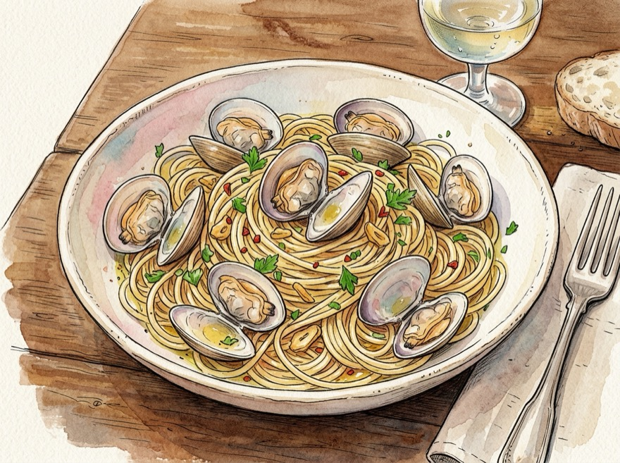
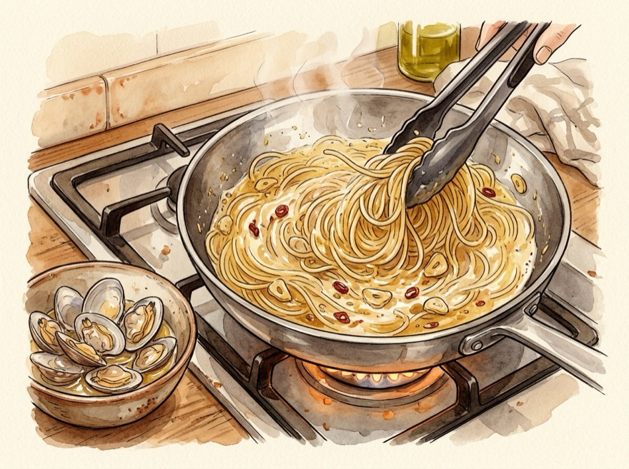

# 🍝 바다 향 가득 정통 봉골레 파스타 레시피

바지락이나 모시조개에서 우러난 뽀얗고 진한 조개 육수와 마늘·올리브유를 쫀득하게 유화(만테까레)시켜 면발 끝까지 감칠맛이 착 감기는 레스토랑급 오일 파스타입니다.

---

## 📌 개요
오일 파스타인데 기름만 겉돌거나 조갯살이 질겨졌던 경험을 한 번에 해결해 주는 레시피입니다. **조개 입이 열리자마자 건져두기**와 **면 전분물로 뽀얗게 유화시키기** 두 가지만 지키면 집에서도 이탈리안 비스트로 맛을 그대로 낼 수 있습니다!

* **핵심 포인트:** 3% 소금물 해감, 화이트와인(또는 청주) 조개 스팀, 조개 먼저 건져 질김 방지, 강불 유화(만테까레)
* **조리 분량:** 1인분 기준
* **조리 시간:** 약 15~20분 *(사전 해감 시간 제외)*
* **난이도:** 보통
* **코멘트:** 
* **분류:** 양식

---

## 🛒 재료 (1인분 · 바지락/모시조개 기준)

> [!NOTE]
> **조개 선택 & 해감 기준:** **바지락**(1알 약 12~15g)과 **모시조개**(1알 약 30~40g)는 **무게(`g`) 기준으로는 동일**하지만 알 크기가 달라 개수는 차이가 납니다. 해감이 안 된 생조개는 **소금물(`{{purge_water}}` + `{{purge_salt}}`)**에 쇠숟가락을 함께 넣고 어둡게 덮어 냉장실에서 미리 해감해 주세요.

### 1. 주재료
| 변수 | 재료 | 수량 / 분량 (g·ml) | 손질 및 비고 |
| :--- | :--- | :--- | :--- |
| `noodle` | **파스타 면 (링귀니 또는 스파게티)** | 1인분 (약 90~100g) | 소스가 잘 묻는 납작한 **링귀니**나 스파게티 면 추천 |
| `clam` | **바지락 또는 모시조개** | 200~250g (바지락 15~20알 · 모시조개 6~8알) | 해감 후 껍질끼리 문질러 세척 후 물기 빼기 |
| `garlic` | **통마늘** | 5~6알 (약 25g) | 대부분은 편 썰기, `{{garlic_crush}}` 분량은 으깨거나 다지기 |
| `chili` | **페페론치노 (또는 건고추/청양고추)** | 2~3개 (청양고추는 1개) | 페페론치노·건고추는 반 부수기 / 청양고추는 송송(어슷) 썰기 |
| `herb` | **이탈리안 파슬리 (또는 바질/쪽파)** | 약간 (한 줌) | 생략 시 건조 파슬리 또는 불 끈 뒤 바질페스토 소량 대체 |

### 2. 오일 · 스팀 · 면수 재료
| 변수 | 재료 | 수량 / 분량 (g·ml) | 비고 |
| :--- | :--- | :--- | :--- |
| `olive_oil` | **올리브유 (볶음용)** | 2.5큰술 (약 35ml) | 마늘 향 우려내기용 넉넉한 베이스 오일 |
| `ev_oil` | **엑스트라버진 올리브유 (마무리용)** | 0.5큰술 (약 7ml) | 불 끄고 마지막에 둘러 생오일 풍미와 윤기 코팅 |
| `wine` | **화이트와인 (또는 청주/맛술)** | 3큰술 (약 45ml) | 조개 비린내 제거 및 스팀용 *(단맛 없는 **청주/화이트와인** 권장!)* |
| `boil_water` | **면 삶는 물** | 1L (약 1000ml) | 파스타 면 삶기용 |
| `boil_salt` | **면수용 소금** | 0.4큰술 (약 5g) | ⚠️ 조개 자체가 짭조름하므로 평소보다 면수 소금을 절반으로 줄임 |
| `pepper` | **후춧가루 (통후추 권장)** | 약간 | 마무리 풍미 |

### 📌 조리 내 계량 변수
| 변수 | 항목 | 기준 분량 | 역할 |
| :--- | :--- | :--- | :--- |
| `purge_water` | 해감용 물 | 500ml | liquid |
| `purge_salt` | 해감용 소금 | 1큰술 (약 15g) | strong_seasoning |
| `garlic_crush` | 으깨는 마늘 분량 | 1~2알 | main |
| `pasta_water_keep` | 따로 덜어둘 면수 | 1컵 (약 150ml) | liquid |
| `pasta_water_steam` | 조개 스팀용 면수 | 3큰술 (약 45ml) | liquid |
| `pasta_water_emulsify` | 면 유화용 면수 | 4~5큰술 (약 60~70ml) | liquid |
| `pasta_water_add` | 농도 보충용 면수 | 2큰술 | liquid |

### 🥣 미리 준비할 용기
| 용기 | 용도 및 준비 포인트 |
| :--- | :--- |
| **뚜껑 있는 깊고 넓은 팬(웍)** | 조개 와인 스팀 및 파스타 유화용 *(조개 입을 열기 위해 **뚜껑 필수**!)* |
| **면 삶는 깊은 냄비** | 물 `{{boil_water}}`를 끓여 파스타 면을 삶을 냄비 |
| **내열 컵 또는 국자 그릇** | 뜨거운 면수(`{{pasta_water_keep}}`)를 버리지 않고 따로 덜어둘 용기 |
| **중간 볼 또는 접시** | 입이 벌어진 조개(`{{clam:main}}`)를 질겨지지 않게 잠시 건져둘 용기 |
| **해감용 볼 & 검은 봉지(또는 뚜껑)** | *(해감 안 된 생조개일 때)* 소금물에 어둡게 해감할 용기 |

---

## 🍳 조리 순서 (Instructions)

### Step 1. [재료 손질] 조개 해감·세척 및 마늘·고추 미리 손질하기
1. **조개 해감·세척:** 해감이 안 된 생조개(`{{clam}}`)는 볼에 물 `{{purge_water}}`와 소금 `{{purge_salt}}`(염도 3%), 쇠숟가락을 넣고 검은 봉지나 뚜껑을 덮어 냉장실에서 **1~2시간** 미리 해감합니다. 조리 직전 조개 껍질끼리 바락바락 문질러 씻은 뒤 체에 밭쳐 물기를 뺍니다. *(해감된 조개는 세척만 진행)*
2. **마늘 2가지 방식으로 손질:** 통마늘(`{{garlic}}`) 중 `{{garlic_crush}}` 분량은 칼등으로 꾹 으깨어 굵게 다지고(소스에 마늘 진액이 우러남), 나머지는 도톰하게 편 썰어 준비합니다.
3. **고추·허브 손질:** 페페론치노(`{{chili}}`)는 씨째 반으로 부수어 두고, **청양고추로 대체할 경우** 얇게 송송(또는 어슷) 썰어둡니다. *(고추 조각이 씹히는 게 싫고 향만 내고 싶다면 가로로 큼직하게 2등분하거나 통고추 옆면에 세로 칼집만 한 줄 내어 준비하세요.)* 파슬리(`{{herb}}`)는 잎 위주로 곱게 다져둡니다.

### Step 2. 파스타 면 살짝 덜 삶기 (6분 · 면수 확보!)
1. 냄비에 물 `{{boil_water}}`가 팔팔 끓으면 **면수용 소금 `{{boil_salt}}`**을 넣고 파스타 면(`{{noodle}}`)을 펼쳐 넣습니다. *(조개 육수가 짭조름하므로 면수를 너무 짜게 잡지 마세요!)*
2. 나중에 조개 육수를 흡수하며 마저 익힐 수 있도록 봉지 표기 시간보다 살짝 덜 익게 **약 6분간** 심지가 단단한 상태(알단테 전 단계)로 삶습니다.
3. 면을 건지기 전 **면수(전분물) `{{pasta_water_keep}}`**을 내열 컵에 반드시 따로 덜어둡니다.

### Step 3. 차가운 팬에서 마늘·고추 오일 향 내기
1. **차가운 팬**에 **볶음용 올리브유 `{{olive_oil}}`**과 손질해 둔 **편 마늘·으깬 마늘(`{{garlic}}`)**, 반으로 부순 **페페론치노**(사용 시)를 함께 넣습니다. *(팬이 달궈진 상태에서 넣으면 향이 나기 전에 마늘이 타버립니다!)*
2. 불을 **중약불**로 켜고 마늘 가장자리가 노릇한 황금빛으로 변하며 고소한 향이 올라올 때까지 **약 2분~2분 30초간** 천천히 볶습니다.
3. **청양고추 사용 시 투입 타이밍:** 썰어둔 청양고추는 처음부터 넣으면 타거나 색이 죽으므로 마늘이 노릇해진 **이 단계 마지막 30초에 넣어** 매운 향을 기름에 입힙니다. *(썰어 넣은 청양고추는 완성 후 면과 함께 드시면 되고, 통째로 칼집 내어 넣은 고추는 불 끄기 직전에 건져내세요.)*

### Step 4. 조개 넣고 와인 스팀 후 조개만 먼저 건지기
1. 마늘이 노릇해지면 불을 **강불**로 올리고 물기 뺀 **조개(`{{clam}}`)**를 넣은 뒤 바로 **화이트와인(또는 청주) `{{wine}}`**과 덜어둔 **면수 `{{pasta_water_steam}}`**을 붓습니다.
2. 알코올 비린내가 날아가도록 **뚜껑을 열고 강불에서 20초간** 끓인 뒤, **뚜껑을 덮고 중강불에서 약 2분~2분 30초간** 조개 입이 딱 벌어질 때까지 쪄냅니다.
3. **⭐ 질김 방지 핵심:** 조개 입이 다 벌어지면 불을 잠시 약하게 줄이고, 팬 바닥의 **뽀얀 조개 육수는 그대로 둔 채 조개만 집게로 준비해 둔 볼에 잠시 건져둡니다.** *(끝까지 안 벌어진 조개는 상했거나 뻘이 찬 것이니 과감히 버리세요!)*

### Step 5. 면 넣고 강불에서 뽀얗게 유화시키기 (만테까레)
1. 조개 육수가 남은 팬에 **덜 삶은 파스타 면(`{{noodle}}`)**과 **면수 `{{pasta_water_emulsify}}`**을 넣고 불을 **중강불**로 올립니다.
2. 집게로 면을 빠르게 원을 그리듯 휘젓거나 팬을 흔들어가며 **약 1분 30초~2분간** 조개 육수를 면발 속까지 흡수시킵니다. 면의 전분과 오일·육수가 섞여 **기름 띠 없이 뽀얗고 걸쭉한 소스**가 바닥에 자작하게 남으면 유화 성공입니다! *(뻑뻑하면 면수를 `{{pasta_water_add}}`씩 보충하세요.)*

### Step 6. 건져둔 조개 합치고 생올리브유로 마무리
1. 건져두었던 **통통한 조개**와 다진 파슬리(`{{herb}}`)를 팬에 다시 넣고 **30초간** 가볍게 섞어 온기만 입힌 뒤 **불을 끕니다.**
2. 불을 끈 상태에서 **엑스트라버진 올리브유 `{{ev_oil}}`**과 후춧가루를 두르고 한 번 더 버무려 그릇에 담으면 윤기 흐르는 봉골레 파스타(`{{servings}}`) 완성입니다! *(간을 보고 싱거울 때만 소금 한 꼬집을 더하세요.)*

---

## 🔄 베리에이션

### [옵션] 🍅 방울토마토 추가 (봉골레 로소 · 감칠맛 폭발)
조개의 호박산 감칠맛과 익힌 토마토의 글루탐산 감칠맛이 만나 풍미가 2배로 깊어지고 색감도 화사해지는 이탈리안 **봉골레 베라체(로소)** 스타일입니다.

| 변수 | 재료 | 수량 / 분량 (g) | 비고 |
| :--- | :--- | :--- | :--- |
| `cherry_tomato` | **방울토마토** | 4~5알 (약 50~60g) | 꼭지 떼고 반으로 썰기 |

#### [Step 1에 추가] 방울토마토 반으로 썰기
1. **방울토마토 `{{cherry_tomato}}`**는 꼭지를 떼고 깨끗이 씻어 반으로 잘라둡니다.

#### [Step 3에 추가] 마늘 오일에 방울토마토 살짝 구워 단맛 내기
1. 마늘 향이 노릇하게 다 올라오면 반 자른 **방울토마토(`{{cherry_tomato:main}}`)**를 넣고 **중강불에서 30~40초간** 껍질이 살짝 주름질 정도로 구워 감칠맛을 끌어낸 뒤 다음 조개 스팀 단계로 넘어갑니다.

#### [Step 5에 추가] 유화할 때 토마토 살짝 눌러 소스에 즙 섞기
1. 면을 유화시킬 때 익은 방울토마토 몇 알을 집게로 살짝 눌러 과즙을 풀어주면 상큼하고 깊은 주홍빛 소스가 면발에 착 감깁니다!

### [옵션] 🧈 무염버터 추가 (실패 없는 유화 & 고소한 풍미)
오일 파스타 유화가 어렵게 느껴지거나 묵직하고 고소한 레스토랑 스타일을 원할 때 쓰는 치트키입니다.

| 변수 | 재료 | 수량 / 분량 (g) | 비고 |
| :--- | :--- | :--- | :--- |
| `vongole_butter` | **무염버터 (차가운 상태)** | 1조각 (약 10g) | 가염버터 사용 시 면수 소금을 조금 더 줄이기 |

#### [Step 6에 추가] 불 끈 직후 차가운 무염버터로 잔열 코팅하기
1. 조개를 합치고 **불을 완전히 끈 직후**, 차가운 **무염버터 `{{vongole_butter}}`**을 넣고 잔열로 빠르게 비벼 녹이면 소스가 분리되지 않고 크림처럼 매끄럽게 코팅됩니다!

### [옵션] 🌿 바질페스토 추가 (향긋한 바질 봉골레)
생 파슬리·생 바질 대신 시판 바질페스토를 활용해 조개의 바다 향에 바질·치즈·견과류의 고소함을 입히는 레스토랑 인기 메뉴입니다.

| 변수 | 재료 | 수량 / 분량 (g) | 비고 |
| :--- | :--- | :--- | :--- |
| `vongole_pesto` | **바질페스토** | 0.5~1큰술 (약 8~15g) | 허브 향만 살짝 낼 때는 절반 이하만 사용 |

#### [Step 6에 추가] 불 끈 직후 잔열에 바질페스토 비비기
1. 바질페스토는 불 위에서 끓이면 향이 날아가고 색이 거뭇해지므로, 조개를 합친 뒤 **반드시 불을 완전히 끄고** 팬 바닥에 촉촉한 유화 소스가 남아 있을 때 **바질페스토 `{{vongole_pesto}}`**을 넣어 잔열로 빠르게 비벼 코팅합니다. *(시판 페스토 자체에 올리브유와 치즈 짠맛이 들어 있으므로 마무리용 엑스트라버진 올리브유와 추가 소금은 생략하세요!)*

### [모드] 🍲 해장용 국물 봉골레 (얼큰·시원한 스튜 파스타)
바지락·모시조개의 시원한 국물을 숟가락으로 파스타와 함께 떠먹을 수 있도록 한국인 입맛에 맞춘 **자작한 국물 봉골레** 버전입니다. 해장용이나 술안주로도 최고입니다!

| 변수 | 재료 | 수량 / 분량 (1인분 기준) | 비고 |
| :--- | :--- | :--- | :--- |
| `s_noodle` | **파스타 면 (스파게티 또는 링귀니)** | 1인분 (약 90g) | |
| `s_clam` | **바지락 또는 모시조개** | 250~300g (바지락 18~24알 · 모시조개 8~10알) | 국물 맛을 위해 기본보다 조개 양을 넉넉히! |
| `s_garlic` | **통마늘** | 6알 (약 25g) | 편 썰기 |
| `s_scallion` | **대파 (흰 부분)** | 1/3대 (약 15g) | 송송 썰기 |
| `s_chili` | **페페론치노 & 청양고추** | 3개 + 1개 (페페론치노 3 · 청양고추 1) | 페페론치노 부수기 / 청양고추 얇게 어슷썰기 |
| `s_oil` | **올리브유** | 2큰술 (약 30ml) | |
| `s_wine` | **화이트와인 (또는 청주)** | 3큰술 (약 45ml) | 비린내 제거 |
| `s_broth` | **물 (또는 치킨스톡/멸치다시마 육수)** | 180ml (약 1컵) | 떠먹기 좋은 자작한 조개탕 베이스 |
| `s_umami` | **참치액 (또는 까나리액젓/치킨스톡)** | 0.4큰술 (약 6ml) | 이탈리안 콜라투라(어장) 역할 — 깊은 감칠맛 비법! |
| `s_boil_water` | **면 삶는 물** | 1L (약 1000ml) | |
| `s_boil_salt` | **면수용 소금** | 0.4큰술 (약 5g) | |

#### 🥣 미리 준비할 용기
| 용기 | 용도 및 준비 포인트 |
| :--- | :--- |
| **뚜껑 있는 깊고 오목한 팬(웍)** | 조개 육수를 끓이고 면을 함께 졸여낼 팬 *(뚜껑 필수)* |
| **면 삶는 냄비** | 파스타 면 삶기용 |
| **중간 볼** | 입 벌어진 조개(`{{s_clam:main}}`)를 잠시 건져둘 그릇 |
| **오목한 파스타 볼 / 면기** | 시원한 조개 국물까지 넉넉히 담아낼 그릇 |

#### Step 1. [재료 손질] 조개 세척 및 마늘·대파·고추 썰기
1. 해감된 **조개(`{{s_clam}}`)**는 껍질끼리 문질러 깨끗이 씻어 물기를 빼둡니다.
2. **통마늘(`{{s_garlic}}`)**은 편 썰고, **대파 흰 부분(`{{s_scallion}}`)**은 송송 썰며, **고추(`{{s_chili}}`)**는 페페론치노는 반으로 부수고 청양고추는 얇게 어슷썰어 준비합니다.

#### Step 2. 파스타 면 6분 삶기
1. 끓는 물 `{{s_boil_water}}`에 소금 `{{s_boil_salt}}`을 넣고 파스타 면(`{{s_noodle}}`)을 **약 6분간** 삶아 건집니다.

#### Step 3. 마늘·대파·고추 향오일 내고 조개 육수 끓이기
1. 차가운 팬에 올리브유 `{{s_oil}}`, 편 마늘(`{{s_garlic}}`), 송송 썬 대파(`{{s_scallion}}`), 부순 페페론치노를 넣고 **중약불에서 2분간** 향을 우려냅니다.
2. 강불로 올려 **조개(`{{s_clam}}`)**와 **화이트와인(청주) `{{s_wine}}`**을 붓고 **20초간** 알코올을 날린 뒤, **물(또는 육수) `{{s_broth}}`**와 어슷썬 청양고추를 붓고 뚜껑을 덮어 **2분 30초간** 끓입니다.
3. 조개 입이 벌어지면 조개만 잠시 볼에 건져둡니다.

#### Step 4. 국물에 면 끓여 졸이고 조개 올리기
1. 뽀얀 조개 국물에 **참치액(또는 치킨스톡) `{{s_umami}}`**과 삶은 면(`{{s_noodle}}`)을 넣고 **중강불에서 약 2분간** 면발에 시원한 조개 국물이 배도록 끓입니다.
2. 건져둔 조개를 다시 합쳐 **20초간** 데운 뒤 오목한 면기에 국물째 듬뿍 담아 후추·파슬리를 뿌려 완성합니다!

---

## 💡 요리 팁 & 대체 재료 (Tips)

* **맛술(미림) 대신 청주·화이트와인 추천:** 일반 맛술에는 당분(설탕·물엿)이 들어 있어 봉골레가 달짝지근해질 수 있습니다. 당분이 없는 **화이트와인**이나 **청주(정종)** `{{wine}}`을 쓰시면 훨씬 깔끔하고 고급스러운 맛이 납니다.
* **모래 씹힘 방지 꿀팁:** 팬에서 조개를 찐 뒤 면을 넣기 전 팬 바닥 가장자리를 살짝 살펴보아 검은 모래 알갱이가 보인다면, 조개 육수를 고운 체나 키친타올에 한 번 걸러서 팬에 다시 부어주면 마지막 한 입까지 완벽하게 깔끔합니다!
